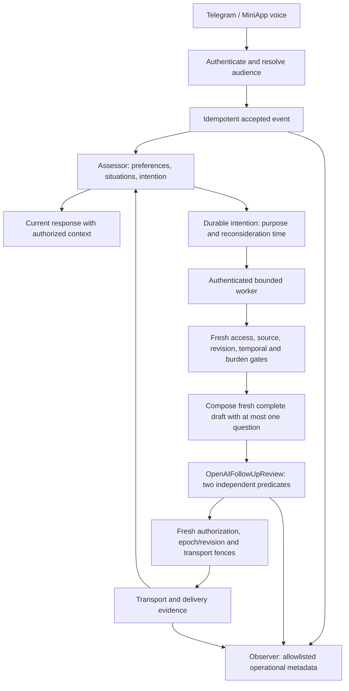

# Vox relationship system — delivery plan

Status: core v3 is implemented in a review candidate and remains default-off; it is not production. The current typed follow-up review contract passed a small frozen fictional gate, and an independent final default-model gateway session passed scoped user acceptance with fake Telegram transport. Human-rated pilot and live deployment gates remain open, and quality/population claims are not established. Baseline: `68a1cd3` (2026-10-19). Historical personality datasets are out of scope.

## Product outcome

An agent remembers the context of an ongoing relationship, adapts its communication to the person, and takes considerate initiative. If someone mentions an unresolved disagreement with their boss, it may check in later. Before doing so it reconsiders the current situation: a resolution, new boundary, poor timing, or unanswered outreach can make silence the correct outcome. Ordinary conversation does not require repeated permission prompts.

Character remains stable. Personalization changes language, detail, pacing, and contextual relevance. Inferred mood is uncertain and temporary; a user correction wins. Voice transcripts support the first release; acoustic emotion recognition is not claimed. Culture comes from individual statements and behavior, not demographic stereotypes. The product does not optimize emotional dependence, number of messages, or time spent.

## Architecture and ownership

Scoped source events feed an assessor that updates preferences, situations and typed intentions with timing. Deterministic temporal, audience, access and control gates run before composition. A due candidate is composed fresh from latest authorized context as one complete draft with at most one question; the composer may omit a question when none is useful. `OpenAIFollowUpReview` returns two independent typed predicates: meaningful continuity (at least 0.80) and observable content violation (at most 0.10). The older four-way `OpenAIDecisions` send/defer/close/stay-quiet evaluator remains historical evaluation only; it is not the current runtime path. Server code rechecks fresh authorization, epoch/revision and the durable transport fence before sending the exact reviewed draft.

Temporal grounding uses a literal quote from the current source, caller-attached `sourceId`, source time and timezone. Model-derived ISO date extraction is not independent proof of an event date. A known future start is preparatory; `after_event` requires a known end; ongoing events do not imply completion. Reschedules refresh the window while preserving the old kind unless the new purpose changes it. Unknown timing fails quiet. Shadow assesses the supplied incoming turn only: it creates no outbox work, foreground reply or memory and does not perform the complete fresh-draft review. It is not full-loop quality evidence. The observer remains an event-processing role; Decisions is not an event database, memory store, scheduler, or autonomous developer.

Every action retains a policy version, source, event identity, time, and outcome. Model results cannot override server-side scope, explicit stop, recipient restrictions, or delivery guards. Local storage uses serialized atomic replacement in one process. Serverless production uses Firestore transactions and an externally scheduled authenticated drain endpoint. No reliability claim depends on a background timer surviving a request.

## Team and model allocation

| Role | Skills and responsibilities | Model / allocation |
|---|---|---|
| Delivery lead / system architect | Requirements, contracts, scope, dependency sequencing, evidence and release decisions | GPT-6.1 Sol; complex cross-system work |
| Loop engineer | Event-driven state machines, idempotence, lease recovery, uncertainty, scheduling, burden/backoff, outbox fences | GPT-6.1 Sol; core implementation |
| Context engineer | Retrieval, provenance, source corrections, temporal memory, audience snapshots, revocation and deletion | GPT-6.1 Sol; privacy-sensitive work |
| Observation / decision engineer | Typed telemetry, calibrated bounded decisions, prediction evaluation, schema and model versioning | GPT-6.1 Sol for contracts; Luna for bounded fixtures |
| Full-stack developer | Studio service/API integration, Telegram/voice parity, accessible controls, responsive UI | Sol for authorization/integration; Luna for isolated UI tasks |
| QA / simulation engineer | Fake-clock replay, storage contracts, concurrency and fault injection, integration/E2E harnesses | GPT-6 Luna for fixtures; Sol for invariant review |
| Synthetic users | Independent motives, varied conversation rhythms, EN/FA, corrections, groups and sharing | GPT-6 Luna for routine roleplay; Sol for complex multi-person/adversarial arcs |
| Independent reviewer | Security/privacy, durability, user experience, regressions and release evidence | GPT-6.1 Sol after implementation |

Reusable role contracts are versioned in `.agents/skills/vox-relationships/SKILL.md` and its role reference. Roles are assigned to bounded tasks. A maximum of four workers run concurrently in this environment; slots are reused after independent work finishes. Code owners avoid overlapping edits; integration changes remain with the delivery lead. Agent model names are `gpt-6.1-sol` and `gpt-6-luna`.

## Epics and acceptance criteria

Effort is relative (S/M/L), not a delivery-date promise. Each row is a reviewable work package.

| Epic / task | Owner | Effort | Dependency | Completion evidence |
|---|---|---|---|---|
| E0.1 Scope, contracts, threat model and rollout modes | Lead + loop | M | Baseline | This plan, exported typed contracts, explicit scope and evidence limits |
| E1.1 Fence guest and group extraction/retrieval | Context | L | E0 | Canary tests show no unrelated names, facts, histories or preferences in any model prompt |
| E1.2 Snapshot audiences and correct attribution | Context | L | E1.1 | New group members do not inherit older private disclosures; new user source required; corrections supersede only same-source facts |
| E1.3 Selected-person sharing and revocation | Context + full-stack | L | E1.2 | Only source owner grants recipients; revoke/forget clears derived histories and cancels intentions; no forward widening |
| E2.1 Relationship state and contextual assessor | Loop + full-stack | L | E0 | Accepted private and voice turns share persistent state; stated preferences affect next response; malformed model output fails safely |
| E2.2 Durable reconsideration and delivery | Loop | L | E2.1 | Fresh-state send/defer/close/quiet; lease recovery; stale decision blocked; uncertain transport suppresses repeat |
| E2.3 Explicit control and restraint | Loop + full-stack | M | E2.2 | Stop/pause/resume/forget; quiet hours and timezone; one unanswered social outreach blocks more until inbound |
| E3.1 Decisions adapter and bounded observation | Decision engineer | M | E2.1 | Actual documented schema, timeout/refusal validation, no raw sensitive telemetry, model/policy identity |
| E3.2 Observation dashboard and evaluation | Full-stack + QA | M | E3.1 | Admin aggregate operational outcomes; users see their own preferences/status; no transcript access through analytics |
| E3.3 Validate typed follow-up review contract | Decision engineer + independent QA | M | E2.2/E5.2 | Frozen fictional exact-draft criteria; current small synthetic gate qualified, human-rated pilot remains open |
| E3.4 Verify feedback classification and observation links | Decision engineer + QA | M | E3.2/E5.2 | Code verification of explicit helpful/unwanted/correction/neutral labels and bounded observer linkage; human pilot metrics remain future work |
| E4.1 Telegram + MiniApp voice integration | Lead | L | E1/E2 | Same policy and identity across channels; no stale live-call history after deletion |
| E4.2 Worker authentication and runtime config | Lead | M | E2.2 | Unauthorized requests rejected before runtime/provider init; bounded drain, modes off/shadow/live, allowlist, kill switch |
| E4.3 Premium, accessible controls | Full-stack | M | E4.1 | Existing Studio design language, clear status, useful empty/error states, mobile keyboard-accessible controls |
| E5.1 90-day deterministic replay | QA | M | E1/E2 | Seeded fixtures, clock advancement, state and send assertions, reproducible report |
| E5.2 Independent multi-agent user simulation | Synthetic users + QA | L | E5.1 | Agents interact through actual implementation; realistic motives and group arcs; transcripts and findings retained as synthetic evidence |
| E5.3 Integration, browser, storage and fault checks | QA + lead | L | E4 | API/auth, UI, file restarts, Firestore concurrency where emulator available, provider and transport failure cases |
| E6.1 Independent review and remediation | Reviewer + owners | L | E5 | Findings resolved or explicitly release-blocking; no suppressed failing checks |
| E6.2 Deploy, scheduled worker and live pilot | Lead | L | E6.1 | Exact deployed revision, scheduler reachability, production storage, provider response and authorized Telegram/call evidence |

## Behavioral and privacy contract

- Store future *purpose*, not a message to send regardless of later events.
- Prefer a relevant question to a generic daily greeting. No guilt, claims of need, manufactured urgency, or pressure to reply.
- Treat silence as missing evidence. Do not infer unhappiness, consent, or dislike from it.
- Stop or topic refusal overrides an inferred opportunity. No automatic re-enable from a model inference.
- A private relationship is person + persona. A group has separate state, and no member's DM preferences or facts are imported.
- Sharing is an explicit disclosure action distinct from ordinary friendly initiative. The source owner chooses the audience and can revoke future use.
- Unknown group audience fails closed for historical/internal context. Automatic group outreach remains disabled until the relevant audience and delivery invariants are independently proven.
- Forget removes retrievable and derived context and cancels pending intentions. Already delivered Telegram messages cannot be recalled by deleting backend memory.
- Retention is bounded; operational exports contain no transcripts, names, health content, audio, or provider error bodies. Admin status does not imply access to personal conversations.

## Evaluation plan

Six independent user patterns: quiet/busy, chatty/topic-switching, direct/corrective, EN/FA language switching, listening rather than advice, and group organizer. Scenarios cover a boss conflict resolved before follow-up; an unresolved issue; return after silence; explicit stop/resume; a mood correction; a quoted prompt injection; two people with conflicting preferences; shared fact then revocation; group join/leave and unknown guests; duplicate/out-of-order events; restart during work; timeout or uncertain delivery.

Mandatory release invariants: zero cross-audience canary leaks; zero unauthorized sends; zero blind retries of uncertain deliveries; no sends after stop; no stale-topic outreach after a recorded resolution; no repeated social nudges after unanswered outreach; corrections respected; observer contains only its typed allowlist. Test deterministic behavior with fake clocks, concurrent drains and storage restart, not sleeps.

Model quality is evaluated separately: relevance, timing, warmth without pressure, correct uncertainty, conversational continuity, and whether staying quiet was preferable. Compare to a no-proactive baseline. Track unwanted outreach, corrections, stops, stale decisions, delivery-unknown and per-action cost. Reply rate alone is not a reward. Synthetic results do not establish long-term human benefit; a measured pilot with human-rated examples is a separate gate.

## Release sequence and rollback

1. Implement and review with mode off by default; baseline conversations continue.
2. Run deterministic, integration, browser and independent synthetic-user suites.
3. Verify real Decisions account/schema on synthetic content, Firestore transactions/index behavior, and authenticated scheduler against the exact candidate.
4. Use shadow to assess supplied turns and operational failure rates; it creates no outbox, foreground reply or memory and does not fully review a draft. Evaluate relevance separately with a complete authorized synthetic/live candidate.
5. Enable live only for a named internal pilot allowlist with fresh authorization per delivery. Demonstrate DM, voice, pause, sharing/revoke and restart behavior.
6. Expand only after human evaluation and operational thresholds are met. Kill switch moves mode off; pending jobs must never bypass current mode or audience policy.

Feedback is classified only for the same private audience when a later turn matches the latest assistant message's exact intention marker and epoch within seven days. Decisions may label explicit helpfulness, unwanted contact, correction or neutral response. Malformed, refused or low-confidence results produce no feedback observation; politeness, replies and silence are not success labels. Feedback classification does not train models or change control state. The assessor applies explicit preferences and corrections to later context. Observer linkage uses HMAC identifiers and admin reporting exposes aggregate outcome counts. At most 24 receipts are retained for 30 days with source fences for forget; last-target linkage expires after seven days.

The first implementation is not an autonomous production code-writing loop. Product issues and improvement suggestions can use sanitized aggregate evidence; code changes still pass isolated development, tests, independent review and release gates.

## Source references

- [OpenAI Decisions guide](https://developers.openai.com/api/docs/guides/decisions)
- [Decisions API reference](https://developers.openai.com/api/reference/typescript/resources/decisions/methods/create)
- Existing Vox `docs/PRODUCTION.md`, Studio runtime, gateway and memory implementations are the operational baseline.

Evidence reports are separate: `relationship-candidate-evaluation` records historical four-way failures; `relationship-follow-up-review-evaluation` records the current fictional gate (12 cases: four implicit positives passed, five draft negatives rejected, and three timing cases blocked by code before provider review); `relationship-temporal-extraction` records 12 calls, strict extraction 8/12, literal grounding 10/10, known windows 3/3, busy windows 2/2 and boundaries 2/2, while ongoing/planned handling was only 2/4; `relationship-feedback-verification` records 8/8 real-provider classification checks plus 35 test cases; and [final user acceptance](reports/relationship-final-user-acceptance.md) records one independent fictional English conversation that passed with real model calls and fake Telegram transport. This scoped session is not real-user or deployment evidence and does not establish population quality. Human-rated pilot and production gates remain open. This plan is not a deployment certificate.

## Final delivery evidence

See [candidate verification](reports/relationship-verification.md) for final checks, independent review, frozen provider evaluations and the default-model user session. The session demonstrated ordinary unsolicited initiative, a linked style correction and silence after resolution; production deployment and human-rated expansion remain E6.2 gates.
