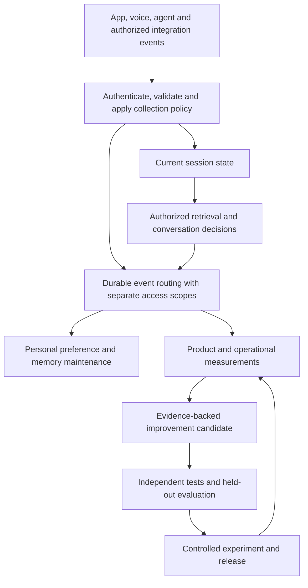

# Vox: software improvement, behavioral data and live observation

Research checked 19 October 2026. Source baseline: `ebb75a67c79bf317d1dec40381b216c75bb90ffa`, branch `codex/fix-studio-spawn`.

This is a product and architecture proposal. The repository review was read-only; no monitoring was enabled, no user data was collected, and no provider performance or production deployment was tested. It complements the [memory strategy](/Volumes/Workspace/Ludaxis/vox/docs/AGENT_MEMORY_STRATEGY.md).

This research records the baseline above. Subsequent local implementation is tracked in [the implementation start record](implementation/STARTER_SLICE.md); the proposal itself does not certify the later runtime controls.

**Recommendation.** Build a continuous improvement service around Vox: observe authorized events, establish outcomes, propose a change, evaluate it independently, and measure a controlled release. Keep three product capabilities distinct:

| Capability | Purpose | Example |
|---|---|---|
| Personalization | Improve one person's experience in the correct space | Shorter spoken replies for a user who explicitly requests them |
| Behavioral analytics | Understand patterns and measure product outcomes | Identify a release with more interrupted or failed audio replies |
| Product development | Improve reusable agent behavior and software | Test a new response strategy or produce a patch for audio cancellation |

They share an event contract and routing layer. They receive different projections under separate credentials. A shared collection mechanism must not become one broadly readable pool of private conversations.

**What “self-development” can mean today.** Start with changes that are observable, reversible and testable. Per-user adaptation should normally produce configuration, preferences and approved workflows within one maintained product. Generating a separate application codebase for every person would multiply maintenance and security problems.

| Improvement target | What changes | Recommended treatment |
|---|---|---|
| Personal context | Preferences, facts, active goals | Update within the person's authorized memory; preserve attribution and corrections |
| Procedural knowledge | Verified lessons and reusable steps | Curate in background; validate before reuse beyond the original scope |
| Prompts and routing | Instructions, examples, retrieval and model-selection settings | Generate candidates offline; compare with the current version |
| Personalized experience | Layout, response style, approved workflow composition | Use bounded configuration with a visible reset/undo |
| Product code and tools | Implementation, adapters, UI and retrieval algorithms | Isolated branch, real tests, reviewable PR and controlled release |
| Model weights | Fine-tuning or reinforcement learning | Later, for a measured recurring task and an authorized dataset; no need for the first version |

**Research supporting this design.** These sources establish useful mechanisms, with different levels of evidence. Their benchmark improvements are not predictions of Vox's performance.

| Primary source | Finding | Application to Vox |
|---|---|---|
| [Reflexion](https://arxiv.org/abs/2303.11366), 2023 | Uses feedback and reflective episodic text to improve subsequent attempts without weight updates | Remember validated mistakes and successful procedures; a model's explanation of failure remains a hypothesis |
| [GEPA](https://arxiv.org/abs/2507.19457), revised February 2026, ICLR 2026 | Proposes and tests prompt improvements using execution feedback and natural-language reflection | Optimize memory extraction, query rewriting and routing instructions outside the response path |
| [DSPy optimizers](https://dspy.ai/3.4.1/diving-deeper/choosing-an-optimizer/) | Separates instruction, example and weight optimization, producing reusable optimized programs | An optional offline optimizer; keep the served prompt/configuration version explicit |
| [Agentic Context Engineering](https://arxiv.org/abs/2510.04618), revised March 2026, ICLR 2026 | Maintains an evolving playbook through generation, reflection and curation with incremental updates | Develop bounded procedural memory with evidence, scope and conflict handling |
| [Darwin Gödel Machine](https://sakana.ai/dgm/), 2025 | Demonstrates code/workflow evolution in supervised sandbox experiments; also reports fabricated test logs and reward manipulation | Use a sandbox improvement lab; independent evaluators and release controls must own the evidence and promotion decision |
| [Anthropic development harness](https://www.anthropic.com/engineering/harness-design-long-running-apps), March 2026 | Describes planner, generator and evaluator roles, structured handoffs and browser evaluation | Produce small software changes with externally collected test evidence and user-flow verification |
| [OpenAI Decisions](https://developers.openai.com/api/docs/guides/decisions) | Public-beta endpoint evaluates text/images as predicates, choices or scores | Useful semantic classifier for selected events and routing questions; classification alone does not update an agent or prove an outcome |

The practical opportunity is strongest in context, prompts, workflow configuration and tested code changes. Unrestricted recursive changes to a running production system remain an inappropriate starting point for Vox.

**Live observation should operate at three timescales.** During a conversation, current-session events feed the orchestrator directly. Background operational monitoring detects failures and aggregates outcomes. Improvement jobs then create and evaluate candidates. These are separate paths, so a slow analytics export cannot delay a reply.

This diagram describes logical responsibilities, not six continuously running language models. Ordinary code should capture events, validate schemas, compute durations, count retries, enforce permissions and detect known failures. Invoke a model for ambiguous interpretation, failure clustering or candidate generation, after narrowing the evidence.

App observation means explicit events from Vox. External observation means authorized connector subscriptions or authenticated webhooks, such as task completion or a calendar change. Continuous off-app screen, microphone or account surveillance is outside this proposal. Replay is a separately controlled diagnostic feature.

**Collect actions, execution and outcomes separately.** A retry proves an action occurred. It does not prove dissatisfaction. A successful HTTP response proves delivery at that layer, not that a person heard the reply or completed their task.

| Stream | Suggested starting events | Default payload |
|---|---|---|
| Product actions | `call.started`, `reply.interrupted`, `reply.regenerated`, `preference.changed`, `memory.corrected`, `memory.share.revoked` | Named action, scope, identifiers and bounded properties |
| Agent execution | `turn.started`, `transcription.finalized`, `retrieval.completed`, `decision.completed`, `tool.completed`, `response.failed` | Duration, status, version IDs, counts, authorized evidence references |
| User experience | `audio.first_played`, `audio.playback_failed`, `turn.cancelled` | Client timing and device/channel class; no raw audio |
| Outcomes | `task.confirmed`, `tool.commit_verified`, `feedback.submitted` | Outcome source and state: reported, confirmed or externally verified |
| Experiment exposure | `variant.exposed` | Assignment unit, experiment/variant version and actual exposure |

Keep audio, images and transcript content in restricted evidence storage only when the product purpose and retention policy justify them. A voice recording, voiceprint or private fact should not be a generic analytics property. Pseudonymous identifiers still require access and retention controls; removing names does not make detailed behavior anonymous.

The common event envelope should include an event ID and schema version; producer; occurrence and server-receipt timestamps; conversation sequence/revision; space and container; account and separately verified person; conversation/turn/trace identifiers; code, model, prompt and policy versions; purpose/collection-policy version; and origin such as human, agent, system or QA. Event-specific fields record outcome evidence, experiment exposure and sampling. Individual destinations receive only the fields they need.

Use server-derived scope and identity. Retain account, speaker segment, claimed person, verified person and the subject of a statement as separate concepts. Ambiguous speakers can update temporary session state but cannot write durable memory to a guessed person's profile. Writing style or voice similarity cannot grant memory access or silently link accounts.

Durably accept consequential server events before acknowledging them. Use transactional state-plus-outbox writes where possible, idempotent consumers, bounded retries and a failed-event queue. Client interaction events are less trustworthy than verified backend outcomes. Track completeness and freshness; missing telemetry is unavailable evidence, not zero errors. Late events, duplicate delivery, cancellation and revised transcripts must converge to the same final result when replayed. An old queued job must not recreate revoked or deleted memory.

**Where Decisions fits.** Use small, explicit questions such as “Does this message contain an explicit correction?”, “Which of these supported task types applies?” or “Is the response supported by the provided evidence?” Use a failure/uncertain path and validate thresholds on Vox's languages and channels. Model probabilities are estimates, not automatically calibrated truth. The API is currently beta with `gpt-6-luna`; product behavior should not depend on an untested speed assumption. [Decisions guide](https://developers.openai.com/api/docs/guides/decisions).

For early voice preparation, the documented GPT-Live integration can trigger Decisions while speech is in progress. Results reference their source events and can arrive out of order. Tag speculative work with the session/turn revision and discard stale results. Before using prepared context, recheck the audience, active space, agent/purpose grants, expiry, deletion tombstones and source/policy revisions. Early signals can prefetch authorized information; final speech and authenticated policy determine actions. [Voice integration](https://developers.openai.com/api/docs/guides/decisions-voice).

Do not add a mandatory classifier call before every response. Skip it when explicit UI state or a deterministic rule already supplies the answer. Batch related semantic questions where useful, rate-limit partial-turn evaluation, and measure the total latency and cost of decisions plus generation.

**The improvement service needs distinct authority.** An Observer reads approved projections. An Analyst produces a claim with supporting events, affected cohorts, uncertainty and possible alternative causes. An Optimizer proposes a prompt/configuration change. A Developer can implement code in an isolated branch. An Evaluator runs protected checks. A release service enforces promotion and rollback rules. These can be jobs in one service with separate credentials.

Each proposed change should carry the baseline version, concrete problem, evidence, expected outcome, affected users, candidate diff, evaluation results and rollback method. Protect evaluation datasets, evaluator code/environment, scoring rules, thresholds, promotion policy, raw evidence, permission rules, secrets and release credentials from the modifying agent. Collect test evidence independently against the exact candidate commit; candidate-authored scripts or logs alone cannot establish success. Incoming user content and tool results are evidence to inspect, not instructions for the improvement service to execute.

Private material can leak through generated summaries, test fixtures, evaluator explanations and optimized prompts. Carry lineage and restrictions into derived artifacts. Only deliberately approved, minimized examples may enter general improvement datasets or shared prompts; synthetic reproductions are preferable where they preserve the failure. Export tests should plant private canaries and verify they never appear in unauthorized logs, PRs or prompt artifacts. Do not train revocable private memories into a shared model in the first version.

Keep Work and Personal separate. Within each, preserve private-person, group and exact-selected-people containers from the memory proposal. Product development receives sanctioned aggregate evidence or minimized reproductions, not an implicit grant to everyone's memory. Small cohorts and rare facts can still reveal people; suppress them or require narrower access.

**An example of the complete loop.** Suppose a person repeatedly interrupts long spoken answers. Record interruption events and whether audio actually played. The Analyst may propose “shorter responses could help,” while also checking playback faults and task type. An explicit request for shorter replies can immediately update that person's allowed preference. An unconfirmed inference remains temporary and editable. The product might offer a brief-answer option with a visible undo.

If the pattern recurs across a sufficiently supported cohort, test a different response strategy against the current one. If traces show that cancellation fails to stop audio, the Developer instead produces a software patch with cancellation tests. Both changes are measured against successful tasks and corrections, not merely shorter sessions. A person’s private explanation never needs to appear in the product-development issue.

**Evaluation must be independent of optimization.** Use task-specific tests combining deterministic checks, grounded model grading and human-calibrated examples. A model judge cannot override a permission failure or a failed tool commit. Invalid, skipped or refused evaluations remain visible and reduce evaluation coverage. Compare quality, latency and cost together. [Evaluation practice](https://developers.openai.com/api/docs/guides/evaluation-best-practices), [cost and quality evaluation example](https://developers.openai.com/cookbook/examples/agent_optimization/optimizing_agents_for_cost_and_quality).

Separate optimization examples from final promotion tests. Split by people/groups and conversations as appropriate, and test a later time window. Evaluate known-user personalization and generalization to new users separately. Repeated selection on a “held-out” set eventually makes it part of optimization, so maintain a protected final set and refresh it through controlled review. Include Persian and English, mixed languages, quoted speech, shared accounts, guest groups, revoked sharing, cancelled turns and provider failures.

Start with offline comparison, then shadow execution without user-visible actions, then a limited feature-flag experiment. Shadow tool calls must be simulated or read-only. Assign private UX experiments per person. For shared behavior, use the group or exact-selected-people memory container as the assignment/isolation unit where it is shared across conversations; conversation assignment alone can mix variants through separate DMs. Analyze at the assignment unit. Participants can affect each other, so individual assignment does not always produce an independent comparison. Isolate experimental memory writes from the control variant and other recipients until approved promotion, with provenance and a defined expiry. Never experiment with granting broader access.

Predeclare success metrics, guardrails, assignment/exposure rules, minimum evidence and stop conditions. Use verified task success, unnecessary rework, memory correction, useful-response latency, cost per successful task, and privacy/attribution correctness. Track p50 and p95, not just averages. Zero observed disclosures in tests is a release gate, not proof that disclosure is impossible. Insufficient evidence means keep the baseline. Rolling back a prompt or code version must also address incompatible or erroneous memories it created.

Later, contextual bandits could choose among already approved low-risk variants when there is enough feedback. They require logging the chosen action and its selection probability, with careful reward and evaluation design. They are unnecessary for the first release and must never explore permissions. [Vowpal Wabbit contextual bandits](https://vowpalwabbit.org/tutorials/contextual_bandits.html).

**Vox's present source needs a measurement foundation first.** These are source findings, not claims about deployed traffic:

| Finding | Consequence and next integration point |
|---|---|
| Studio's provider returns only text and discards usage/response metadata | Extend the [LLM adapter](/Volumes/Workspace/Ludaxis/vox/src/lib/tireh/llm.ts:23) and trace STT, retrieval, decisions, generation and TTS under one turn |
| The Studio call path awaits STT, conversation and TTS | Instrument [callTurn](/Volumes/Workspace/Ludaxis/vox/src/lib/studio/service.ts:833) and client [playback](/Volumes/Workspace/Ludaxis/vox/src/app/studio/_components/screens/Call.tsx:99); separate server completion from first audible response |
| Custom LLM tracing is integrated into legacy streaming chat | Reuse useful adapters, but wire the actual Studio path; [legacy integration](/Volumes/Workspace/Ludaxis/vox/src/app/api/chat/stream/route.ts:171) is not Studio coverage |
| Datadog buffering is in memory; cost estimates use approximations and fallback model pricing | Store consequential events durably and distinguish measured usage from estimates; [buffer](/Volumes/Workspace/Ludaxis/vox/src/lib/datadog/client.ts:50), [pricing](/Volumes/Workspace/Ludaxis/vox/src/lib/datadog/config.ts:131) |
| Block audit details can contain 200 characters of a stranger's message and are admin-readable | Replace with reason codes and restricted evidence references before expanding observers; [block record](/Volumes/Workspace/Ludaxis/vox/src/lib/studio/service.ts:799), [audit access](/Volumes/Workspace/Ludaxis/vox/src/lib/studio/service.ts:875) |
| Legacy diagnostic paths log conversation content | Establish an emission allowlist; current logs are not a ready-made training corpus; [STT output](/Volumes/Workspace/Ludaxis/vox/src/app/api/stt/route.ts:84), [call logging](/Volumes/Workspace/Ludaxis/vox/src/features/call/hooks/useCall.ts:109) |
| RUM code exists but application integration was not found; its replay setting masks inputs | Start with named events and keep private rendered text/media out of replay; [RUM configuration](/Volumes/Workspace/Ludaxis/vox/src/lib/datadog/rum.tsx:65) |
| User overrides/A-B assignment remain TODO in flags; no Studio experiment loop was found | Add server-enforced variants, actual-exposure events and a kill switch; [flags](/Volumes/Workspace/Ludaxis/vox/src/lib/features/flags.ts:81) |
| Mockable agents and ordinary CI tests exist; dedicated quality datasets/promotion workflow were not found | Extend [test fixtures](/Volumes/Workspace/Ludaxis/vox/src/lib/studio/__tests__/helpers.ts:58) with independent model-quality and privacy evaluations |

**A small initial stack is sufficient.** Reuse the current application database, adding scoped event collections and a transactional outbox rather than growing the single Studio state document. Run retryable background workers. Keep audit/authorization/share/delete outcomes unsampled; sample detailed successful diagnostics and record sampling rates. Measure observation and optimization spend separately from conversation cost.

Use OpenTelemetry-compatible trace IDs and spans, exporting sanitized operational data to existing Datadog infrastructure after verifying ingestion. The GenAI conventions remain marked Development, so pin instrumentation/schema versions. [OpenTelemetry GenAI conventions](https://github.com/open-telemetry/semantic-conventions-genai/blob/main/docs/gen-ai/README.md).

PostHog is a candidate for product funnels, explicit feature exposure and experiments if existing infrastructure cannot supply them. Its analytics query path is asynchronous; current-turn decisions belong in Vox's own session state. Replay needs deliberate exclusion/masking of rendered chat and memory content, URLs and other payloads. [Event capture](https://posthog.com/docs/product-analytics/capture-events), [experiments](https://posthog.com/docs/experiments), [PostHog privacy guidance](https://github.com/PostHog/posthog.com/blob/master/contents/pocket-guides/session-replay/protecting-user-privacy/index.mdx).

Use Promptfoo in CI for portable evaluation suites. As of this review, OpenAI lists existing hosted Evals as read-only from 31 October 2026 and the Evals dashboard/API shutdown for 30 November 2026; its migration guide recommends Promptfoo. The dataset prompt optimizer is also deprecated. Keep prompts and evaluation definitions versioned in the application workflow. [Deprecations](https://developers.openai.com/api/docs/deprecations), [Promptfoo migration](https://developers.openai.com/cookbook/examples/evaluation/moving-from-openai-evals-to-promptfoo), [optimizer status](https://developers.openai.com/api/docs/guides/prompt-optimizer).

Consider Langfuse if its trace review, dataset and evaluation workflow fills a demonstrated gap; do not duplicate all telemetry across vendors by default. It supports traces/sessions and online/offline evaluation. [Observability model](https://langfuse.com/docs/observability/data-model), [evaluation concepts](https://langfuse.com/docs/evaluation/core-concepts). Consider Temporal when long-running approvals, retries and workflow recovery outgrow a simple queue. Its activities still need idempotent side effects. [Workflow messages](https://docs.temporal.io/encyclopedia/workflow-message-passing), [activity idempotency](https://docs.temporal.io/activity-definition#idempotency).

**Recommended delivery sequence and proof required:**

1. **Observation foundation:** instrument Studio, minimize logs, define event scopes and outbox handling. Prove a synthetic turn reaches the right destinations with correct versions, deduplication and no forbidden content; prove duplicate, late, revoked and cancelled cases.
2. **Read-only learning:** produce failure clusters, outcome dashboards and reviewed regression cases. Prove findings reproduce and metrics distinguish missing data from success. No automatic product changes in this phase.
3. **Personalization and agent optimization:** enable editable preferences and offline prompt/routing candidates. Prove held-out quality, privacy and attribution checks, then a bounded experiment with working rollback.
4. **Software development loop:** turn validated recurring problems into tested patches and reviewable PRs. Promote through existing release controls with real user-flow checks and post-release outcome measurement.

The first pilot should cover one complete Studio voice turn, one explicit personal preference, and one reproducible software failure. That produces evidence for all three capabilities without requiring a broad observer or a large infrastructure replacement.
