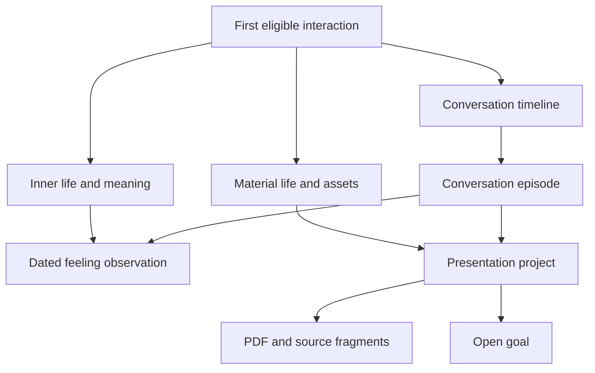

# Agent memory system: unified product and delivery specification

25 October 2026 · Consolidated proposal · Planning artifact, not an implementation or release receipt

Implementation is now authorized under [the production delivery program](AGENT_MEMORY_PRODUCTION_PROGRAM.md), with [T1 as the storage direction](TELEGRAM_STORAGE_DECISION_T1.md). Earlier T0/T1 decision gates below remain feasibility/evidence requirements; T1 has been selected for the scoped implementation, not qualified for unrestricted activation. The backlog tracks incomplete capabilities separately.

This specification merges the submitted **Agent Memory System Design** (`Untitled.md`) with the earlier agent product design, delivery program, research brief, and subsequent review recommendations. It is the primary reading document for this work. Earlier documents remain supporting history; where their proposals conflict, this document states the intended direction. It does not supersede implemented security contracts or authorize production changes.

The product is a recognizable agent that continues a relationship over time: it remembers relevant conversations, finds original files and messages, accepts corrections, and stays within its creator's character. One shared engine provides these capabilities to every agent, while identity, permissions, memory, tools, and budgets remain separately scoped.

**First proof:** start a conversation → retain eligible evidence → return later with an indirect reference → retrieve the correct source → continue in character → correct a fact → forget it → restart without resurrecting it.

Reading guide: sections 1–4 define the agent experience; 5–8 define memory and Telegram storage; 9–13 cover routing, connectors, observation, costs and feature releases; 14–21 contain work packages, sprints, metrics and the improvement loop; 22 gives the first sprint brief; 23 records the merge decisions.

## 1. Product commitments and evidence boundaries

1. **Continuity is the outcome.** Reduce repeated explanations and recover the user's current goal, not merely answer memory quizzes.
2. **The creator owns the character.** The agent develops familiarity within explicit bounds. Users cannot rewrite its core personality through conversation.
3. **Memory has sources.** Claims, episodes, summaries, files, and relationships retain provenance, time, audience, and correction history.
4. **Telegram is the intended memory home.** Its chat, file, channel, and topic features form the user-visible archive. Strict Telegram-only durable content/control remains a feasibility requirement to test, not a guarantee already established.
5. **Remember comprehensively within the chosen retention and access policy.** Capture eligible supported history and show gaps. Do not promise perfect recall, invisible access to earlier chats, or indefinite retention of everything.
6. **Corrections and forgetting take precedence.** A new authoritative correction immediately blocks the old current claim. Forgetting prevents future authorized use and tracks physical purge separately.
7. **Cost is part of quality.** Measure total cost per successful task and relationship, including background work and failures. Strong models are used when justified.
8. **Improvement is evidence-driven.** Observations create reproducible issues and experiments; independent evaluation informs controlled releases.

Three labels apply throughout: **commitment** means required product behavior; **proposal** means a design to implement and evaluate; **qualification gate** means evidence is still required. All numerical targets below are proposed acceptance thresholds or inherited planning targets, not achieved results.

## 2. Identity, personality, and relationship growth

Keep four distinct objects:

| Object | Authority | Examples |
|---|---|---|
| Versioned identity charter | Creator or explicitly appointed co-creator | Name, character, tone, humor, communication boundaries, examples of recognizable responses |
| Adaptation envelope | Creator | Allowed familiarity, formality, explanation depth, pace, initiative and languages |
| Relationship state | Scoped interaction evidence within the envelope | Shared vocabulary, current projects, explicit preferences, unfinished discussions |
| Task state | Current authorized request | Produce a table, find a contract, summarize an audio message |

User prompts, repeated reinforcement, connector text, and retrieved memories cannot mutate the charter. A user who wants a different character can choose another agent. Switching agents does not transfer private history automatically; permitted transfer is a separate selected action.

Accessibility, Stop, correction, forgetting, and clear factual communication remain available. Asking for readable text or a spreadsheet is not a personality rewrite. The agent can fulfill a task in its own voice without obstructing practical formatting needs.

Creators can publish new personality, feature, and design versions after launch. Preview differences, test synthetic conversations, publish against an expected prior revision, and retain rollback information. Organization administration alone does not confer personality-editing rights; emergency disable is a separate power. Do not keep a permanent seven-day creator lock in the new contract.

Relationship growth means fewer repeated explanations, better continuity, appropriate familiarity, and reliable closure of open situations. It does not mean claiming human feelings, increasing emotional dependence, or interpreting silence as rejection. Creator analytics do not grant access to private conversations.

## 3. Human-memory inspiration and its limits

Human memory motivates an associative, temporal system with selective retrieval and consolidation. The [research brief](../research/AGENT_HUMAN_MEMORY_RESEARCH_2026_10_25.md) records scientific sources, dates, evidence limits, and engineering interpretations. The additional literature list in the submitted document is a research backlog; this merge does not certify every citation or confidence label in it.

| Useful concept | Agent design | Boundary |
|---|---|---|
| Working memory | Small current context and active task brief | Token budgets are engineering choices |
| Episodic memory | Dated conversations and events | The agent did not have a human experience |
| Semantic memory | Attributed claims, concepts and associations | A summary is not independent evidence |
| Procedural memory | Versioned, reviewed workflows | Conversation cannot rewrite code or permissions |
| Prospective memory | Open commitments and reconsideration cues | An intention is not authorization to execute |
| Consolidation | Reconcile duplicates, corrections and summaries | Run when useful; nightly work is not a biological requirement |
| Retrieval accessibility | Rank relevant, usable evidence | Frequent retrieval does not make a claim truer |
| Emotional significance | User-stated importance and dated observations | Do not infer diagnoses or durable traits from tone alone |
| Forgetting | Reduced prominence, expiration, or deliberate deletion | Archiving and erasing are different operations |

“Memory DNA” may describe the engineering blueprint—schema, provenance, temporal rules, association, and lifecycle. It is not a literal biological storage claim. Fibonacci numbers, eight-message checkpoints, graph-hop counts, promotion thresholds, and review intervals are product hypotheses.

Do not convert three similar episodes into a proven personality trait. “Reported anxiety before three client calls this week” is an attributed observation. “Is an anxious person” is a different, unsupported generalization. Repeated citations of the same source count as one evidence lineage.

## 4. Memory organization: a graph shown as a mind map

Create a relationship root at the first eligible interaction, keyed by agent, verified person, space, and container. Private, group/channel, and exact-recipient shared containers have separate roots and grants. Agent ownership is not access to every user's memory.

Persist conversation content and derived nodes only under current scoped history/automatic-memory eligibility or an eligible explicit save. A greeting need not create a biography. Sensitive-category classification requires its applicable save policy; discussing a feeling or belief does not itself grant durable classification.

The user sees two primary browsing branches, with episodes and cross-cutting views alongside them:

| Branch/view | Categories | Example |
|---|---|---|
| Inner life and meaning | Feelings, values, explicitly shared beliefs/spirituality, aspirations, preferences | “I felt nervous before Friday's presentation” |
| Material life and assets | Files, possessions, work, places, routines, financial or health information when eligible | Presentation PDF, project, venue, stated budget |
| People and relationships view | Attributed people, roles, relationship episodes | Colleague involved in that project |
| Goals and open situations view | Goals, commitments, decisions, unresolved questions | Presentation preparation still unfinished |
| Timeline/source view | Conversations, source versions, life/project periods | Discussion before the trip, latest uploaded draft |

These are navigation categories, not truth classes. A feeling can be explicit; a property valuation can be speculative. Evidence status, sensitivity, expiry, temporal validity, and access are orthogonal fields. Labels are localized and can evolve without changing source identity.



Each node has a preferred parent for display and typed cross-links for retrieval. Store an event once, with several links. Do not split nodes automatically at seven children; split or merge when navigation and retrieval improve. A file type is a separate facet: PDF, spreadsheet, image, audio, video, or text. A PDF can concern a project, feeling, asset, or several topics.

## 5. Data contracts and invariants

| Record | Required content |
|---|---|
| Source/event | Stable logical ID; source revision; origin; actor; agent/space/container; happened-at and received-at; eligibility/authority version; payload reference; ingestion state |
| Claim | Subject, predicate, value; explicit/inferred/disputed status; source fragments; valid-from/to; recorded-at; confidence basis; sensitivity; retention/review rule |
| Episode | Source range, topic, goal, decisions, open questions, outcome, exact source pointers |
| Node/edge | Stable IDs; type; display parent; relationship meaning; supporting sources; audience; current state |
| Derived artifact | Summary/embedding/extraction version; complete dependency references; policy and model version; invalidation state |
| Open situation | Intended outcome; owner; due/reconsider time if known; current state; contact preferences; source; execution authority kept separate |
| Correction/tombstone | Affected IDs/lineage; authority; effective revision/time; suppression/purge state; minimal non-content audit receipt |
| Operation receipt | Attempt/logical operation IDs; expected source/authority revisions; result; delivery certainty; usage/cost; retry/reconciliation state |

Track `last_retrieved_at`, `last_mentioned_at`, `last_explicitly_confirmed_at`, and `last_contradicted_at` separately. Silence changes none of the confirmation fields. Model confidence requires calibration; it is not a probability established by the model's assertion alone.

Core invariants: permission filtering precedes retrieval and follows it before output; source text is evidence, never executable instruction; derived artifacts cannot outlive their source authority; no unknown delivery is treated as successful; no inferred intent grants an external action; restore cannot roll back current revocation or forgetting.

## 6. Encoding, consolidation, correction, and forgetting

1. **Receive and qualify.** Authenticate, scope, deduplicate and classify the event. Record received, accepted, archived, parsed, indexed, failed, unsupported and unavailable states distinctly. Never-received provider gaps remain visible.
2. **Persist under the selected storage contract.** Acknowledge “remembered” only after its durability condition is satisfied. Temporary conversational handling may continue during an outage, but must not pretend unsaved content is durable.
3. **Extract bounded candidate claims.** Use explicit save/correction rules first. A small qualified model handles ambiguous meaning; save source fragments and observation time. New important information need not wait for a checkpoint.
4. **Update the working brief.** Checkpoint after roughly eight committed conversational messages or a meaningful topic/task boundary. Count semantics are configuration. Fields are goal, constraints, decisions, unresolved questions, next step and source ranges. Mood is optional, attributed and temporary. Corrections and Stop apply immediately.
5. **Consolidate changed material.** Background jobs reconcile duplicates, temporal updates and dependency invalidation. Start with incremental jobs on changed scopes. Nightly batching is an optional operating schedule; inactive users do not need daily model replay. Regenerate from canonical claims/sources, not repeated summaries of summaries.
6. **Retrieve and reconsider.** Useful retrieval may raise accessibility. New explicit evidence can update validity and confidence. Distinguish “that was wrong” from “that changed yesterday”; disagreement can remain disputed when unresolved.
7. **Review, archive or expire.** Apply claim-specific policies. A past event may stay historically valid while a current address, price or medication statement becomes stale. Never interpret “explicit” as “valid forever.”
8. **Forget.** Commit a suppression/tombstone barrier, invalidate dependent context, summaries, indexes, embeddings, queued jobs and speculative work, then execute eligible physical purge. Recheck before final delivery. Old snapshots cannot reactivate erased content.

| Claim type | Promotion | Ongoing handling |
|---|---|---|
| Explicit eligible statement | May become an attributed active claim immediately | Temporal validity and source authority still apply |
| Inference | Remains a marked hypothesis | Review or expire; repeated same-source mentions do not confirm |
| Sensitive inferred pattern | No automatic durable promotion from a fixed count | Applicable explicit-save policy and careful source attribution |
| Connector observation | Can be usable as “provider X reported Y at T” | Freshness and grants apply; repetition does not turn it into a user statement |
| Open intention | Record a supported unresolved goal | Reconsider against current context; stop on resolution or contact withdrawal |
| Evidence archive | Retain eligible content under the chosen policy | Show coverage and retention; deletion has a separate physical status |

User-directed forgetting must not appear as a reopenable archived branch. A minimal deletion receipt may remain without the forgotten content. In-flight operations must validate the deletion epoch before committing or sending.

## 7. Fibonacci priority/time layers

Preserve the sequence `1, 1, 2, 3, 5, 8, 13, 21, 34, 55, 89, 144` as a proposed layered organization. Give duplicate labels distinct internal IDs. Do not use them as fixed offsets, bucket widths, retention durations, or a 376-message horizon.

| Layer family | Intended role |
|---|---|
| First 1 | Current turn and active focus |
| Second 1 | Immediately preceding conversational context |
| 2–8 | Nearby episodes and active topics |
| 13–34 | Consolidated projects, repeated concepts and relationships |
| 55–89 | Enduring knowledge and significant episodes |
| 144 | Highest-priority eligible anchors: explicitly important commitments, milestones or durable constraints |

These are display/policy labels, not mutually exclusive storage silos. An anchor can also be recent. Old evidence can be reactivated without altering its original date. User importance does not override deletion, audience, or source validity.

Rank authorized candidates using separate features: present relevance, evidence quality, unresolved goal relevance, user-stated importance, temporal validity, recency, and redundancy. Version the policy and evaluate weights; do not assert an unmeasured optimum. Compare ordinary recent-window plus brief plus retrieval against the layered variant. Ship the extra layer logic only if measured usefulness or efficiency improves without a quality regression.

## 8. Telegram storage and the visible memory space

Use the bot chat for conversation, a deliberately connected private archive for durable bundles, optional forum topics for navigation, and a Mini App for the graph and file library. User channels can contribute explicitly connected shared knowledge. A forum topic is not a separate privacy boundary from other members of its group.

Telegram facts constrain the design: normal bot updates are retained for at most 24 hours; general MTProto history/search methods are user-only; ordinary Bot API deletion has time limits; file handles and retrieval limits need verification for the selected deployment. The [Bot API](https://core.telegram.org/bots/api), [history method](https://core.telegram.org/method/messages.getHistory), and [Mini App documentation](https://core.telegram.org/bots/webapps) are the implementation references. Mini App CloudStorage is small per-bot/user state, not a substitute for a general graph database.

### Storage choice

| Mode | Durable state | Decision |
|---|---|---|
| T0: strict Telegram prototype | Telegram records/bundles/manifests; runtime indexes rebuild in memory; secrets kept outside chats | Test first because it best matches the requested storage direction |
| T1: Telegram archive plus service state | Telegram originals plus explicit external authority, tombstone, operation and index records | Recommended fallback for reliability, but requires a product decision before implementation; list every external field |
| T2: conventional database plus Telegram interface | External authoritative content and indexes | Comparison baseline only; not the selected product requirement |

T1 cannot be described as “only a disposable index” if recovery depends on external revocation or job state. Embeddings, snippets and graph edges are potentially personal content. Telegram storage does not mean Telegram-only processing: authorized model/provider calls and runtime indexing process data elsewhere.

### T0 feasibility protocol

1. User creates/selects and connects an archive with a verified matching audience. A bot is not assumed to create arbitrary groups/channels itself. Private memory must not be placed in a creator's shared archive.
2. Serialize one writer per scope for the prototype. Write immutable, bounded event/snapshot chunks and verify returned identifiers and downloaded hashes.
3. Publish a manifest listing source revisions, chunks, dependency versions, previous checkpoint, and current suppression/authority state. A pinned root and exportable recovery descriptor provide candidate discovery; neither a pin nor a hash proves freshness.
4. Define an actual supported path to recover every accepted event after the snapshot. A journal topic plus message IDs is insufficient without fetch/discovery support. Commit recoverable event references or bundles under the tested protocol.
5. Prove cold startup with a trusted archive locator, signing trust/key access, and latest authority/revocation watermark. If freshness cannot be established, refuse restoration. If that requires external durable state, T0 has failed that requirement and the T1 decision is required.
6. Inject crashes before/after upload, manifest and pointer updates; lost responses; duplicate deliveries; conflicting writers; changed membership; missing files; expired ingress; replaced bot identity; and old snapshots after forget.
7. Measure reconstruction time, bytes, requests, cost, and completeness for declared history sizes. A one-minute recovery target is a benchmark hypothesis, not a universal promise.

During Telegram outages, an in-memory queue can be lost on crash. A durable external outbox changes the storage contract. The implementation must state which guarantee it offers and must not silently acknowledge durable capture. Recovery also needs known upload/delivery outcomes before retries to avoid duplicated effects.

The UI distinguishes **removed from agent use**, **purge pending**, **purged from controlled copies**, and **external copies may remain**. Telegram plaintext history and user copies may survive a tombstone. Losing access to a group does not prove that the user deleted it; suspend use and reconcile the state. Do not promise reliable group-deletion detection without a proven signal.

Telegram cloud chats are not Secret Chats. Encrypted archive bundles require a separate key custody/recovery plan; encryption does not erase earlier plaintext messages. Validate the actual archive audience before writes and after relevant changes; an application ACL cannot retract plaintext already exposed to another member.

### User experience

Offer natural-language equivalents of `/memory`, `/find`, `/summary`, `/continue`, and `/forget`. Show a source-linked card with what is known, when, where it came from, and who can access it. The mind map is optional; ordinary conversation should not require filing work.

Earlier chats need an explicitly provided import or a separately authorized account connector. Do not imply that adding a bot gives it the whole account history. Report indexed date range, unsupported files and gaps in every archive-wide summary.

## 9. Context engineering, Decisions, and reply routing

Context priority is: execution constraints → current charter → current request and correction overlay → authorized recent dialogue and working brief → relevant open situations → selected source-backed memories → needed connector results. Logical priority does not require placing private data into a shared cached prefix.

Cache stable charter/schema/tool prefixes where the selected provider supports it. Cache matching, retention, cost and hit rate must be measured; no “cached for weeks” or “free personality” promise. Current [prompt-caching documentation](https://developers.openai.com/api/docs/guides/prompt-caching) describes model-dependent behavior. Revalidate authority on cache use; caches never freeze permissions.

| Route | Trigger | Work |
|---|---|---|
| R0 Control | Stop, exact control, correction/forget acknowledgement, pagination | Deterministic code where sufficient |
| R1 Direct | Current context is sufficient | Economical qualified model in the agent's character |
| R2 Recall | Past conversation, file or implicit context matters | Scoped exact/lexical/date/entity search, then bounded graph/semantic expansion |
| R3 Lookup/action planning | External current information or tool requested | Scoped tool plan; reads and effects separately authorized |
| R4 Synthesis | Complex reasoning, multi-source comparison or conflicts | Stronger model only when justified |
| R5 Clarify/abstain | Evidence absent, inaccessible or ambiguous | One discriminating question or an honest limitation |
| Quiet | Background reconsideration has no useful allowed contribution | No outbound reply |

Decisions supplies bounded semantic choices such as prior-context relevance, correction versus new event, category/time cues, open-situation match, or next conversational action. The deterministic runtime validates eligibility, selects allowed operations, and applies the result. Decisions does not write memory, grant access, or compose the complete reply. Refer to the [Decisions guide](https://developers.openai.com/api/docs/guides/decisions); current provider/SDK qualification is a delivery gate.

Prefer exact rules and cheap retrieval before adding a classifier call. Start with bounded candidate count, two graph hops at most, and at most one targeted reformulation when retrieval is ambiguous. All are configurable experiment settings. Retain the earlier source's 12-record/8,192-byte memory budget as a compatibility baseline pending fresh code verification; larger file tasks get an explicit separate budget.

The agent can ask “Was this before your trip, or the later contract revision?” when this resolves ambiguity. It should first use available dates and episodes. Source gaps must not be filled by plausible reconstruction.

At a spend cap, stop optional speculation first. Preserve correction, forget and Stop, and use cheaper qualified routes. If a task cannot be completed without paid retrieval/tool work, explain the limitation. Never silently replace a memory-dependent answer with an uninformed confident answer to hide the cap.

## 10. Files, connectors, and shared-channel assistance

Separate four facets: physical media type, semantic topic, memory role, and audience. Give artifacts stable IDs, source version/hash, original name, observed dates, and fragments such as page, paragraph, worksheet/cell, or media timestamp. An answer to “find that invoice” should return the correct version and origin, not only its summary.

Begin with text, PDF/document and spreadsheet extraction. Add image OCR and time-aligned audio transcripts as independently qualified capabilities; video follows with explicit sampling/coverage and cost. Use sandboxed bounded parsers. Imported text is untrusted evidence; embedded instructions cannot change persona, tools or permissions.

Every connector binds provider account, exact agent, container, resources, operations, purpose and expiry. Use the existing [Connections contracts](../connections/ARCHITECTURE.md), with credentials in the broker/vault. Read, draft, write, send and destructive actions are different authorities. Recheck before the operation and final output.

Connector observations can be useful immediately as attributed current evidence. They do not need the user to repeat every calendar entry; nor does repetition turn them into user-confirmed statements. Revocation prevents new unauthorized access/use. Retention or purge of previously saved evidence follows its explicit contract and cannot be bypassed by archive restoration.

For group/channel search, apply speaker attribution, membership/history policy, resource access, and output audience. A channel summary cannot include private bot DMs. Handoffs between agents pass narrow tasks and authorized references; they never inherit a full map merely because the agents share a creator.

## 11. Observation events and predictive preparation

All modalities feed a common event envelope, with different capture and retention rules:

| Input | Useful event | Handling |
|---|---|---|
| Submitted text | New message, edit, correction, explicit save | Durable only under applicable history/save policy |
| Composer draft | Debounced input revision | Optional transient preparation; discard on cancel; no durable memory from unfinished text |
| Touch/UI | Stop, select, open, dismiss, confirm | Deterministic event; a tap is not evidence of a feeling |
| Microphone | Capture state, real partial/final transcript | Deliberate capture and provider/device qualification; partials remain provisional |
| Camera/image | Selected frame/image and extraction result | Deliberate capture, scope/expiry; no ambient surveillance assumption |
| File | Upload, version replacement, extraction status | Stable artifact identity, provenance and invalidation |
| Location | Explicitly shared position or permitted update | Coarse/time-bounded when sufficient; no inference from language alone |
| Connector | Authorized resource update | Current source revision and operation receipt |

Native Telegram bot interfaces must not be assumed to expose unsent composer text. Draft prediction applies only to a controlled composer/client with an actual supported producer. Language is a communication cue, not a reliable proxy for location or identity.

The observation pipeline is: event → qualification → current state → bounded route/preparation → final-input revalidation → delivered outcome → minimized measurement. Duplicates and out-of-order events must not let older results replace newer state.

Prefer warming one relevant retrieval path over guessing a full answer. Cancel when the input, source, audience or permission changes. A final negation can invalidate all preparation. Prediction never writes durable facts, sends messages, changes permissions, or performs connector effects. Full answer speculation is a later costed experiment.

The inherited single-preparation implementation has two prediction calls per turn, one active lease, no speculative retry, a 500 ms decision deadline and a 1,500 ms receipt window. These are historical compatibility constraints, not evidence that the five-worker design below is implemented. AM-17 must explicitly revise the orchestration/budget contract: count routing, worker inference and tool work separately under one aggregate ceiling. A worker may not extend an expired decision receipt; it needs current job authority and final validation. Reply triage and background reconsideration have separate budgets. Keep prediction off unless it improves latency or task success at matched quality within a declared cost ceiling.

### Five preparation subagents per agent

Product direction: each parent agent may run up to five preparation subagents to personalize likely next steps using permitted past conversations. Five is a maximum concurrent pool per parent agent across active preparation jobs, not five mandatory calls per message. Every job remains isolated to its person/space/container; pooled capacity never means pooled private context. Additional work queues or uses the normal response path. Subagents cannot recursively create more subagents.

| Preparation role | Narrow responsibility | Temporary output |
|---|---|---|
| Conversation memory | Identify the project/topic and recover its latest decisions, corrections and open questions | Source-linked current-state brief |
| Files and evidence | Find relevant artifacts, versions and exact fragments | Authorized file/source references |
| Personalization | Apply explicit preferences, shared vocabulary and relevant dated experiences within the creator's envelope | Bounded presentation/constraint hints; no invented traits |
| Next-step planning | Prepare plausible options for the supported goal | Short alternative outlines with assumptions and unresolved questions |
| Freshness and consistency | Check whether relevant sources changed and whether prepared claims conflict; use a scoped connector read only when allowed and justified | Current-source receipt, conflicts or missing-evidence notice |

Decisions selects among candidate topics, likely needs, and useful preparation roles; deterministic scheduling enforces the five-slot limit, scope and spend. Start with inexpensive memory retrieval and add other workers when evidence supports their value. Specialized workers may be ordinary code or a small qualified model. They are implementation roles behind the main agent, not five new personalities speaking to the user.

Each job carries parent agent/run, person/space/container, input revision, hypothesis, permitted sources/operations, source and authority epochs, deadline, expiry, cost reservation, cancellation token and output schema. Results contain sources, assumptions, uncertainty and usage. No speculative memory write, message send, file modification or external effect is permitted. The main agent revalidates the actual request and current permissions before using results and retains its creator-owned voice.

Example: “About my new project…” activates conversation memory. “The one we discussed last week…” narrows the source. “I'm meeting the designer…” can activate files and planning. If the user continues “but I want to cancel,” obsolete work is cancelled and its cost recorded. Reuse a project brief across plausible next questions; do not generate five full answers to five guesses. Never block a ready answer waiting for all workers.

### Golden-ratio timing and accuracy experiment

The golden ratio, `phi = (1 + sqrt(5)) / 2`, approximately `1.618`, is a proposed pacing parameter alongside Fibonacci priority/time layers. Successive Fibonacci ratios approach phi, but this mathematical relation does not establish optimal conversational timing or higher model accuracy.

Test geometrically spaced optional reevaluation gaps: `gap(k) = min(max_gap, base_gap * phi^k)`. Illustrative configuration: a 200 ms initial stable-input debounce, followed by inter-check gaps of approximately 324, 524 and 847 ms, capped at 1,000 ms. These are gaps, not cumulative timestamps, latency promises, provider retries, or thresholds validated in production. Evaluate only while there is unprocessed meaningful input and budget; unchanged input never causes repeated model calls. Do not add a separate model call merely to decide whether another call is affordable.

The rule adapts to evidence: meaningful new topic/entity/negation invalidates obsolete preparation immediately and can trigger a new bounded decision; explicit submission, Stop, correction and revocation bypass geometric waiting. Continuous small edits are coalesced; a new input revision must not reset the per-turn spend or concurrency limits. Do not delay the final answer to satisfy the timing pattern. Worker timeouts and authorization expiry are independent of phi.

Accuracy is a measured outcome, not a numeric consequence of the ratio. Compare event-driven-only, fixed-debounce, and golden-ratio pacing on identical chronological histories and budgets. Freeze the primary comparison before testing. Measure correct project/intent selection, wrong-memory use, useful preparation reuse, first useful response p50/p95, cancellation handling, wasted work and total cost per successful task. Reject phi pacing if it worsens quality or user-visible latency without the predeclared compensating benefit. Never derive confidence cutoffs such as 0.618 from the ratio; calibrate them from labelled application outcomes.

## 12. Tracing, recovery, and cost accounting

Record a compact receipt for each logical turn/operation: agent and charter versions, scope/authority revision, source IDs/versions/fragments, selected route and reason code, context policy, tools, model/provider version, timing, usage/price source, delivery certainty, and observed outcome. No hidden chain-of-thought is required. Operator views default to aggregates and reason codes, not private content.

Three recovery levels: reconstruct the source/context package for an answer; restore the conversation's brief/goals/corrections; rebuild the authorized memory view after index loss. Exact output replay is not guaranteed by reusing a model name. Where exact context reconstruction is required, preserve versioned inputs or references under compatible retention; after deletion, report that reconstruction is intentionally unavailable.

```text
total_cost = reply + routing + retrieval + extraction + consolidation
           + media + connectors + retries + discarded_preparation
           + archive_recovery + storage_queues + allocated_shared_overhead
cost_per_success = attributable_cohort_cost / verified_successful_tasks
mean_cost_per_active_relationship = attributable_cohort_cost / active_relationship_count
```

An active relationship has deliberate human interaction in the declared window; autonomous outreach does not make it active. Report dormant carrying costs separately. Compute p50/p95 from each relationship's attributed cost, not from the cohort mean. Shared/group costs are allocated once using a disclosed rule. Zero denominators give `n.a.`; missing/unbounded spend gives `UNAVAILABLE`, optionally with a known lower bound.

Preserve the submitted $3 per 1,000 messages launch and $1.50 later targets as hypotheses for a specified routine-text workload. They are not pricing commitments or gates until a baseline demonstrates feasibility. Include a separate total monthly budget, voice/media workloads and recovery. Do not require exactly one large-model call or a fixed cache-hit percentage: require qualified quality, latency and total economics. Use deduplication, incremental consolidation and no-op handling for inactive scopes before model optimization.

## 13. Creator feature releases and implementation boundaries

Version charter, adaptation envelope, UI, memory schema, extractor, retrieval/routing policy and connector contracts independently. A feature update should not rewrite old conversations. Preview compatibility, explain material character changes, and roll back derived behavior without reverting user corrections, grants or tombstones.

Existing integration seams include Tireh gateway/memory/context assembly, Studio persona/permissions/service, adaptive Decisions/runtime/persistence, reviewed-memory provenance, and the Connections broker. The earlier product design contains a [source-seam inventory](AGENT_MEMORY_PRODUCT_DESIGN.md#13-implementation-interfaces-and-ownership). Those findings are dated design inputs; inspect the exact candidate before implementation. Do not rebuild working connectors or introduce a second credential store.

Delivery uses the established AM-01–AM-22 package IDs below. These are proposed work packages, not completed runtime tasks or newly activated scheduler jobs. The earlier EMP and repository backlog entries should be mapped before execution to avoid duplicate implementation. No existing backlog item is marked complete by this document.

## 14. Development work packages and ownership

| ID | Deliverable | Owner / independent reviewer | Dependencies | Ownership and acceptance evidence |
|---|---|---|---|---|
| AM-01 | Agent charter and bounded adaptation contract | Architect + UX / privacy + QA | None | Charter schema/compiler, creator publication rules, supported language/delivery boundaries; adversarial user/connector content cannot mutate core |
| AM-02 | Telegram archive feasibility | Architect / release + privacy + QA | AM-01 scope contract | New archive adapter prototype using synthetic data; manifest/root discovery, bot-specific file handles, crash/race/revocation/delete tests; T0 limitations and T1 field inventory |
| AM-03 | Frozen baseline/evaluation protocol | QA / independent acceptance owner | None | Protected chronological fixtures, query labels, metric definitions, corpus splits, resource budgets and reporting; baseline quality/latency/cost recorded or UNAVAILABLE |
| AM-04 | Creator identity migration | Architect + frontend / QA | AM-01 | `studio/permissions.ts`, `service.ts`, `persona.ts`, `tireh/types.ts`, prompt rules; existing persona becomes v1, no private-memory copy on succession, replace timed lock, tested rollback |
| AM-05 | Source/event and coverage ledger | Architect / privacy + QA | AM-02 qualified storage contract | Telegram text/edit/media envelope, deduplication, source revisions, delivery state, outbox/lease behavior supported by selected backend; no false complete-history claim |
| AM-06 | Typed temporal graph | Architect / QA | AM-05 | Nodes/edges/manifests repository; separate relationship/shared roots; current/previous validity; authorized traversal, no duplicate evidence |
| AM-07 | Conversation briefs and consolidation | Architect / QA | AM-06 | Eight-message checkpoint plus meaningful boundaries; structured episodes/claims/open situations; current correction overlay; stable restart and bounded background fan-out |
| AM-08 | Fibonacci priority/time policy | Architect / QA | AM-07,03 | Layer assignment/reason/review, independent recency/importance/relevance, high-priority old and new facts; matched comparison to ordinary summary retrieval |
| AM-09 | Exact/semantic/graph retrieval | Architect / QA | AM-06,07 | `tireh/memory/`, context builder; exact refs, date/entity/lexical candidates, evaluated semantic/hop expansion; token bounds, citation and ambiguity handling |
| AM-10 | Memory and source UI | UX + frontend / privacy + accessibility QA | AM-01,06,09 | Tree/timeline/source cards, inspect/correct/forget/importance controls, EN/FA RTL, coverage states; source links do not bypass audience |
| AM-11 | File library and extraction | Backend architect + frontend / QA | AM-05,06,09 | PDF/document/spreadsheet first; normalized artifact IDs, fragments, versions, source citations; sandbox/size limits, unsupported state, replacement invalidation |
| AM-12 | Conversation recovery | Architect / QA + release | AM-05,07,09 | `/continue` and implicit continuation, current charter/scope/correction/open-action reconstruction; unknown send outcomes never cause blind duplicate effects |
| AM-13 | Reply/Decisions routing | Architect / QA | AM-01,09,03 | R0–R5 typed registry, economical routine reply route, escalation/clarification/fallback; no permission inference, full task-level comparison |
| AM-14 | Trace and cost ledger | Architect schema then data engineer / QA | AM-05,13 | Content-free operation/job/relationship attribution, usage source and price version, bill reconciliation, cold-recovery and discarded-work costs; completeness measured |
| AM-15 | Bounded relationship growth | Architect + UX / psychology-informed reviewer + QA | AM-01,07,12,13 | Familiarity/topic continuity within creator bounds, preferences with provenance/expiry, resolved situations stop outreach; no global persona mutation |
| AM-16 | First external connector | Connection adapter/platform roles / connection security + QA | Existing Connections contracts, AM-05,09,13 | One named provider/resource, read-only first, freshness and revocation/correction behavior; signed tool receipts, no secrets in memory |
| AM-17 | Predictive preparation and five-worker pool | Architect + frontend / QA | AM-13,14 | Extend the draft controller with at most five scoped concurrent preparation workers per parent agent, aggregate cost reservations, nonrecursive delegation, cancellation and final-input validation; reconcile inherited single-preparation limits; compare event-driven/fixed/phi pacing and measure benefit over prediction-off |
| AM-18 | Voice/image/sensor increments | Voice + frontend roles / privacy + QA | AM-05,11,17 as applicable | Real partial transcripts only after producer qualification; deliberate capture; stop/background/denied permission; OCR/audio/video as separate measured capabilities |
| AM-19 | Creator feature/design releases | Product lead + frontend + architect / QA | AM-04,10,15 | Versioned identity/UI/memory/routing/tool manifests, preview/diff/publish/rollback, no history rewrite; accessibility and cross-version regression |
| AM-20 | Migration, load, recovery, and deletion qualification | Architect + release / privacy + QA | AM-02,05–14 | Reconciliation, cold reconstruction at declared scale, latest authority survives restore, archive gaps visible, no stale-grant/tombstone rollback |
| AM-21 | Pilot and guarded promotion | Release + product lead / independent QA | Applicable AM-01–20 gates | Exact artifact/config/provider/device evidence; private then shared scopes; capability-specific cohort reports, kill switch and repair drill |
| AM-22 | KPI review and next-sprint generation | Product lead + data engineer / QA | AM-03,14; operational deployment for live reports | Minimized evidence pipeline, versioned dashboard/report, reproducible issues, sprint proposal records and post-release evaluation; no automatic persona or policy changes |

Suggested ownership modules are in the product design. Map AM-05–12 to EMP-03–07/14 and VOX-013–018; AM-13/17 to EMP-08/09 and VOX-024–031; AM-15 to EMP-13 and the relationship backlog; AM-16 to existing Connections tasks; AM-20/21 to EMP-14–16 and VOX-049–056. AM-01/04/19 amend the previous persona lifecycle and need explicit migration coverage.

Use a lead plus at most three active development workers. The architect owns shared contracts and integration. A data engineer wires only reviewed schemas. QA does not author the candidate it accepts. Serialize edits to the gateway, runtime service, shared persistence schemas, and conversation UI. Reserve a reviewer slot before integration becomes a bottleneck.


## 15. Sprint milestones

A two-week planning cadence is proposed. Sprint goals are dependency milestones, not a promise that each stage fits two weeks or a commitment to a calendar release. Carry incomplete work honestly and reduce scope before weakening acceptance.

| Sprint goal | Packages / scope | Demonstrable outcome | Exit gate |
|---|---|---|---|
| S0: identity, science, storage and baseline | AM-01/02/03 | Creator charter plus adaptation boundaries; synthetic Telegram archive proof/gap report; baseline fixtures and metrics | Core policy agreed; T0 limitations explicit; production storage decision recorded before dependent production work |
| S1: first interaction becomes durable evidence | AM-04/05/06 | Start one agent, establish private root, retain eligible sources, create attributed nodes, restart | Scope/idempotency/recovery hold; creator can version core, ordinary user cannot; no data mixture |
| S2: continue the relationship accurately | AM-07/09/12 | Resume a past discussion, resolve references, correct and forget, continue after restart | Continuity, temporal correctness and deletion suite pass; useful response does not require the user to repeat known facts |
| S3: managed library and mind map | AM-10/11 plus AM-08 experiment | Navigate material/inner-life episodes; find a file/page/message; explain a source-linked summary | UI/RTL/accessibility; correct file identity/version/coverage; Fibonacci retained only if useful |
| S4: routing and cost | AM-13/14 | Matched cheap/strong routes, accounting per task/relationship, bounded recovery cost | Quality noninferiority; cost and usage gaps visible; uncertainty/fallback calibrated |
| S5: growth and first connector | AM-15/16/19 | Familiar agent uses current external source and remembered context without persona drift | Connector revocation/freshness; creator-only identity changes; no private data in global improvement |
| S6: anticipation and selected modalities | AM-17/18, independently scoped | Useful early context preparation; one qualified voice/image capability | Real provider/device proof, cancelled work accounting, safe final-input revalidation, measurable incremental benefit |
| S7: production qualification and improvement loop | AM-20/21/22 | Pilot evidence, recovery/kill drill, first KPI-backed next-sprint proposal | Applicable gates pass; remaining capability gaps named; schedule ownership agreed |

Quality, privacy, and tracing are built into every sprint. S7 is not the first time they are tested. Ship useful qualified slices independently: Telegram text continuity need not wait for video, camera, or multiple connectors. If T0 fails, do not mark the storage milestone achieved merely because a conventional database would work.


## 16. KPI dictionary and acceptance targets

Safety and integrity invariants take precedence over aggregate quality, cost and engagement. A recovery failure that restores revoked information is an integrity failure, not a low-priority resilience score. Do not reward raw node count, resistance to merging, conversation length, prediction accuracy about a person, or compulsory memory use. Useful recall is measured on labelled opportunities where memory should help, with unwanted personalization measured separately.

The submitted weekly sample sizes—200 claims, 100 replies and 50 route decisions—are useful initial review workloads, not proof of rare-failure rates. Stratify by language, source type, history length, route, scope and relevant sensitivity; publish denominators and uncertainty. User restatement is not automatically a failure: distinguish deliberate repetition from repetition needed because the agent forgot. Retention and voluntary memory-view use are exploratory product signals, never reasons to push more conversation.

All numerical values below are **proposed targets**, not measured results or published service guarantees. Preserve stricter existing [QA gates](../implementation/QA_AND_RELEASE.md). Freeze exact thresholds, eligible populations, sample requirements, confidence intervals, slice requirements, and stop rules before final evaluation. A point estimate alone does not authorize promotion.

An eligible task is a declared, supported user goal started under current access and measurement permissions. An active relationship is a distinct `(tenant, agent, person-or-group container, space)` with at least one deliberate eligible human interaction in the reporting window. Automated outreach does not create an active relationship. Session length and reply rate are diagnostic, not primary success metrics.

| KPI | Exact measurement | Proposed target / interpretation |
|---|---|---|
| Conversation continuity | Correct goal/current state/source recovered with at most one necessary clarification / all labelled eligible continuation episodes | >=95%; report uninterrupted, restarted, long-gap, indirect-reference, and multi-topic separately |
| Verified task completion | Independently verified successful task episodes / all eligible started episodes | Noninferior to baseline within 2 percentage points with uncertainty; unknown/abandoned outcomes stay visible and never count as success |
| Memory precision | Supported and correctly attributed retained claims / all sampled retained claims | >=98%; independently label from original evidence |
| Memory extraction recall | Correctly retained eligible salient claims / all human-labelled eligible salient claims in source | Baseline then proposed >=90%; report unsupported/uncertain separately; prevents an empty memory store winning precision |
| Exact-item retrieval | Queries returning the correct authorized source/version in top 5 / all labelled answerable file/message queries | >=95%; also report top-1 and fragment accuracy |
| Useful implicit memory | Responses where earlier context materially helps without incorrect personalization / all labelled implicit-memory opportunities | >=80% initially; unwanted personalization <=2%, with ratings and coverage reported |
| Temporal/correction accuracy | Correct current value, past value, date and attribution decisions / all labelled relevant opportunities | >=95%; immediate authoritative suppression of an explicitly corrected current claim is a hard invariant |
| Abstention accuracy | Appropriate non-fabricated abstentions / all labelled unanswerable questions | >=95%; also report false abstention on answerable queries |
| Clarification efficiency | Clarifications that materially resolve ambiguity / all clarification questions | Target >=80%; report questions per resolved task and avoid counting forced user repetition as success |
| Evidence traceability | Memory-bearing answer claims with correct resolvable authorized source/version/fragment / all audited memory-bearing answer claims | >=98%; source inaccessible after revocation must be reported, not replaced by an invented citation |
| Graph integrity | Correctly attributed/source-linked current nodes/edges / sampled graph assertions; invalid/dangling references separately | No unauthorized traversal or deleted-source resurrection; edge count is not a success metric |
| Ingestion coverage | Durably represented eligible accepted logical events / all eligible accepted logical events | 100% in crash/replay suite; report provider-visible gaps separately—events never received cannot be included in a completeness claim |
| Memory freshness | Accepted eligible source to usable committed memory, with delayed/failing jobs included | Existing initial targets p50 <=2 s / p95 <=10 s under declared normal load; current-turn correction overlay remains immediate |
| Persona invariance | Unauthorized changes to core fields/version/pointer caused by user content or learning | Zero; separately target >=95% human-rated rendered style consistency on applicable tasks |
| Creator update correctness | Published core updates from authorized expected revision with successful compatibility/migration / all attempted valid updates | 100% deterministic fixtures; conflict/migration failure must not partially publish |
| Accessibility | Mandatory supported journeys passing / all mandatory journeys | 100%; core identity does not waive required accessibility or Stop |
| Reply routing recall | Correct response route / all human-labelled messages requiring a response | >=98%; report ignore/decline/block errors per class, not one blended accuracy |
| Decisions routing | Macro F1 plus per-class recall, false positives, abstentions, latency and invocation rate | Existing initial macro F1 >=0.90; harmful/wasteful false positives <=1%; confidence alone is not a quality score |
| Unwanted group contribution | Unhelpful/unaddressed contributions / all rated unsolicited group contributions, plus per 100 eligible group messages | <=1% proposed; ratings coverage explicit; no inference that group silence means consent |
| User-visible latency | Same-clock first meaningful visible text/audible reply, over declared workload with failure/timeout distribution | Existing routine-text p50 <=0.8 s / p95 <=2.0 s; voice <=1.2/2.5 s; qualify actual providers/devices |
| Recovery integrity | Correct reconstructed latest state and next useful action / all recovery scenarios | >=95% functional target; zero duplicate external effects and zero rollback of current revocation authority |
| Suppression and purge | New authorized uses after acknowledged revoke/forget; age/count of remaining eligible purge jobs | Zero new authorized uses after commit; target primary payload purge <=24 h subject to backend/provider proof; Telegram physical copies reported separately |
| Total cost per success | All attributable costs / verified successful tasks in cohort/window | Seek >=25% reduction versus matched baseline with <=2-point quality noninferiority; zero verified successes => n.a.; missing/unbounded cost => UNAVAILABLE, optionally showing a known lower bound |
| Cost per active relationship | Cohort mean: direct plus declared allocated costs / active relationship count. Distribution: sum attributed cost for each individual active relationship in the window, then compute p50/p95 across those values | Set mean, p50/p95 and absolute monthly budget from measured workloads; dormant carrying cost separately |
| Accounting completeness | Attributable reconciled billable operations / all observed billable operations | >=99% proposed before strong unit-cost claims; unknown spend reported as gaps/bounds, never zero |
| Prediction value | Useful reused preparations / all launched preparations; full discarded cost; final user task outcome | Promote only with >=20% lower p95 useful-response latency at matched quality or predeclared supported task-success gain within cost ceiling |
| Preparation pool integrity | Concurrent workers per parent agent; out-of-scope reads/results; recursive launches; stale-result uses after invalidation | At most five concurrent workers; zero scope leaks, recursive launches or invalidated result uses; queue delay and rejected launches reported |
| Timing-policy value | Paired event-driven/fixed/phi comparisons at equal workload and budget, including project/intent accuracy, useful-response latency and wasted cost | Adopt phi only for a predeclared measurable benefit with quality guardrails; no assumed biological or accuracy advantage |
| Proactive usefulness | Human-rated helpful initiatives / all rated delivered initiatives; unwanted/stop rates and rating coverage | Use existing contact-quality gates; do not optimize for more messages or emotional dependence |

Track file size/type, agent/version, language, channel, device, network profile, relationship age, storage mode, source coverage, and cache state as explicit workload dimensions. Respect small-cohort privacy; private transcript access is not granted to creators by aggregate reporting.

For metrics with no eligible denominator, output `n.a.`. For missing measurement, output `unknown`/`UNAVAILABLE`. Never replace either with zero. Report nonresponses, abandoned tasks, provider failures, parsing failures, refusal, cancellations and unsupported modalities. Include confidence intervals clustered at person/container or assignment unit as appropriate; critical slices cannot be hidden by a good aggregate.


## 17. Evaluation protocol

Use a fixed source corpus with realistic conversation arcs, known answers, controlled unknowns, edits, changed plans, and source revocation. Include English, Persian, mixed language, private/group/exact-recipient scopes, shared names, multiple agents, and material/inner-life cross-links. Start synthetic; any real examples require the appropriate minimized, explicitly permitted evaluation flow.

Compare incremental variants under the same source and context budgets:

1. Recent context + running summary + flat relevant facts.
2. Typed episodic/semantic/open-situation memory.
3. Version 2 plus bounded graph traversal and mind-map organization.
4. Version 3 plus Fibonacci priority/time policy.
5. Selected memory design plus economical routing.
6. Same design plus optional prediction or an individual modality/connector.

This isolates whether graph complexity, Fibonacci, routing, and anticipation earn their costs. Avoid changing every component at once and attributing all improvement to memory architecture.

Split by person/group/container and time. Chronological replay must expose only evidence available at that turn. Future user messages are outcome labels, not model context. Keep known-relationship future-turn performance separate from new-user generalization. Experimental derivatives must not enter the control memory. Shared graph-connected containers use one consistent assignment where information can cross conversations.

Use benchmark task families from [LongMemEval](https://arxiv.org/abs/2410.10813), [PersonaMem](https://arxiv.org/abs/2504.14225), [LoCoMo-Plus](https://arxiv.org/abs/2602.10715), and [LOCOMO-CONV](https://arxiv.org/abs/2609.03467) as inputs to fixture design, not as claims of our performance. Research publication/revision status and applicability must be checked before borrowing benchmark scores. Creator-owned persona means user-preference benchmarks apply to allowed relationship adaptation, not core identity mutation.

The evaluator owns held-out data, prompts/rubrics, thresholds, and final protocol digest. Candidate authors use optimization examples and cannot modify tests to pass. Deterministic privacy/deletion/identity failures override any model judge. Human raters assess natural continuity, useful clarification, persona consistency, and unwanted personalization; automated exact checks assess source/temporal/authority invariants.

Record the exact candidate artifact, source/base, prompt/charter/model/extractor/connector/storage versions, prices, configuration, dataset digest, hardware/network profile, and evaluator. Run actual provider/device tests after synthetic correctness, with a separately authorized spend cap. Small pilot counts are diagnostic floors, not sufficient evidence of rare-event safety or stable p95.


## 18. Required acceptance scenarios

| Family | Examples and invariant |
|---|---|
| Identity | Repeated “change your personality,” file-contained instructions, fake creator claim, org-admin edit without co-creator grant; no core mutation |
| Bounded adaptation | Familiarity and explanation depth change only within charter; plain-text/stop/accessible delivery work; another user's preferences never leak |
| First interaction | Empty greeting creates only permitted structural metadata; first real topic creates supported nodes; no invented biography |
| Continuity | Return after a month, indirect reference, two similar events, interrupted answer; recover the correct current goal/source within useful clarification limit |
| Timeline | Past residence versus current visit, rescheduled deadline, source edited after summary, disputed claims; preserve time/attribution |
| Exactness versus gist | Exact filename/date/number and broad topic summary both work; a good summary cannot conceal lost exact evidence |
| Graph boundaries | Mixed-audience edge, guest joins, new agent, renamed category, deleted source; no traversal outside current authority |
| Telegram durability | Lost upload response, crash at each manifest stage, replaced pin, missing root locator/key, two writers, archive membership change, >24-hour ingress gap, new bot identity |
| File/connector | Unsupported/encrypted/oversized file, stale provider revision, changed resource rights, malicious OCR, missing original, ambiguous latest version |
| Forget/recovery | Delete while extraction runs, restore an old snapshot, stale cache or index, old private Telegram copy remains; no false complete-erasure claim or resurrection |
| Prediction | Final negation, IME edit, cancelled capture, stale ASR/image, timeout/refusal/malformed result, exhausted spend; no speculative durable action |
| Five-worker preparation | Six simultaneous job requests, two private relationships sharing capacity, one slow worker, expired receipt, cancelled parent, recursive delegation request; enforce cap/isolation, answer without waiting for all, and reject stale results |
| Timing policy | Identical histories under fixed/event-driven/phi pacing; typing bursts and long pauses; immediate Stop/correction; no repeated calls for unchanged input or reset of budgets on revision |
| Cost/scale | Long archive cold restore, repeated duplicate import, inactive relationships, large group and media load; bounded work and complete cost reporting |
| Delivery | Response generated but send unknown, duplicate webhook, reconnect, output audience changes; no invented delivery receipt or blind duplicate send |
| Creator updates | v1 -> v2 -> rollback, concurrent edits, schemas change, inaccessible archived sources; history/grants/tombstones remain correct |


## 19. Ongoing review cadence

This is a proposed operating plan. No recurring job is created in this chat. Enabling the program requires the corresponding deployed instrumentation, authorized data scopes, owners, and schedule configuration.

| Cadence | Owner | Review / output | Action boundary |
|---|---|---|---|
| Per operation | Runtime | Source/authority/route/delivery/cost receipt, failures and current coverage | Immediate deterministic stops and bounded fallback only |
| Daily operational review | Operations + data engineer | Queue lag, rejected/failed capture, missing accounting, delete backlog, cost spikes, archive freshness, provider outages | Alert/incident under predeclared controls; no automatic personality edit |
| Weekly quality review | Product lead + QA | Continuity misses, user corrections, source/citation failures, unwanted personalization, route and cost comparisons | Reproducible issue clusters and candidate backlog; do not export raw private histories |
| Every two weeks | Product lead + owners + independent evaluator | Sprint selection, acceptance of finished work, next hypotheses and budget | Approve bounded development work; no auto-promotion from a dashboard |
| After each release | Release + QA | Candidate versus baseline, regression and cohort outcomes, rollback readiness | Expand, hold, repair, or roll back under release policy |
| Every six weeks | Research reviewer + architect | Primary memory/agent-evaluation research, status and relevance | Small sourced design experiment proposals, not wholesale architecture replacement |
| Monthly | Product/finance/operations | Cost per relationship including dormant cost, storage capacity, retention/deletion and source access | Adjust explicit budgets/capacity; measure effect before promising economics |

P0 integrity events—unauthorized content export, core mutation, resurrection after forget, stale authority after restore, duplicate external effects—stop affected expansion and trigger incident handling immediately. Do not wait for the next sprint. Performance/cost thresholds trigger only when the denominator and measurement completeness are sufficient; missing telemetry itself creates an instrumentation task.


## 20. Turning evidence into the next sprint

1. Normalize permitted feedback and outcomes into content-free measures and scoped evidence references. Distinguish reported dissatisfaction from inferred cause.
2. Cluster a repeated failure by behavior and version. An analyst may propose a cause; it must be reproduced before becoming an implementation fact.
3. Create a sprint candidate with the contract below. Prioritize privacy/integrity first, then observed user impact, evidence confidence, expected benefit, implementation effort, and operating cost. Avoid a pseudo-precise composite score when evidence is weak.
4. Product lead and QA choose a small number of measurable hypotheses, freeze baseline and evaluation budget, assign an owner plus a non-author reviewer, and map dependencies.
5. Implement on optimization examples; independently evaluate the exact candidate; publish failures and unknowns. If inconclusive, retain baseline and improve the evidence plan rather than lowering thresholds.
6. Release the accepted bounded change to its eligible cohort. Observe actual exposure and outcome; complete the sprint only when its stated evidence level is met.
7. Feed confirmed regression/usefulness/cost findings into the next sprint. Never use successful test output as evidence that a feature is active in production.

```yaml
id: AM-NEXT-001
title: Recover the correct event when two recent topics share a date
status: proposed
affected_capability: conversation_recovery
affected_versions: [explicit versions]
population_and_scope: declared eligible relationship/container cohort
evidence: [authorized minimized receipt IDs or synthetic reproduction]
baseline: metric value, denominator, uncertainty, measurement gaps
hypothesis: a bounded event-disambiguation cue reduces wrong-topic continuation
proposed_change: exact owned paths and behavior
primary_metric: continuity accuracy
guardrails: attribution, clarification burden, core style, latency, cost, access
budget: implementation, evaluation and pilot ceilings
owner: named implementer
independent_reviewer: different evaluator
dependencies: [accepted contracts]
acceptance: frozen thresholds and mandatory scenarios
stop_conditions: privacy failure, persona mutation, regression, budget exhaustion
rollout_and_rollback: exact versions, cohort and state repair
result: pending; source, CI, deployment and observed behavior reported separately
```

Automated jobs may prepare a candidate report, test a fixed synthetic protocol, or draft sprint proposals when deployed and authorized. They do not grant new source access, alter evaluation policy, publish a creator personality, merge code, or deploy merely because a KPI improved. Creator-approved persona changes use the separate identity release flow.


## 21. Release, rollback, and completion evidence

Start with synthetic histories and the chosen archive/backend contract. Then a small internal adult private-chat pilot, then limited eligible cohorts (the existing 5% -> 25% -> broader rollout sequence), with sufficient observations and uncertainty analysis at each gate. Group sources, shared containers, connectors, voice, and camera each need their own activation evidence. A private-text pilot cannot certify them.

Release packet:

- Exact source, candidate diff/artifact digest, build, storage/config/charter versions.
- Author evidence and independent review with mandatory checks passed, failed, or unavailable.
- CI result, current deployed target/revision, policy/storage/credential configuration.
- Authenticated Telegram/Mini App journey and actual provider/device evidence.
- Memory/source reconstruction, correction/delete, authority-preserving recovery, and rollback drill.
- Frozen cohort metrics with accounting coverage, uncertainty, exclusions, and cost ceiling.
- Capability flags, owner, kill condition, rollback state repair, remaining unqualified features.

Do not overwrite fresh corrections, grants, or tombstones when rolling back. Disable capture/preparation and invalidate stale receipts before downgrading readers; repair candidate-created summaries/indexes with a versioned process. Telegram history already disclosed to recipients is not undone by reverting code.

## 22. First sprint brief and decisions to resolve

**Sprint 0 produces reviewable evidence, not the entire engine.** Architect owns AM-01/02; QA owns AM-03 and a protected baseline. UX reviews charter and archive setup; privacy and release reviewers assess authority, retention and recovery claims. Exact file ownership is assigned against the current checkout before implementation.

Deliverables:

1. A versioned charter/adaptation/relationship contract with examples of allowed formatting and prohibited personality mutation.
2. A synthetic archive protocol describing every write, recovery lookup, trusted root, current authority source, crash state and deletion status.
3. A T0 prototype report: pass/fail/unavailable per requirement. If it fails, a concrete T1 inventory identifying external fields, content, purpose, retention, access and costs for the product decision.
4. A frozen replay corpus, baseline, metric definitions, budgets and task-level cost worksheet, including 100-turn and 10,000-message histories, dormant scopes, shared files and cold restore.
5. One next-sprint proposal with named owner, non-author reviewer, dependencies, acceptance criteria and stop conditions.

Resolve before dependent production work: storage mode and recovery trust; retention/purge commitments; supported account/import modes; selected provider/models and actual pricing; initial memory-save eligibility; and scale limits. Missing answers do not prevent synthetic contract and feasibility work. They do prevent promising the corresponding production capability.

## 23. Merge decisions and source record

| Submitted idea | Merged decision |
|---|---|
| One engine for every agent | Retained; private scopes and creator identities remain separate |
| Graph rendered as tree | Retained; categories are navigation, not evidence classes |
| Material and Immaterial branches | Retained as Material and Inner life/meaning, with people/goals/timeline cross-cutting views |
| Eight-message brief | Retained as an approximate checkpoint plus meaningful boundaries |
| Fibonacci-width history buckets | Replaced with the user's priority/time layer interpretation |
| Silence confirms a retrieved claim | Rejected; retrieval, mention and explicit confirmation have separate timestamps |
| Three episodes establish an emotional pattern | Replaced with tentative attributed observations and appropriate save/review policy |
| Never-changing explicit material facts | Replaced with historical validity, freshness, review and supersession |
| Nightly replay for every person | Changed to incremental changed-scope work with optional batch scheduling |
| Everything recoverable from Telegram alone | Retained as a T0 qualification objective, with a real discover/fetch/freshness protocol required |
| Disposable external database | Permitted only as a separately accepted storage contract; authority and tombstones cannot be silently lost |
| One large-model reply every message | Replaced with deterministic/cheap/strong routing according to need |
| Cached for weeks and nearly free | Replaced with measured provider/model-specific cache behavior and billing |
| Published low dollar targets | Retained as workload-specific hypotheses until measured |
| Personality card and bounded adaptation | Retained, with accessibility, creator versioning and private-memory boundaries |
| Fixed review loop generates next sprint | Retained, with integrity-first prioritization and independent evaluation |
| Map growth/prediction as relationship maturity | Replaced by continuity, task success, appropriate recall, correction reliability and unwanted-personalization measures |

Inputs: the user-supplied `Untitled.md` dated 25 October 2026; [earlier agent product design](AGENT_MEMORY_PRODUCT_DESIGN.md); [earlier delivery program](AGENT_MEMORY_DELIVERY_PROGRAM.md); [human-memory research brief](../research/AGENT_HUMAN_MEMORY_RESEARCH_2026_10_25.md); [event-memory plan](../implementation/EVENT_MEMORY_PREDICTION_PLAN.md); and the review recommendations discussed with the user. Scientific evidence remains attributed in the research brief. Telegram and provider constraints link to official documentation in the relevant sections.

This artifact defines the merged proposal. It does not claim code implementation, successful live Telegram recovery, achieved KPI values, completed deployment, or an activated recurring improvement service.
