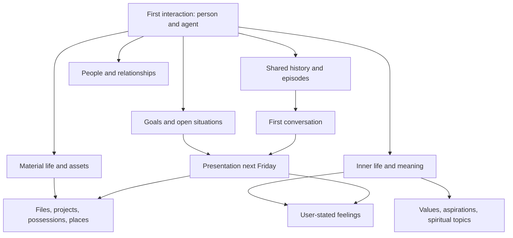

# The agent as a product: identity, relationship, and memory

25 October 2026. Design proposal, not implemented or enabled. Source baseline `d56dfa7aa185e807f656fcc864c36e94c98ebaf2`. Product owner request: evaluate each agent itself, with a stable creator-controlled personality, growing relationships, excellent memory/context/routing, connectors, low cost, and Telegram-based storage and interaction.

The [unified agent memory specification](AGENT_MEMORY_MASTER_SPEC.md) is now the primary consolidated proposal, merging this design, the submitted document, and review corrections. This document remains supporting design history and source-seam detail. It refines the [earlier implementation plan](../implementation/EVENT_MEMORY_PREDICTION_PLAN.md), particularly its personality and storage assumptions. The [delivery and improvement program](AGENT_MEMORY_DELIVERY_PROGRAM.md) records the original work-package and KPI breakdown; the [human-memory research brief](../research/AGENT_HUMAN_MEMORY_RESEARCH_2026_10_25.md) separates scientific evidence from engineering analogies.

## 1. Product judgment and promise

The strongest product is an agent with a recognizable identity that becomes more useful as it learns the history of each relationship. Its value is demonstrated when someone returns after weeks, refers indirectly to an earlier discussion, and receives an accurate, natural continuation with the right evidence and no unrelated private information.

The product promise is: **“I can continue our history, find what you shared, explain what I remember, and update it when life changes—while remaining the same recognizable agent.”** This requires dependable storage, attribution, retrieval, correction, and communication. Adding more models or sensors does not establish those qualities.

“World class” is an evaluation ambition. Acceptance will be judged against a matched baseline and held-out conversations, not the number of features. The initial priorities are continuity, trustworthy recall, creator identity, traceable file/message search, and predictable cost. Voice, visual interaction, additional connectors, and anticipation build on those foundations.

### Product requirements

| Requirement | Meaning for the agent | Evidence needed |
|---|---|---|
| Recognizable personality | Same creator-owned identity and communication character across people and channels | Persona consistency and adversarial override tests |
| A growing relationship | Remembers shared events and what remains unfinished without inventing intimacy | Longitudinal continuation and human-rated naturalness |
| Comprehensive authorized history | Preserves the supported, received interactions the person chose to retain; tracks gaps | Ingestion ledger, reconstruction and coverage checks |
| Human-inspired memory | Experiences, facts, routines, intentions, and temporary attention serve different roles | Independent memory-task tests and source traceability |
| Managed knowledge | Files, messages, claims, topics, and connections have stable references | Exact-item retrieval, source citations, version handling |
| Intelligent routing | Uses the cheapest sufficiently capable route; asks for a useful cue when uncertain | Quality/latency/cost frontier and clarification burden |
| Telegram-centered experience | Chat, files, memory cards, controls, and approved summaries are usable in Telegram | Actual bot/channel/group/device journeys |
| Extensibility | Features, UI, tools, models, and personality have independent versions and rollback | Contract compatibility, staged updates, recovery |

No system can truthfully promise perfect recall of unavailable, deleted, unreceived, or unsupported content. “Remember everything” means an explicit retention mode for all eligible committed sources, with a coverage ledger and no silent loss. It does not mean putting all history in every prompt or permanently recording unsent drafts and ambient sensors.

## 2. Identity belongs to the creator; history belongs to the relationship

Use three separate contracts:

1. **Agent identity charter:** creator-owned name, role, values, communication character, humor/directness, voice, boundaries, and examples of recognizable behavior. It has an immutable version ID and a creator-signed change history.
2. **Adaptation envelope:** creator-defined ranges for pacing, explanation depth, formality if allowed, familiarity, and initiative. The system can learn a bounded relationship-specific state within these ranges. A creator may lock particular dimensions.
3. **Relationship memory:** what this person and this agent have actually discussed, including dates, preferences, corrections, open situations, and source access. It cannot rewrite the charter or expand the envelope.

End users choose an agent whose character they like. “Become a different personality,” repeated reinforcement, or instructions hidden in documents cannot modify its charter. The agent can briefly explain its character without arguing, and offer a clear exit/change-agent action. Changing agents does not automatically transfer private history; the person selects any permitted memories to carry over.

Basic accessibility, safety, consent, stop, correction, and deletion controls remain available regardless of style. A request for readable text, translation, slower playback, or “please stop” is not an identity rewrite. Task-specific formats can vary within the creator's declared envelope: a consistent warm agent can still produce a spreadsheet or concise factual answer. Where a requested tone conflicts with a locked identity dimension, preserve the identity while fulfilling the underlying task where possible.

### What changes through interaction

| Layer | Who can change it | Example | Must not happen |
|---|---|---|---|
| Identity charter | Authenticated creator through a versioned release | Creator changes an agent from playful to restrained | A user prompt silently changes global personality |
| Adaptation envelope | Creator | Allows brief or detailed explanations, locks directness | Model widens its own bounds |
| Relationship state | Bounded learning from this relationship; editable factual/preferences records | Knows the user is familiar with a project and need not re-explain it | One user's behavior changes everyone else's agent |
| Task state | Current authorized request | Summarize a file in a table | Task formatting becomes a permanent persona rewrite |
| Permissions and retention | Authorized person/admin under the corresponding product rules | Disconnect a source or forget a memory | Creator persona text grants access to private data |

The first Start establishes the relationship root and records the charter version shown. A short optional invitation helps the person supply a topic; it is not a psychological questionnaire. Early adaptation uses explicit conversation evidence, stays tentative, and does not claim to know the user's character after a few messages.

Creator changes are allowed after launch. Create a draft charter, compare it against the existing version on recorded synthetic scenarios, preview it, and publish a new version with a change note. Do not rewrite historical messages or prior memory attribution. A major identity change must be visible; support rollback. Release cadence should preserve recognizability, but no permanent seven-day creator lock is part of this design.

Only the creator or an explicitly appointed co-creator can publish core identity changes. Organization administrators may retain emergency disable/access-management powers, but that role alone does not authorize rewriting another creator's personality. Use expected-version checks for concurrent publication. Migration snapshots the exact existing persona as v1 and preserves the stable agent ID; a new successor agent receives private memories only through separately authorized transfers, never merely because it shares a creator.

Current source has a conflict that implementation must resolve: `src/lib/tireh/conversation/prompt.ts` lets current-user register/length instructions override default style; `src/lib/studio/types.ts` describes a seven-day forming period and permanent personality lock. Reuse existing `identityVersion` and creator authorization concepts, but replace the priority and lifecycle rules with the contracts above. This document does not claim that replacement is already made.

## 3. Human inspiration, engineering boundaries

The research brief examines recent primary work and established memory models. Human memory is reconstructive, selective, associative, and affected by context; literal biological replication is neither necessary nor demonstrated. We should adopt useful organizational principles while protecting the digital record from false reconstruction.

| Human-memory concept | Proposed agent mechanism | Where the analogy stops |
|---|---|---|
| Working memory | Bounded current-turn context, recent dialogue, active goal | A token budget is not a measured human capacity |
| Episodic memory | Dated conversations/events linked to exact sources | The agent did not have a human experience |
| Semantic memory | Source-backed facts, concepts, preferences, relationships | A compressed claim must remain correctable and attributed |
| Procedural memory | Reviewed reusable task plans and tool workflows | Private conversation cannot silently rewrite code or policy |
| Prospective memory | Open commitments and future reconsideration cues | Remembering an intention is not permission to execute it |
| Consolidation | Background reconciliation and structured summaries | Summary output is not new independent evidence |
| Retrieval cues and schemas | Topic/entity/time associations and a short clarification | A suggestive question must not manufacture a false memory |
| Forgetting/interference | Lower prominence for stale or irrelevant context; deduplication | Lower attention is different from deleting retained evidence |
| Emotional salience | User-stated significance and temporary feeling observations | No emotion diagnosis or invented psychological profile |

“Memory DNA” is a useful name for an engineering blueprint: schema, provenance, temporal validity, association rules, priority policy, and lifecycle. It is not a claim that human memories are stored as inherited text in DNA. Fibonacci and the eight-message update interval are configurable product hypotheses, not neuroscience findings.

## 4. The mind map starts with the first interaction

Create one private relationship root per authenticated person + agent + selected space. Group/channel knowledge has its own root and history policy. Never use a single global tree containing all users' private histories. Source access remains attached to every node and edge.

Current-turn organization may remain temporary. Persist a root with conversation content or derived nodes only under current scoped history/automatic-memory eligibility or an eligible explicit-save request. Discussing a feeling or belief alone does not authorize durable sensitive-category classification; such content stays temporary or follows the separate explicit-save policy. Apply this boundary to the examples and every graph branch below.

The interface is a tree for understandable navigation. The underlying model is a graph, because a meeting can relate to a project, a person, a file, and a feeling at the same time. Store one canonical event with several typed links rather than duplicating contradictory facts under each branch.



“Spiritual” is an optional user-facing category within inner life/meaning. It includes beliefs only when the person actually discusses them. Feelings need not be spiritual. “Material” includes physical and digital objects/assets. Some topics belong to both or neither; preserve cross-links and allow uncategorized nodes. These categories organize information and never imply a judgment about the person.

### First conversation example

User: “I am nervous about Friday's presentation. The slides are in this PDF.”

Create the received message/source node; a dated presentation event; a temporary self-reported feeling with its exact wording; the submitted PDF artifact; and links `concerns`, `has_artifact`, and `expressed_during`. Resolve “Friday” using the message date and known timezone, asking only if ambiguity matters. Do not create “an anxious person” or infer ownership of every item shown in the slides.

On the next visit, “It went well” can retrieve the open presentation event. If several events fit, ask “Do you mean the presentation?” Once confirmed, close the open situation, record the reported outcome, preserve the earlier feeling as dated history, and stop deadline follow-ups. That is relationship growth.

### Independent classification dimensions

| Dimension | Examples |
|---|---|
| Topic | Feelings, assets, work, family, travel, learning, meaning |
| Memory function | Episode, semantic claim, procedure, future intention, working context |
| Evidence modality | Text, PDF, spreadsheet, image, audio, video, connector result |
| Time | Event time, asserted time, valid-from/to, recorded time, last relevant use |
| Priority/depth | Fibonacci layer, reason, review time |
| Truth/evidence state | User assertion, observed tool result, hypothesis, disputed, superseded |
| Access | Owner/container, audience, agent/purpose grants, retention |

A PDF is a format, “invoice” is a document type, “assets” is a topic, and “paid on Monday” is a source-backed claim. Keep these separate so the agent can answer either “find PDFs” or “what did we decide about this asset?”

## 5. Addressable records and temporal graph

Proposed application records:

```text
AgentCharter(id, creatorId, version, lockedTraits, adaptationBounds, capabilityManifest)
Relationship(id, agentId, personOrGroupId, spaceId, containerId, startedAt, charterVersion)
Source(id, relationshipId, channel, botEndpointId, chatId, threadId, messageId,
       sourceRevision, receivedAt, occurredAt, mediaType, fileHandle, coverage, expiresAt)
MemoryNode(id, kind, contentRef, subjectId, assertedBy, evidenceClass,
           validFrom, validTo, recordedAt, status, layerId, importanceReason, revision)
MemoryEdge(id, from, relation, to, evidenceRefs, scope, revision, expiresAt)
Derivation(id, sourceIdsAndRevisions, extractorVersion, summaryVersion, manifestDigest)
OpenSituation(id, goal, state, dueAt, sourceRefs, nextReconsideration, stopState)
RetrievalReceipt(id, questionVersion, selectedRefs, omittedReasons, authorityRevision)
Correction(id, targetRoot, replacementRef, actor, effectiveAt, revision)
Tombstone(id, targetRoot, authorityEpoch, createdAt, purgeStatus)
```

Every durable record also carries tenant/scope and current authority metadata. Graph edges can themselves reveal private information, so traversal filters both nodes and edges before resolving content. An inferred relationship is labelled inferred, with evidence and expiry. Avoid unconstrained graph traversal; start with bounded candidates, at most two association hops, then expand only with an explicit retrieval reason and budget.

Use opaque stable addresses such as `mem_...`, `episode_...`, and `artifact_...`, plus versioned fragment anchors. User results show a friendly title/date and source location: Telegram message where accessible, PDF page, spreadsheet sheet/range, or audio/video timestamp. A public-looking ID never grants access. Query aliases and renamed categories point to stable IDs; edits do not break historical provenance.

Distinguish “when it happened,” “when we learned it,” and “when it was true.” An agent can answer both “Where do I live now?” and “Where did I live when we discussed this?” Corrections supersede active claims without falsifying history; explicit forgetting suppresses all dependent views.

## 6. Fibonacci layers and conversation continuity

Keep the user's sequence `1,1,2,3,5,8,13,21,34,55,89,144`. It denotes memory priority/depth over time, not fixed offsets or a total history limit. Give the repeated `1` entries distinct IDs. A layer does not determine ownership or permission.

| Layers | Intended use |
|---|---|
| First `1`, second `1` | Latest message and immediate preceding context |
| `2,3,5,8` | Nearby topic context and working conversation brief |
| `13,21,34` | Earlier episodes, meaningful decisions, unresolved situations |
| `55,89,144` | Increasingly selective durable knowledge; `144` is highest-priority lasting memory |

Store independent time and importance fields. Old trivial content does not become important just by aging; important new content may immediately enter durable memory. An old important episode can return to active context when relevant. High priority never overrides a correction, deletion, expiry, or access restriction.

Initial importance signals: explicit “remember this,” user-stated significance, an agreed decision, a continuing commitment, a stable stated preference, and independently repeated supporting evidence. Repeated retrieval, duplicated imports, and the agent repeating its own summary are not new evidence. Tune thresholds using held-out examples; record why a memory changed layer and allow user correction of importance without giving control of the agent's personality.

Keep eight eligible committed messages as the working window where size permits. Refresh a compact brief after eight new messages, topic closure, a decision, a correction, or a token threshold. This is independent of the layer called `8`. Assistant final messages count as dialogue but do not become evidence of user facts. During background work, use the last valid brief plus the unsummarized tail. A correction applies immediately, even when older summaries are still rebuilding.

Consolidation groups stable episodes and reconciles atomic claims. It never repeatedly compresses prose with no route back to original evidence. A derived view can omit detail from the prompt while the authorized archive retains it. Avoid twelve model calls per message: one bounded checkpoint job can update a structured brief and affected node proposals; unrelated layers stay untouched.

## 7. Memory lifecycle and recovery


The reliable implementation needs atomic source acceptance/outbox state, idempotency, bounded leases, source revisions, deletion tombstones, and final authority checks. The Telegram-only experiment in section 8 cannot be assumed to provide those properties.

Every processing stage has a status: received, archived, parsed, indexed, consolidated, failed, unsupported, or revoked. The agent must distinguish “I received your file” from “its contents are searchable.” Malformed/encrypted/oversized files remain identifiable artifacts with honest coverage; do not invent their contents.

On a new session, recover the valid relationship/charter, scope, recent committed turns, active brief, latest corrections, open situations, and coverage watermark. On a vague reference, search bounded episode/topic/time candidates, then original source fragments. If still ambiguous, ask one discriminating question with safe choices, such as a project or approximate date. Do not force users to supply database IDs or ask them to repeat content already available.

Recovery paths must cover process restart, lost cache, Telegram outage, creator update, bot replacement, revoked connector, corrected message, missing attachment, and partial archive restore. A log of missing ranges is part of memory. Never silently transform an incomplete restore into a complete-history claim.

Explicit forgetting first suppresses access at the authoritative revision, then purges eligible content and derivatives. A stale summary, queued extraction, or restored snapshot cannot recreate it. Dependent graph edges, indexes, source snippets, and prepared answers must invalidate together. Preserve only the minimal tombstones needed to prevent resurrection under the approved retention contract.

“Human-like forgetting” changes prominence; user-directed deletion changes availability. Do not intentionally introduce human false-memory errors. Do not promise that an external Telegram copy or provider copy has been physically erased unless the relevant operation and retention behavior have been verified.

## 8. Telegram storage: requirement, feasible design, and hard limits

The user's requested target is **all memory managed through Telegram storage and chat features**. This supersedes the earlier assumption that the product had already selected an external content database. We will test that target rather than silently replacing it. Telegram still does not run the language model, document parser, or agent execution service.

Official capability facts checked 25 October 2026:

| Capability | Verified constraint |
|---|---|
| Bot updates | Unreceived updates are retained at most 24 hours; this is not a historical archive API |
| Files | `file_id` belongs to one bot; `file_unique_id` identifies but cannot download a file |
| Deletion | Ordinary `deleteMessage` has a general 48-hour limit and additional conditions |
| Recovery pointer | Chat metadata may expose the most recent pinned message, not a transactional manifest/history cursor |

These constraints come from the [Bot API](https://core.telegram.org/bots/api). Mini App [CloudStorage](https://core.telegram.org/bots/webapps#cloudstorage) is per bot/user and limited to 1,024 keys with 4,096-character values. The documented MTProto [history](https://core.telegram.org/method/messages.getHistory) and [search](https://core.telegram.org/method/messages.search) methods are user-only. A bot token does not become a user account session.

Inference from the documented surfaces: Telegram can be an archive and artifact origin, but the ordinary bot interface does not expose a supported transactional graph store with atomic multi-record writes, distributed locks, full-history search, and arbitrary physical erasure. Do not equate a successful upload with a qualified memory backend.

### Storage options to qualify

| Option | Durable content | Durable control/index state | Product consequence |
|---|---|---|---|
| T0: strict Telegram-backed prototype | Telegram messages/documents/snapshots only | Telegram manifests; runtime caches rebuild in memory; deployment secrets still external | Closest to requested content-storage constraint; no production promise until recovery, concurrency, revocation and deletion gates pass |
| T1: Telegram content archive with minimal reliable service state | Originals/checkpoints in Telegram where allowed | External IDs, source revisions, grants, tombstones, job/operation ledger, checkpoint receipts, and bounded searchable derived data | Recommended reliability option, but a deviation from literal all-Telegram state; requires an explicit product decision before implementation |
| T2: conventional memory service with Telegram interface | External content store plus selected Telegram copies | External transaction/index stores | Technically straightforward baseline; not selected by this request |

T1 index data is not automatically “just metadata”: names, snippets, embeddings, and graph edges can be personal content. List exactly which fields would leave Telegram, whether they persist, and how they are erased. An in-memory index reduces persistence but still processes content outside Telegram. Creator/user credentials and encryption keys must not be posted into chats. No option should market Telegram-only processing when providers receive authorized text/media.

### T0 proof-of-concept specification

1. User creates or selects an appropriate private archive chat/channel and explicitly connects the bot. Do not assume a bot can provision an arbitrary channel itself. Archive scope is one relationship/container; never put all users' private data in the creator's shared channel.
2. Preserve original source references and archive supported records as versioned bundles (`events`, `nodes`, `edges`, `sources`, `manifest`). Use opaque scope IDs; descriptive filenames in shared Telegram locations can leak content.
3. Write immutable snapshot chunks, then a manifest listing their IDs/hashes/revisions and the previous manifest. Verify downloaded bytes before reporting a recoverable checkpoint. A human-readable memory card is a view, not a database lock.
4. Maintain a recoverable root pointer using a deliberately pinned manifest where available, plus a user-exportable recovery descriptor. A replaced/missing pin or lost descriptor is a recovery failure, not permission to scan unrelated chats. Validate authenticity and reject stale manifests; a digest alone does not prove freshness or authority.
5. Use a single writer per prototype scope and serialize jobs. This reduces collisions but is not distributed compare-and-swap. Test a crash before/after each chunk/manifest/root update, duplicate request, ambiguous send, and a second writer. Do not claim exactly-once writes.
6. Rebuild a bounded in-memory search index from the authorized snapshot; fetch source files on demand. Measure cold recovery/network cost as history grows. Do not download an entire archive for every reply.
7. Acknowledge separate states: accepted by the application, Telegram upload confirmed, checkpoint recoverable. Never acknowledge durable memory before the chosen durability condition is met. Unknown Telegram outcome stays unknown and reconciles before resending.
8. Prototype deletion by publishing a new tombstoned manifest and suppressing old data in the agent. This does not erase older Telegram copies. Test whether cryptographic erasure is needed and feasible with separately governed keys; do not claim it solves plaintext already sent to Telegram.

Before the first archive write, validate the actual Telegram audience against the memory container. Direct readers of plaintext Telegram messages bypass the agent's graph permissions. Reject a shared archive for private relationship content; unknown membership fails closed. Revalidate membership on relevant changes and before disclosure. If access expands, stop dependent writes/use and report possible external exposure; neither a graph ACL nor an agent tombstone retracts copies already visible in Telegram.

Cold recovery needs a trusted archive locator, signature trust anchor/key access, and a trusted latest authority/revocation watermark. A pinned manifest and its hash do not prove it is the newest authorized manifest after rollback or revocation. Missing freshness evidence leaves T0 unavailable. If external durable highest-revision/grant/tombstone state is necessary, T0 has failed that requirement and T1 needs an explicit product decision. Do not silently accept an older permissive snapshot. Successor bots require deliberate file reattachment/reupload and grant revalidation because predecessor file handles are not portable credentials.

Telegram Cloud Chats must not be described as end-to-end encrypted Secret Chats. Application encryption of archive bundles requires a separate key-custody and recovery design; it does not protect plaintext memory cards or previously sent conversation messages. [Telegram encryption explanation](https://telegram.org/faq#q-so-how-do-you-encrypt-data)

The official Mini App documentation also mentions a [Serverless endpoint surface](https://core.telegram.org/bots/webapps#serverless). Transactional persistence, secret custody, backup/recovery, account availability and deletion behavior were not established in this review; AM-02 may evaluate it, but its existence does not qualify T0. Review applicable provider/API/content-use terms before broad account-history indexing or using content for model improvement; those uses are separate from this agent's requested conversation service.

Stop the T0 production path if it cannot prove current revocation after restart, reliable root recovery, isolation when archive membership changes, or honest deletion semantics. Produce a measured gap report and a concrete T1 field inventory for the product decision. This is a feasibility gate, not permission to ship a less reliable memory system.

### Telegram-native experience

Use each agent bot as the conversational identity. User-owned channels can hold files and published knowledge; groups or linked discussions handle collaborative questions. Connect exact sources explicitly. Separate group knowledge from private conversations with the same bot. A Telegram topic organizes messages but does not provide a private access boundary from other members of that group.

Offer source-linked memory cards and commands such as `/memory`, `/find`, `/summary`, `/forget`, and `/continue`, with natural-language equivalents. The Mini App shows the mind map, timeline, files, source coverage, and privacy controls. Category names and Fibonacci layers are mostly navigation/internal organization; ordinary conversation should not require users to manage a filing system.

Earlier history requires an authorized import/export or deliberately connected account integration. Do not silently turn on MTProto user-account access. Ordinary bot access, a user-authorized account connector, and a submitted archive import are separate capabilities with different credentials and effects. Record import provenance and gaps; imported data does not establish current permissions.

## 9. Context engineering and reply routing

The context builder assembles a small, auditable package for each turn in priority order: execution/policy constraints, current charter version, current request, correction overlay, authorized recent dialogue, active brief, relevant open situations, selected source-backed memories, and task-specific connector results. Each component has a byte/token budget and expiry. Drop redundant material before dropping necessary evidence; preserve original claims and dates.

Engineering guidance supports selective retrieval, structured notes, and compaction as ways to manage limited context; it does not prove a particular architecture will be faster or more accurate for our agents. [Context engineering guidance](https://www.anthropic.com/research/effective-context-engineering-for-ai-agents)

### Routing ladder

| Route | Use when | Work |
|---|---|---|
| R0 deterministic | Stop, permission state, exact ID, pagination, simple control | No classifier or generative model |
| R1 direct conversation | Current context is sufficient | One economical qualified reply model, charter intact |
| R2 memory retrieval | Earlier discussion/fact/file is relevant | Filtered lexical/date/entity retrieval, bounded graph/semantic expansion, then answer |
| R3 connector lookup | Current external truth is needed | One scoped read operation with freshness/coverage evidence |
| R4 deeper reasoning | Multi-source conflict, complex synthesis, difficult task | Escalate to stronger qualified reasoning route under cost budget |
| R5 clarify/abstain | Insufficient, contradictory, or inaccessible evidence | One useful question or a precise limitation; no invented memory |

Try deterministic evidence and cheap retrieval before a separate classifier. Use Decisions only when a semantic decision is needed and its incremental latency/cost is justified. Extend the existing question registry with separate name/version metadata: prior-context relevance, context category, correction-vs-new-event, unresolved-topic match, and next allowed conversational action. Predicates/choices select bounded routes; they do not grant access or generate complete replies. [Decisions documentation](https://developers.openai.com/api/docs/guides/decisions)

Use one route decision to batch compatible questions when the provider contract permits, rather than chaining a model call for each branch. Treat refusal, unknown, malformed output, timeout, and budget exhaustion as normal baseline fallbacks. Confidence is a model estimate requiring calibration. Never fall back across a privacy boundary or silently use an unqualified provider.

Memory retrieval starts with explicit filters, then relevance/temporal validity/importance ranking. Initial retrieval budget: at most 200 authorized candidates and two graph hops; exact-ID retrieval is separate. Current source selects at most 12 memory rows/8192 serialized UTF-8 bytes. Benchmark any expansion instead of assuming more context is better. Long-document tasks receive a separately declared budget and retrieval plan.

### Tracing a recovered conversation

User: “Where was that contract we discussed before the trip?” -> identify accessible trip episodes -> find temporally related discussion -> resolve contract artifact -> retrieve matching page/paragraph -> answer with the item and source, stating ambiguity if multiple contracts fit. The trace records selected source IDs/revisions, query/category decisions, coverage, model versions, latency, and cost. It does not require storing hidden chain-of-thought or copying private content into operator logs.

### Preparation and next steps

Optional stable draft/partial voice can warm one authorized retrieval path. Keep current source limits as starting controls: two prediction calls per turn, one active session lease, no speculative retry, 500 ms Decisions deadline, 1500 ms result receipt. These are distinct from the existing 2000 ms reply-triage and 6000 ms background relationship budgets; they are not a promised end-to-end response time.

Final submitted input, current source revision, and current authority must validate the prepared result. A predicted intention cannot write a fact, send a message, perform a connector mutation, or promise a future action. Full answer speculation stays a separately measured experiment. Touch/stop and explicit UI choices bypass inference. Later assistance reuses the existing open-situation reconsideration workflow and respects current contact choices and resolved tasks.

## 10. Connectors and file memory

Every agent has a capability manifest independent of its personality. Attach exact provider accounts, resources, operations, purposes, and expiry to agent/container grants. “Knows about a file” is not “may open it now.” Connector reads and memory reads are separately authorized. Recheck access before each tool/provider call and before delivery.

A normalized connector result includes source ID/version, fetched time, freshness, owner/audience, permitted content reference, coverage, revocation epoch, and operation receipt. Read, draft, write, send, destructive, and privileged actions are distinct. Credentials remain in a vault/broker boundary, never in memory nodes or prompts. The model proposes an operation; deterministic policy authorizes it. Reuse [the existing Connections contracts](../connections/ARCHITECTURE.md); do not build a second credential store.

Start with Telegram sources and explicit uploads, then add one high-value file/calendar/task provider after evaluating demand and cost. External permissions must survive or revoke predictably across reconnect/account changes. Webhooks normalize into the same event contract; duplicated callbacks cannot duplicate facts. Connector disconnection suppresses fresh access and follows the retention terms for previously saved claims.

Index files by original filename, verified media type, semantic document category, owner/source, dates, version, and extracted fragments. Parse PDFs/documents/spreadsheets first; add OCR and time-aligned transcripts separately. Video frame/transcript indexing is later and budgeted. Treat parser output as untrusted data; use sandboxing, size/time limits, decompression limits, and strict content handling. No executable instructions embedded in a file may alter the agent's identity, permissions, or tools.

“Latest” is supported only by observed revisions/timestamps and known coverage. A summary states its sources, date range, excluded/unsupported items, and whether it summarizes messages or full file contents. A channel summary cannot include private DM memories. File bytes may remain at the origin, but durable references and cold recovery must be tested against bot replacement and inaccessible originals.

## 11. Cost and performance design

Optimize cost per successful user outcome and per active relationship, not cheapest tokens alone. Report direct model/STT/TTS/embedding charges, extraction/graph maintenance, parser/OCR costs, Telegram archival/recovery traffic, index/storage/queue overhead, discarded speculation, failed/retried work, and shared fixed-cost allocation. No assumed zero-cost infrastructure and no claim that Telegram storage makes the whole service free.

```text
total_cost = reply + routing + retrieval + memory_write + consolidation
           + media_processing + connectors + discarded_work + infrastructure
cost_per_success = total_cost_for_cohort / verified_successful_tasks
mean_cost_per_active_relationship = attributable_cohort_cost / active_relationship_count
```

The accounting window and inactive-history carrying costs must be explicit. Allocate background maintenance to its source relationship/container; allocate shared overhead with a disclosed formula. Compute p50/p95 from the separately attributed cost of each relationship in the window, not from the cohort mean above. Provider-reported usage, invoice-reconciled costs, and estimates are separate fields. A zero successful-task denominator gives n.a.; missing or unbounded cost gives UNAVAILABLE, optionally with a known lower bound. Missing usage is a gap, never zero.

Initial tactics: deterministic controls; small source batches; hash/version deduplication within scope; asynchronous checkpoint consolidation; selective graph creation; cache stable charter/tool definitions where provider support qualifies; cache authorized ranking IDs rather than permission decisions; bounded retrieval; small model for qualified routine replies; strong model only when evidence requires it; no model for every sensor sample; no full archive read per turn; and per-scope daily/background/spike budgets.

The delivery program freezes numerical budgets after a measured baseline. A proposed routine-text cost target and a total monthly relationship budget must be feasible at actual usage and pricing before being advertised. Large files, voice minutes, long histories, and recovery are separately metered workloads, not hidden inside a misleading average. At a budget limit, disable optional speculation/consolidation acceleration first, retain correction/forget/stop, and explain any task that cannot proceed within its allowed budget.

## 12. Product experience and growth without personality drift

The main screen remains the agent and the conversation. Three contextual affordances expose depth when needed: “Continue a topic,” “Find something,” and “What do you remember?” The mind map is an optional inspection/recovery surface, not the default chat screen. Cards show source, date, confidence/state, and who can access the memory. Users can correct a claim, change its importance, detach a source, or forget it.

“Growth” means stronger continuity, fewer repeated explanations, better handling of the person's explicit preferences within the charter, accurate understanding of shared terminology, and timely closure of open topics. It does not mean escalating emotional dependence, inventing a human past, or treating silence as abandonment. The agent should remain clearly an AI with a consistent character.

Creator tools provide a versioned identity editor, adaptation bounds, feature/capability selection, tool grants, test conversations, cohort metrics, release preview, and rollback. Creator analytics use minimized aggregates. Creating an agent does not authorize reading every private relationship transcript. User memory is not automatically a dataset for global personality or product optimization.

Features and design updates ship as versioned packages: identity charter, prompt/context policy, memory schema, extractor, retrieval/routing catalog, connector contract, and UI. Update these independently with compatibility tests. An old memory remains interpretable after a new UI release. A new schema cannot silently broaden permissions. Rollback removes a bad derived view while preserving legitimate user corrections and tombstones.

## 13. Implementation interfaces and ownership

Proposed new modules are examples to settle in the contract sprint, not existing deployed components:

| Concern | Existing seam / proposed extension |
|---|---|
| Identity/version rules | `src/lib/tireh/types.ts`, `conversation/prompt.ts`, `src/lib/studio/persona.ts`, `permissions.ts`, `service.ts`; proposed charter compiler and adaptation validator |
| Context/routing | `src/lib/tireh/gateway.ts`, `tireh/memory/`, `adaptive/decisions/`, `adaptive/runtime/` |
| Memory graph/lifecycle | `adaptive/persistence/`, `reviewed-memory/provenance.ts`, `message-memory/`; proposed `agent-memory/{graph,episodes,consolidation,retrieval}` |
| Telegram archive experiment | `src/lib/tireh/telegram/client.ts`, `src/lib/studio/updates.ts`; proposed `agent-memory/telegram-archive/` adapter |
| Event/observation | New purpose-scoped experience events from the earlier plan; keep existing analytics observer content-free |
| Open situations | `src/lib/relationships/`, `src/lib/adaptive/relationships/`; one scheduler/authority path |
| Connectors | Existing `src/lib/connections/` contracts and broker; no credentials in graph |
| Mind map/controls | Existing conversation/memory controls plus proposed relationship map and source-coverage view |
| Evaluation/accounting | Existing adaptive evaluation/telemetry foundations; new cost ledger and chronological relationship fixtures |

Current prediction, memory, and connector modules are foundations with their own qualification limits. The source has no evidence here of a completed Telegram-only memory engine, generalized mind map, complete billing ledger, or enforced new persona contract. Their work packages and acceptance criteria are in the delivery program.

## 14. Decisions and handoff

Confirmed product direction: agent-centered continuity; creator-owned identity; bounded per-relationship growth; material/inner-life categories with cross-links; Fibonacci priority/time layers; file/message addressing and summaries; Telegram-centered storage/interaction; low-cost routing; measured iterative improvement.

Design choices proposed here: typed temporal graph behind a tree interface; canonical source archive with derived summaries; separate charter/adaptation/relationship state; explicit evidence coverage; staged Telegram-only feasibility test before production storage selection; and independent evaluation feeding the sprint backlog.

Unresolved before production: T0 feasibility versus acceptance of T1's explicit supporting-state inventory; precise retention/delete commitments; scale and workload budgets; qualified models/providers/devices; meaningful pilot evidence; and actual deployment/storage/credential boundaries. These are bounded delivery tasks, not reasons to stop the design or synthetic implementation work.

The first complete journey must demonstrate: choose agent -> Start -> first episode and graph nodes -> return later with an indirect reference -> recover the right source -> continue in the same personality -> correct a fact -> forget it -> restart and verify it does not return. A file-search and source-linked summary journey follows before adding broad sensors or many connectors.
