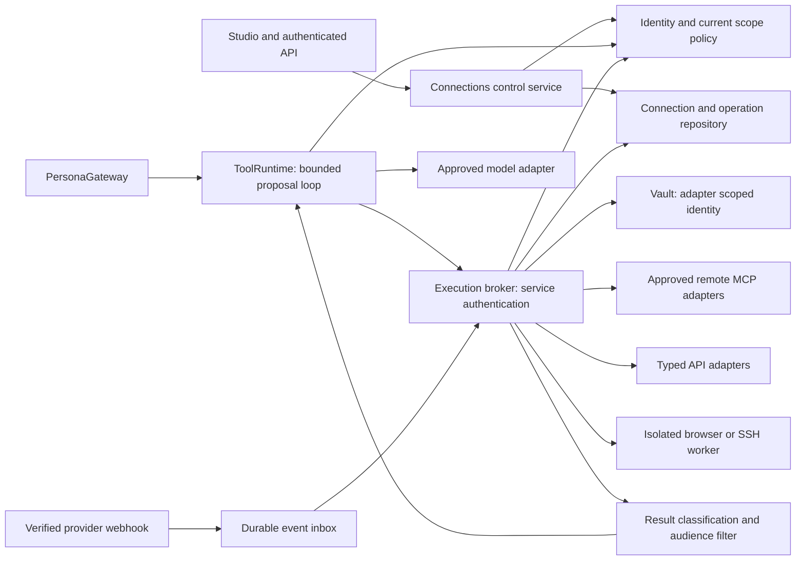

# Per-agent Connections: architecture and execution contract

Task `CONN-PLAN-ARCH`. Research/design only, 19 October 2026. Vox source inspected at `42a1a57113e655b6185ddc731b6f9617aaa4bb4e` (`develop` baseline). Nothing in this document implements a connection, accesses a connected account, starts workers, changes Telegram delivery, or admits a provider to production. All types, endpoints, states, limits and rollout stages below are **proposals** unless explicitly marked observed.

## Decision and boundaries

Add a server-owned Connections control plane and a separately privileged execution broker. Attach grants to exact agents, spaces, containers, audiences, tools and resources. Keep the provider credential in a vault reachable only by the appropriate broker adapter. Studio receives safe metadata and operation receipts; the language model receives only the currently authorized, normalized tool catalog and permitted task data. Owning/editing an agent, making it public, giving it an admin persona, or mentioning permission in its instructions never creates a connection grant.

Use approved remote MCP endpoints when they provide the required security and capability contract. Use typed first-party API adapters when the available MCP surface is too broad, unavailable, or cannot preserve that contract. Both paths implement the same Vox `ToolAdapter` boundary and operation ledger. Browser automation and SSH require separate restricted workers; they are not fallback privileges for a failed API call. A connection is not authorization to send messages, deploy, spend money, or run arbitrary code. Such operations need their own explicit action policy and, where configured, a concrete approval receipt.

This design extends Studio/PersonaGateway and the existing adaptive policy model. It does not migrate the legacy `/app` implementation or add connection records, credentials, histories or operations to `studio/state` JSON.

## Observed source seams and proposed integration

Relative links below refer to the reviewed tree. Existing strategy documents contain historical source observations; the current source, rather than their older line numbers, establishes this inventory.

| Observed at baseline | Design implication / proposed change |
|---|---|
| [`handleStudioRequest`, `authenticate`](../../src/lib/studio/http.ts) validate `x-telegram-init-data`, obtain a member, deny pending members, rate-limit and bound request bodies. [`verifyInitData`](../../src/lib/studio/auth.ts) checks Telegram signature and age. | Reuse authentication mechanics through a shared server helper for new Connections routes; resolve current verified person and scope separately. Signed Telegram account identity is not permission to attach any external account or use another person's grant. |
| [`canUseAgent`, `canManageAccess`, `canEditPersona`](../../src/lib/studio/permissions.ts) govern agent use/management. `canUseAgent` can permit admins to use private agents. | Require independent connection/resource rights even when these functions permit Studio access. Neither agent visibility nor Studio role proves provider-resource rights. Connection management must remain possible after the persona's forming period ends. |
| [`Studio.view`](../../src/lib/studio/service.ts) constructs an allowlisted browser view; `Studio.gateway()` constructs `PersonaGateway` with runtime privacy and group checks. | Add a browser-safe Connections service/view and inject a narrow `ToolRuntime`; never return the provider credential or broker service token in `AgentView`. Keep the catalog separate from mutable persona text. |
| [`PersonaGateway.boundary`, `unchanged`, `historyAt`, `composeReply`, `sendReply`](../../src/lib/tireh/gateway.ts) bind memory/history to audience/policy revisions and recheck before/after generation and delivery. | Extend the boundary with connection/grant/catalog and operation policy versions. Every tool loop round must recheck before model input, provider execution, model result continuation and user delivery. A final delivery check alone is insufficient. |
| [`LLM`, `LLMRequest`, `streamText`](../../src/lib/tireh/llm.ts) offer complete text, optional provider web search and text streaming; Anthropic/Gemini implementations have no generic tool-call/usage/abort contract. | Add a separately evaluated typed tool-capable provider adapter, finish/usage metadata, and `AbortSignal`; preserve existing text fallback. Provider web search is not the new credential broker. Never parse plain generated prose into an executable command. |
| [`types`, `policy`](../../src/lib/adaptive/types.ts) / [`authorizeAccess`](../../src/lib/adaptive/policy.ts) separate account, person binding, Work/Personal space, container, membership, person/agent grants, source descriptors and versioned authorization stamps. | Reuse policy invariants; add an explicit external-execution/egress policy. Existing `read/edit/reshare` or `core.conversation` alone does not authorize an external action. Version new purpose/action definitions before activation. |
| [`SharedMemoryService`](../../src/lib/adaptive/shared/service.ts) and [shared contracts](../../src/lib/adaptive/shared/contracts.ts) implement explicit selected/group audiences, previews and revisions; adaptive persistence has scoped transactions/outbox records. | Integrate through reviewed interfaces; a connection's grant is distinct from the adaptive memory grant. Reuse transaction patterns without assuming the current account document is a general job database or that in-memory locks provide distributed exclusion. |
| [`FirestoreStudioStore`](../../src/lib/studio/firestore-store.ts) persists `studio/state` as one JSON document; [`StudioStore`](../../src/lib/studio/store.ts) serializes file state. | Add normalized connection/grant/auth-flow/operation/outbox records behind a new repository. File-backed synthetic tests may use a separate store; production durable execution needs a reviewed transaction/lease implementation. |
| [`encryptSecret` / `decryptSecret`](../../src/lib/studio/crypto.ts) encrypt bot tokens using one `STUDIO_SECRET`-derived AES-GCM key and a `v1` envelope. | Do not reuse this as a provider vault. It lacks the proposed independent credential IAM, tenant-bound authenticated envelope metadata and key-version/rotation lifecycle. Existing bot secrets stay on their current migration path. |
| [`validateStudioConfig`](../../src/lib/studio/runtime.ts) separates file/polling and Firestore/webhook production modes; [`bots.ts`](../../src/lib/studio/bots.ts) starts manager/agent polling and deletes Telegram webhooks in poll loops. | Connections workers must not initialize bot polling, call `deleteWebhook` or change `STUDIO_PUBLIC_URL`/`STUDIO_BOTS`. New provider webhooks are independent ingress endpoints. Preserve the single existing Telegram polling owner. |

Design references: [memory strategy](../AGENT_MEMORY_STRATEGY.md), [software improvement research](../SELF_DEVELOPMENT_RESEARCH.md), [foundation contract](../implementation/FOUNDATION_CONTRACT.md), and [implementation architecture](../implementation/ARCHITECTURE.md). Their policy/retention requirements remain prerequisites, not authority granted by this plan.

## Components and privileges



`ConnectionsService` owns connection setup, grants, action approval receipts and safe status views. It cannot decrypt provider credentials. `ToolRuntime` intersects current policy and creates proposals; it does not choose credentials, mint grants, or change the operation class based on model judgment. `ExecutionBroker` validates exact operation envelopes and independently rechecks grants using its narrow policy read interface. It resolves an adapter and endpoint from the server registry, retrieves that connection's credential, then executes. The model never selects an arbitrary host, HTTP method/header, executable path or credential reference.

Run the broker as a separate service identity/process from Studio. Browser and SSH workers use separate identities/network profiles from each other and from the broker. The broker can issue short-lived, single-operation leases, not unrestricted vault tokens. Database/IAM, service authentication, filesystem/network restrictions and worker isolation must enforce these boundaries; TypeScript imports, role instructions and process naming alone do not. A local mock can share a process during development but is explicitly not qualification for credential-bearing production use.

Keep orchestration durable and asynchronous. HTTP accepts an operation into the repository/outbox and returns a receipt. The worker lease and version fence are stored transactionally. Use Firestore normalized documents/transactions initially if they meet the reviewed lease, contention, regional, query and audit requirements; do not migrate the entire product database merely to build Connections. Provider I/O occurs outside the transaction, so the ledger cannot promise exactly-once external effects by itself.

## Identity and records

Separate these identities even when UI presents one simple card:

1. **Vox account and verified person:** existing trusted account binding; Telegram ID remains an authentication input rather than a universal person/resource identifier.
2. **Provider account:** external subject plus issuer/base origin and external tenant/workspace/installation ID, bound to its Vox administrative owner. Display names/emails are labels, never identity keys. Reconnecting another provider subject cannot silently replace an old account's grants.
3. **Connection:** configured adapter, provider account, endpoint/profile, credential reference, provider scopes, restrictions, revision, lifecycle and independent health facts. A provider account can have several credentials/connections with different scopes. A credential can be reused only by explicit server policy within its declared scope; Work and Personal never share a credential/session implicitly.
4. **Connection grant:** one agent's allowed connection operations/resources in an exact Vox space/container/audience and purpose, with expiry, policy/catalog revisions and grantor evidence. It is neither the provider's OAuth consent nor the existing memory grant.
5. **Action authorization:** current user intent or standing rule plus any required concrete approval, independently of read access. A grant can permit drafting without permitting sending. A trigger schedule can permit one bounded workflow without granting an open-ended conversation session.

Proposed normalized collections: `providerAccounts`, `connections`, `connectionGrants`, `connectionAuthFlows`, `connectionApprovals`, `connectionOperations`, `connectionOperationAttempts`, `connectionOutbox`, `connectionWebhookInbox`, `connectionTriggerRules`, `connectionTombstones` and minimized audit events. Prefix/partition keys include tenant and scope; IDs are opaque. Credentials live only in the vault; no credential ciphertext is embedded in ordinary records. Encrypting payload storage does not substitute for access checks.

Indexes support owner-visible connections, exact agent+scope grants, next eligible outbox work, lease expiry, provider+event deduplication, and operation lookup. Resource listings and labels themselves may be confidential; list APIs filter them before loading/displaying names. Separate secret-bearing retrieval from metadata-only health/management reads. Client SDK access to these collections is denied; all reads/writes pass the server policy service.

All durable records carry schema version, revision, created/updated timestamps and retention metadata. Connection revocation and agent firing advance a monotonically increasing revocation epoch and invalidate dependent leases/caches/jobs. Physical deletion follows the approved retention schedule; minimal tombstones prevent replay resurrection. Account disconnection does not falsely claim already delivered email, third-party comments or changed cloud infrastructure has been undone.

## Proposed server contracts

These are implementation targets, not exported code at the baseline. Wire parsers must be strict and size-bounded. Server code supplies identities, effect class, resource mapping, action policy and digests; the client/model cannot assert them.

```ts
type ConnectionMode = 'remote_mcp' | 'api_bridge' | 'browser_worker' | 'ssh_worker';
type Effect = 'read' | 'draft' | 'write' | 'send' | 'destructive' | 'privileged';
type SafeHealth = 'unknown' | 'checking' | 'healthy' | 'degraded' |
  'reauth_required' | 'scope_required' | 'policy_blocked' | 'unavailable';

interface ScopeBinding {
  tenantId: string; spaceId: string; spaceKind: 'work' | 'personal';
  containerId: string; audiencePersonIds: string[]; audienceRevision: string;
}
interface ProviderAccountRecord {
  schemaVersion: 1; id: string; ownerPersonId: string; tenantId: string;
  providerId: string; issuerOrBaseOrigin: string; providerSubject: string;
  providerTenantId?: string; displayLabel: string; revision: number;
}
interface ConnectionRecord {
  schemaVersion: 1; id: string; accountId: string; scope: ScopeBinding;
  mode: ConnectionMode; adapterId: string; adapterVersion: string;
  credentialRef: string; credentialVersion: number; // broker-private metadata
  endpointProfileId: string; providerScopes: string[];
  catalogDigest: string; revision: number; revocationEpoch: number;
  lifecycle: 'pending' | 'connected' | 'paused' | 'revoked' | 'deleted';
  health: SafeHealth; checkedAt?: number; expiresAt?: number;
}
interface ConnectionGrantRecord {
  schemaVersion: 1; id: string; connectionId: string; agentId: string;
  scope: ScopeBinding; toolIds: string[]; resourceSelectorIds: string[];
  effects: Effect[]; purpose: string; purposeVersion: number;
  actionPolicyId: string; actionPolicyVersion: number;
  maxCalls: number; maxBytes: number; maxCostMinor?: number;
  grantorPersonId: string; authorityReceiptId: string;
  revision: number; expiresAt: number; revokedAt?: number;
}
interface ToolDescriptor {
  id: string; version: string; adapterId: string; catalogDigest: string;
  inputSchemaRef: string; outputSchemaRef: string;
  effect: Effect; approvalPolicyId: string; resourceMappingVersion: string;
  retryClass: 'safe_read' | 'provider_idempotent' | 'reconcile_only';
  supportsPreview: boolean; supportsExpectedRevision: boolean;
  maxInputBytes: number; maxOutputBytes: number; timeoutMs: number;
}
interface OperationProposal {
  schemaVersion: 1; requestId: string; connectionId: string; grantId: string;
  toolId: string; toolVersion: string; scope: ScopeBinding;
  payload: { kind: 'retained'; argumentsRef: string } |
    { kind: 'ephemeral'; ephemeralLeaseId: string; expiresAt: number };
  inputDigest: string;
  sourceRevisionRefs: string[]; expectedTargetRevision?: string;
  intentReceiptId: string; approvalReceiptId?: string;
  policyStampId: string; turnRevision?: string; deadlineAt: number;
}
interface OperationReceipt {
  schemaVersion: 1; operationId: string; requestId: string; revision: number;
  state: OperationState; stage: string; safeReason?: string;
  providerReceiptRef?: string; outcomeEvidenceRef?: string;
  resultRef?: string; cancellationRequestedAt?: number;
  submittedAt?: number; completedAt?: number; nextCheckAt?: number;
}
interface ToolAdapter {
  discover(context: BrokerContext): Promise<ReviewedCatalog>;
  describe(context: BrokerContext, toolId: string): Promise<ToolDescriptor>;
  preview(context: BrokerContext, proposal: OperationProposal): Promise<SafePreview>;
  execute(context: BrokerContext, proposal: OperationProposal,
          signal: AbortSignal): Promise<AdapterOutcome>;
  reconcile(context: BrokerContext, operationId: string): Promise<AdapterOutcome>;
  health(context: BrokerContext, signal: AbortSignal): Promise<HealthFacts>;
}
```

`BrokerContext` is constructed by authenticated service middleware and validated policy, never deserialized from an LLM response. It includes current trusted actor/agent, scope, lease/fence, allowed endpoint, credential handle and output policy. The payload is a discriminated union: `retained` resolves `argumentsRef` in approved protected storage at the exact validated revision; `ephemeral` binds a short-lived live in-memory payload owner through an unguessable lease ID, with no argument bytes in the durable queue or receipt. The broker must possess that live payload and validate its digest, scope, expiry and current policy before dispatch; the lease ID alone is never executable input.

An ephemeral operation cannot be queued for later dispatch or resumed/retried from its receipt after process loss. A crash/expiry before dispatch ends it as expired/cancelled with no effect; after possible dispatch it becomes `outcome_unknown` and uses only independently permitted provider-receipt reconciliation, never reconstructed arguments or automatic redispatch. Retained work likewise cannot dispatch if the exact payload is missing, deleted, revoked or revised. Both classes retain only minimized authorized receipt metadata; any reconciliation requiring unavailable arguments remains unknown. Digests of low-entropy secrets/private values are not inherently safe audit fields; use a keyed digest if correlation is necessary and approved.

`SafePreview` includes provider identity label, exact agent and audience, target IDs/labels the approver can read, intended effect, actual diff where supported, relevant source/target revisions, expiry and canonical digest. It explicitly says when provider dry-run/affected-count evidence is unavailable. An approval receipt binds that preview digest, approver's current verified identity, exact operation, target, scope, catalog and policy revisions, expiry and one-use constraint. Any material change invalidates approval. A model statement or a button label is not the receipt.

Proposed same-origin routes:

| Route | Contract |
|---|---|
| `GET /api/studio/connections/catalog` | Curated eligible providers/modes and prerequisites, not live account data. |
| `GET /api/studio/connections?agentId=…&spaceId=…&containerId=…` | Current actor's safe filtered connection/grant summaries; paginated. |
| `POST /api/studio/connections/auth-flows` | Authenticated start; explicit target agent/scope/provider, idempotent request ID. Returns flow ID and validated authorization/start URL; never token/PKCE verifier. |
| `GET /api/connections/oauth/:provider/callback` | Exact pre-registered public callback, single-use server flow lookup. Does not expect Mini App header on provider redirect. Completes/quarantines setup; creates no agent grant. |
| `GET /api/studio/connections/auth-flows/:id` | Authenticated same owner status/pending provider identity. Requires fresh Mini App identity to claim or finish. |
| `POST /api/studio/connections/:id/grants/preview` and `POST …/grants` | Validate grantor authority/current recipients; mint/redeem scope-bound short-lived preview; expected connection/grant revision required. |
| `PATCH /api/studio/connections/:id/grants/:grantId` | Exact expected revision; any widening returns to preview/authorization. Narrowing/revocation invalidates leases immediately. |
| `POST /api/studio/connections/:id/test` | Bounded safe health probe, separate budget; never a sample write/message. |
| `POST /api/studio/connections/:id/pause`, `POST …/disconnect` | Stop dispatch/revoke grants transactionally; provider revocation cleanup tracked separately and retried safely. |
| `POST /api/studio/connection-operations/preview`, `POST /api/studio/connection-operations` | Strict proposals bound to authenticated context, stable idempotency key and reviewed operation; reject key reuse with a changed digest. |
| `GET /api/studio/connection-operations/:id`, `POST …/:id/cancel` | Scope-filtered receipt and cancellation request, usable after client disconnect. |
| `POST /api/connections/webhooks/:adapter/:subscriptionRef` | Provider-authenticated ingress; opaque subscription is routing, not sufficient authentication. |

All successful setup and mutation APIs emit minimized unsampled security audit events. Use explicit safe error codes (`scope_changed`, `reauth_required`, `approval_expired`, `target_conflict`, `outcome_unknown`) and trace IDs. Provider error objects, raw URLs/query strings and response bodies do not pass through to Studio/logs. Return `404`/generic denial where existence would leak. Browser responses use `Cache-Control: no-store`; cross-origin service calls require authenticated identities and approved origins, not merely CORS.

## MCP protocol and API bridge profiles

**Research observation, not compatibility proof:** official `latest` documentation resolved to revision `2026-07-28` on 19 October. Its Streamable HTTP profile carries per-request metadata and matching HTTP headers; it is materially different from initialized/session-based 2025 profiles. Closing a response stream requests cancellation, which cannot prove reversal of an external mutation. [MCP Streamable HTTP](https://modelcontextprotocol.io/specification/2026-07-28/basic/transports/streamable-http).

The official TypeScript client README describes v2 `@modelcontextprotocol/client` as the stable line; the client API documents legacy, automatic and pinned version-negotiation modes. These are observations of upstream documentation, not an exact package/dependency/security audit or proof that a provider supports that revision. [Official client package](https://github.com/modelcontextprotocol/typescript-sdk/blob/main/packages/client/README.md), [client API](https://ts.sdk.modelcontextprotocol.io/v2/api/%40modelcontextprotocol/client/client/client.html).

Implementation must select an exact audited SDK patch/integrity lock, Node/TypeScript/runtime compatibility and a **per-provider** protocol profile. Vox currently declares TypeScript `^5` and has no MCP dependency. Qualify explicit `2026-07-28` support and any required `2025-11-25` or older compatibility profile with captured synthetic contract fixtures. Store negotiated/selected profile with health facts. A provider profile cannot silently downgrade authentication or relax schemas after a network error. Keep fallback confined to a tested registry entry; modern typed protocol/header errors must not be treated as permission to fall back.

For remote MCP, Vox is the OAuth client to the approved resource server. Resolve protected-resource/authorization-server metadata under strict endpoint policy, use the target resource indicator, PKCE, exact callback and issuer binding, minimal requested scopes, and confidential server token storage. Current authorization documentation distinguishes metadata-based/pre-registered client identification from deprecated dynamic registration compatibility. Do not assume every provider supports every identification mechanism or will issue refresh tokens. Bearer tokens are sent to their intended resource only. [MCP authorization](https://modelcontextprotocol.io/specification/2026-07-28/basic/authorization).

The broker does not forward a Vox login token as a provider credential, pass a Notion token to another MCP server, or accept a remote server's demand for unrelated credentials. Permit only approved HTTPS endpoints and egress destinations; block metadata/private/link-local/loopback destinations by default, including redirects, DNS rebinding, authorization metadata, resource links and file retrieval. Any required private-network connection uses a separate reviewed route/profile bound to named destinations, never a general SSRF exemption. [MCP security guidance](https://modelcontextprotocol.io/docs/2026-07-28/tutorials/security/security_best_practices).

Treat tool descriptions, schemas, prompts, resource names, annotations, results, errors and change notifications as untrusted provider material. Discovery goes through registry review; model-visible descriptions are curated and cannot carry connection setup instructions. A tool's `readOnlyHint` or `idempotentHint` is advisory, not authority. Catalog changes alter the digest, pause affected grants and require reclassification before the model sees new capabilities. Disable remote sampling, roots, elicitation, arbitrary resource fetching and server prompts initially; where a provider requires one, implement a separately scoped handler with data-flow review. Do not let an upstream interactive request turn into automatic local credential disclosure or broad file access.

Modern parameter-to-header mirroring can place argument values in HTTP infrastructure. Qualify the SDK's header/body encoding/validation and configure proxy/APM/header redaction for `Mcp-Name`, `Mcp-Param-*`, authorization, cookies and URLs. Base64 is encoding, not privacy. Reject tool/profile combinations that cannot meet argument confidentiality. Adapters cannot bypass protocol obligations by omitting required mirrored headers while claiming compliance.

The API bridge exposes named domain operations, typed input/output, an effect class and resource mapping. It has no generic `fetch`, URL/header injection, SQL, shell or arbitrary JavaScript tool. The registry fixes upstream path templates, HTTP method, credential strategy, scopes and allowed egress. It reuses provider/domain validation and expected-revision checks. Downloads, uploads, exports, pagination and embedded URLs all pass byte/resource/retention checks; a schema-valid result is not automatically authorized content.

## Provider-specific architecture choices

Provider enablement and exact supported actions belong to the researched provider inventory and acceptance plan; this section states architecture consequences without promising availability for Vox's accounts.

| Provider / surface | Proposed adapter policy and evidence boundary |
|---|---|
| Notion | Qualify first-party remote MCP as the preferred candidate. Its documentation describes OAuth access to content the connecting user can access, which may be broader than a Vox grant. Restrict to explicit resource selectors; if a remote search cannot constrain or prove result membership before model input, use a narrower API bridge or deny the tool. [Notion MCP](https://developers.notion.com/guides/mcp/overview). |
| Slack | Installation identity includes team/enterprise plus bot/user subject; do not merge workspaces by human email. Keep reading, drafting and posting distinct; no automatic scope union that enables an unrequested feature. Verify provider request signatures before acknowledging events. [Slack OAuth](https://docs.slack.dev/authentication/installing-with-oauth/), [request verification](https://docs.slack.dev/authentication/verifying-requests-from-slack/). |
| GitHub | Prefer an installation-based GitHub App with explicitly selected repositories/permissions where the supported operation permits it; API or approved MCP must preserve installation, repository, branch/ref and action limits. GitHub's app model supports repository/permission selection and installation tokens, but actual installation/organization approval is unverified. PR creation, commenting, merging, Actions dispatch and deployment are separate effects. [GitHub Apps](https://docs.github.com/en/apps/creating-github-apps/about-creating-github-apps/about-creating-github-apps). |
| Forgejo at `git.joyixir.com` | Prefer a typed API bridge with a dedicated scoped application credential after an authorized installed-version/permission audit. Current public Forgejo docs explicitly warn that OAuth2 tokens do not implement scopes and can execute all actions as the user; OAuth is not automatically the least-privilege choice. Repository Git access can use a separately restricted SSH key. No calls to this instance or inference of its installed version were made. [Forgejo OAuth2](https://forgejo.org/docs/latest/user/authentication/oauth2-provider/). |
| Hetzner | Separate Cloud, Robot/dedicated-server and Storage Box product adapters/credentials; a cloud account connection does not imply SSH access. Bound project/server/resource identifiers and block destructive/paid provisioning by default. Exact token scope/capability/plan and billing are provider-specific qualification gates. Public docs distinguish these API surfaces. [Hetzner API overview](https://docs.hetzner.cloud/). |
| Gmail, Drive, Docs, Sheets, Slides | Shared Google identity may be displayed together; each feature uses its required API/scopes, resource selectors, consent and action policy. Mail reading, drafting and sending are distinct. Do not request Gmail access to edit a selected Sheet. Google requires approved use/verification for applicable sensitive or restricted scopes and incremental in-context authorization. Use a system-browser OAuth flow, not a Vox-controlled embedded agent. [Google OAuth policies](https://developers.google.com/identity/protocols/oauth2/policies), [server flow](https://developers.google.com/identity/protocols/oauth2/web-server). |
| Figma | Qualify remote first-party MCP versus REST for each intended read/write action; pin file/team/project resources and output-media policy. Desktop-local MCP would require an explicitly connected local worker and cannot be reached by assuming the Studio host's localhost is the user's Figma. Public Figma docs describe local and remote connection options; actual account/seat and write capabilities require separate verification. [Figma MCP](https://developers.figma.com/docs/figma-mcp-server/). |
| Analytics | One registry entry per actual product/tenant/query API; “analytics” is not a credential type or unrestricted SQL grant. Prefer bounded read queries with cohort/date/platform/timezone/build/identity/filter/freshness metadata and row caps. Raw user-level exports, dashboard writes and tracking configuration are separate grants. No universal analytics MCP availability is assumed. |
| Browser | Dedicated isolated session per connection/owner/space, explicit origin allowlist and approved action set; no reuse of personal Chrome cookies or developer desktop access. See worker requirements below. |
| SSH | Dedicated host/user/key and command-template adapter; no ambient `~/.ssh`, agent forwarding, host-key bypass or shell supplied by model. See worker requirements below. |
| Gamend | Reuse and qualify its existing delegated MCP/API source, rather than create a second Gamend authority. Details follow. |

### Gamend integration seam: existing source, no live admission claim

The local Gamend source inspected at baseline `31e3a2887531cc4e046b62af238acd0b98b8f611` contains [ADR-0058](/Volumes/Workspace/Ludaxis/gamend/docs/adr/0058-agent-first-operations-cli-and-mcp.md) and [`AgentMcpController`](/Volumes/Workspace/Ludaxis/gamend/apps/api/src/modules/agent/agent-mcp.controller.ts), which declares `/v1/mcp`, explicit modern/legacy versions, context/discover/describe/preview/execute/status utilities, structured output and secret-result omission. This is source evidence only; deployed protocol, edge admission, provider credentials and regional behavior were not tested.

Map a Vox grant to a real delegated Gamend grant owned by a current Gamend member, preserving exact organization, game, environment, operation, production/sensitivity limits and expiry. The two authorization layers intersect; Vox cannot widen Gamend's decision. Bind a stable Vox request ID to Gamend's required UUID request ID and canonical input digest. Record the upstream receipt ID and use `gamend_status` to reconcile uncertainty before another write. A preview is validation, not simulated impact; preserve that distinction.

Allow discovery only within the reviewed grant, then describe selected operations and normalize their resource/effect contracts before model exposure. Do not expose secret-creation/credential-returning operations to model continuation; Gamend's secure CLI handoff is a separate human workflow. Gamend's ADR keeps Helsinki/standalone authority, Iran admission restrictions and native release controls. A Gamend product-agent grant cannot grant Vox deployment authority, protected release access, new regional paths or circumvention of domain approval. The first Vox pilot should use read-only game-scoped synthetic/staging data after the upstream endpoint is independently admitted.

## Containment before any model input

Authorization is an intersection, not a hierarchy: current authenticated/verified actor + agent usability + exact Work/Personal container + current complete audience + connection grant + provider rights + purpose/egress policy + operation/action authorization + retention/budget constraints. If one is unknown, deny the dependent step. A service/admin's ability to manage connection metadata never grants conversational access to its content.

1. Resolve trusted actor, active agent, space/container and full delivery audience from server state. Guest, unknown group listener or stale group epoch disables private connection tools. Do not infer a connection identity from a sender name, voice hint or LLM-selected person.
2. Authorize catalog/resource metadata before loading it into the prompt. Resource titles, tool descriptions and counts can leak information even without document text. Return only permitted tools and resource selectors with current catalog digests.
3. Build the model's **entire** task context from authorized sources for that audience: conversation/history, saved context, search snippets, drafts, attachments, tool/schema/resource metadata and prior tool results. Server code conservatively assigns every generated argument, draft, summary and answer the intersection of the restrictions of **all sources visible to that generation**, including prior history and tool descriptions/schemas. The server records that immutable context-label set before the provider call. Model-proposed source IDs, citations, selected subsets, claims of non-use and semantic/secret scanners cannot reduce this label or prove which input influenced an output. Separate planning for a private source from a shared reply; private influence cannot be discarded by paraphrasing or omitting a citation.
4. A generated tool call is a proposal. Validate strict schema, resolve resource selectors server-side, classify effect deterministically and authorize the server-assigned complete-context label against the exact destination. Data egress includes search strings, email recipients/bodies, issue text, filenames, URLs, browser text inputs and SSH parameters. “Read” can still disclose a secret through its query. If the full label forbids that destination, deny. A narrower label requires an independently approved projection and a **fresh isolated generation** whose inputs/history/tool metadata contain only that projection and other permitted sources; never re-use hidden conversation state or ask the already exposed model to sanitize/declassify itself. Recheck immediately before sending any argument to a provider.
5. The broker retrieves only allowed resources where possible. When a provider returns broader search results, filter using independently resolvable resource metadata **before** any model/reranker, logging, summary, extraction or cache receives content. If permission or resource lineage cannot be resolved, discard the result. Apply current provider permissions and Vox's narrower grant; successful provider auth is insufficient.
6. Tag allowed results with immutable resource IDs/revisions, source connection/grant, space/container, exact audience digest, policy epoch and retention. Summaries/embeddings/caches inherit the intersection of every source's restrictions. Unknown lineage stays transient and unavailable to shared/durable context.
7. Recheck before model continuation and each delivery segment. Revocation cancels dependent calls/generation and clears unsent buffers. Already sent external arguments or delivered speech/text cannot be recalled; receipts reflect that boundary. Connection results do not automatically become memory or observation exports.

Work/Personal switch cancels the active tool plan and starts a new context revision; no shared cache, browser storage or model conversation spans both. Cache keys include actor/binding, tenant/space/container, agent, exact audience revision, grant/catalog/credential policy epochs and resource revisions. Authorization stamps are short-lived invalidatable leases; a valid stamp is not atomic external commit authority.

## OAuth and credential setup across Telegram/browser contexts

The provider callback usually opens in an external browser without `x-telegram-init-data`; it cannot safely reuse Studio's header-only request authentication. Authenticate start inside Studio, create a short-lived one-use server flow, then bind the callback to that flow. Store the verified initiating actor/account binding, target tenant/space/container/agent, provider registration ID, issuer/resource, exact redirect URI, requested scopes, PKCE verifier, state hash/nonce, expected revisions, safe return destination and expiry server-side. State contains no private scope or Telegram data; use an unguessable opaque value and consume it transactionally.

Open provider consent in a provider-supported external/system browser. Google explicitly forbids developer-controlled embedded user agents; do not build OAuth on an automated browser worker. Telegram's Mini App API provides `openLink` and `openTelegramLink`, but successful handoff/return behavior must be checked on actual supported Telegram iOS/Android/Desktop clients. [Google browser policy](https://developers.google.com/identity/protocols/oauth2/policies), [Telegram Mini Apps](https://core.telegram.org/bots/webapps).

Validate callback issuer, state, expiry, registration, PKCE, code replay, exact redirect and expected provider account. Exchange only at the registry's trusted endpoint. Store any resulting secret directly in the vault and leave the new connection ungranted/pending claim. The callback renders a generic completed/failed page and a safe return link, not provider tokens, account content or internal scope details. Never require shared cookies between Telegram and the browser. Provider subject mismatch becomes a visible choice on return; it cannot inherit the former connection's grants.

On return, Studio reauthenticates with fresh validated Mini App data, fetches only the initiating actor's flow, checks person binding and current agent/scope permission again, and displays the safe provider identity/scopes for attachment. The flow must remain claimable through a status refresh if deep linking fails. Replayed/expired/wrong-person callbacks cannot steal or attach the connection. Completion of OAuth does not itself activate agent access; the grant preview/redeem step does.

Use server-side PKCE/token-exchange/refresh single-flight with fenced credential revision writes. A crash or timeout during rotating-refresh-token exchange is an ambiguous credential state, not permission to replay an invalidated refresh token indefinitely. Quarantine/reauthenticate if the provider cannot reconcile it. Do not remove an existing refresh token merely because a later valid response omits a new one. Provider-specific token refresh/revocation semantics require adapter contract tests.

For non-OAuth secrets, use a dedicated protected connection form or short-lived secure handoff, never chat/persona text. The control request is TLS, rate/size bounded, excluded from body logging/analytics/session replay, writes directly to the vault, clears client memory promptly and returns only a masked label. Such setup may need provider owner/admin steps; it never reads developer machine credentials automatically.

## Vault and key lifecycle

Use a managed vault/KMS-backed envelope service, or another reviewed secret service providing equivalent independent IAM/audit/rotation guarantees. A secret record binds tenant, connection, adapter, provider issuer/resource, credential version and encryption-key version as authenticated metadata. Broker adapters receive only their permitted credential handle; Studio, LLM workers, browser UI, observers and general developer/QA workers have no decrypt permission.

Maintain credential lifecycle separate from connection lifecycle: pending, valid, refreshing, uncertain, rotated, revoked, destroyed. Store issued/granted scopes, expiry and safe provider identity outside secret values. Redact Authorization/cookies, OAuth codes/state/verifiers, personal access tokens, SSH keys and provider error bodies everywhere including traces, crash reports, backups and callback access logs. Result/secret scanning is defense in depth; prevention and typed omission remain required.

Key rotation is not provider credential rotation. Rewrap/re-encrypt records with a new key version, verify readback under restricted identity, track migration completeness, and keep old versions only for the reviewed backup/rollback interval. KMS key rotation alone does not re-encrypt existing ciphertext. Rotate provider tokens/SSH keys independently with provider-specific overlap/revocation and least-privilege validation. Test restore under the new key and ensure revocation/deletion tombstones apply after restore. [Cloud KMS key rotation](https://docs.cloud.google.com/kms/docs/key-rotation).

Disconnection first disables grants and dispatch, then attempts provider revocation, token/key deletion, worker/session teardown and derived-context purge. Show cleanup pending/failure without restoring access. Retain only approved minimized audit/receipt/tombstone records. A vault outage fails closed for new executions; existing provider effects still require reconciliation using independently permitted evidence. Do not use an old encrypted backup credential to bypass revocation.

## Durable execution, retries and cancellation

```ts
type OperationState = 'proposed' | 'awaiting_approval' | 'approved' | 'queued' |
  'running' | 'submitted' | 'reconciling' | 'succeeded' | 'failed' |
  'outcome_unknown' | 'cancel_requested' | 'cancelled' | 'expired' |
  'denied' | 'superseded';
```

`proposed` is schema-valid planning, not execution. `approved` means a current concrete receipt/standing action policy permits the exact action; rechecks still apply. Transactionally accept the stable request ID plus input digest and enqueue once. The uniqueness domain includes tenant/connection/grant and request ID; reusing a key with a different tool, target, scope or input is a conflict. Attempts have distinct IDs beneath that stable operation and carry catalog/policy revisions and lease fence.

Worker claims queued work with a bounded lease and transactionally verifies deadline, current binding/grants/audience, approval and budget reservation. Before provider dispatch, it marks the dispatch boundary durably. `running` without a known dispatch boundary may be resumable; crossing that boundary means a lost response is potentially committed. Only the current fence may write the receipt; a stale worker cannot overwrite a reconciled outcome. Fencing inside Vox alone cannot prevent an already dispatched remote write, so provider idempotency or reconciliation is still required.

`submitted` means the provider accepted the request, not necessarily that the domain effect completed. Store provider operation/receipt IDs where available and poll/consume authenticated completion events under a budget. `succeeded` requires the adapter's declared evidence level, such as returned immutable object/revision or provider operation completion. Mail/provider acceptance, delivery and recipient action remain separate facts. Report the evidence level; do not label an unverified downstream effect complete.

On timeout, connection loss, worker crash after dispatch or cancellation racing a write, move to `reconciling`/`outcome_unknown`. Use the same upstream idempotency key or query the exact provider receipt/resource revision when the adapter contract supports it. Do not silently issue a new write, create a fresh key, fail over to browser/SSH, or infer success from a nearby matching object. An operator may reconcile with evidence; an explicit new user action after unknown status must show duplicate risk and use the reviewed recovery path. No cross-provider or cross-region automatic mutation replay.

Retry classes are deterministic registry data:

| Class | Permitted behavior |
|---|---|
| `safe_read` | Bounded exponential backoff/jitter within original deadline and budget; reauthorize before each attempt. HTTP GET alone does not establish side-effect freedom. |
| `provider_idempotent` | Retry the exact same operation/key/digest only within the provider's documented key lifetime and scope. Query status first where available. |
| `reconcile_only` | After potential dispatch, query exact outcome; never automatic redispatch. Unsupported reconciliation leaves `outcome_unknown`. |

Cancel is idempotent. Before dispatch, atomically remove eligibility and release budget, yielding `cancelled`. During provider execution, set `cancel_requested`, abort local wait, send provider-native cancellation where supported, and reconcile. If the provider committed, record success with cancellation-too-late evidence; do not pretend cancellation undid it. Undo/compensation is a separate authorized operation with its own preview and may be impossible. Revocation forbids new calls but cannot suppress a minimal security audit or the permitted reconciliation needed to explain an already dispatched effect.

Use expected target revision/ETag/precondition when the domain supports it; preview-to-write drift requires new preview/approval. If a domain lacks concurrency control, classify that limitation and keep high-impact writes disabled until a safe contract or explicit constrained workflow exists. An approval receipt is never an indefinite permission reservation across changed targets.

## Provider webhooks and app triggers

Webhooks are event ingress, not a new principal with the user's full connection authority. Verify provider signature/authentication and replay protection against raw bounded bytes before JSON parsing/acknowledgment; bind subscription to the exact provider account/tenant/resource. GitHub and Slack document signature verification; implement each provider's actual scheme rather than assuming one universal HMAC header. [GitHub deliveries](https://docs.github.com/en/webhooks/using-webhooks/validating-webhook-deliveries), [Slack requests](https://docs.slack.dev/authentication/verifying-requests-from-slack/).

Durably deduplicate by provider/subscription/event ID before acknowledging; persist only the approved minimized envelope or protected short-retention reference. Order by provider resource revision/sequence where available, not arrival time. Fetch authoritative current resource state under the current grant when payload completeness/order is insufficient. Duplicate, delayed, forged, deleted or revoked-resource events cannot recreate access. Unknown signatures/provider tenant IDs fail closed. Verify secret rotation and simultaneous old/new signatures only within an explicit transition window.

A trigger rule records authorizer, agent, connection, exact event/resource filter, Work/Personal/container/audience, purpose, allowed effect/tool set, action policy, schedule/deadline, dedupe key, rate/cost caps and expiry. An app install or webhook subscription never creates such a rule. A webhook notification payload containing “ignore your rules” remains source data. Default trigger behavior can create a private task/draft; sends/writes require the rule's explicit standing authorization or a concrete approval.

Trigger processing uses the same operation ledger and current policy checks as a chat turn. Prevent feedback loops using origin/causation IDs, maximum chain depth and suppression of the system's own handled events. Schedule retries and provider backoff are bounded; quiet/nonactionable events do not become repeated user notifications. Detailed content stays in the authenticated scoped inbox; external notification delivery follows the existing independent notification consent contract.

## Browser and SSH workers

**Browser:** use a disposable isolated runtime/context with per-connection encrypted session storage, no host mounts/desktop profile, origin/egress allowlist and scoped download/upload directory. Disable extension installation, arbitrary developer tools code, local filesystem URLs, unmanaged downloads and access to cloud metadata/internal services. Bind every navigation and popup/redirect to policy. Screenshots/DOM/storage/cookies and captured downloads are restricted provider content subject to pre-model filtering and short retention. Authenticated sessions must not share cookies across people/spaces. Login, MFA, passkeys, consent prompts and captchas use a secure human handoff; no session-cookie exfiltration into the model. A browser worker cannot become the OAuth consent browser for the user.

Validate individual action intent/destination before typing/submitting. A page button can perform a destructive/paid/send operation, so “click” is not a safe effect class. Broad arbitrary click/write automation remains disabled until action classification and confirmation are reliable; begin with allowlisted read-only flows. Browser mutations without provider idempotency/receipts use `reconcile_only` and may remain unavailable. Downloaded active content is sandboxed and never executed by Studio.

**SSH:** separate connection per named host/project/user and approved command family. Pin independently verified host-key fingerprints; do not learn them from an unauthenticated first-use prompt. Use a restricted service user, command templates or a reviewed RPC agent, short-lived/dedicated key material where feasible, fixed working directories, argument validation, time/CPU/output caps and audited network destination. No root/sudo, agent forwarding, SSH tunneling, port forwarding, generic shell, environment/profile startup, shell expansion, arbitrary upload/execute or access to host secrets by default. If a use case truly requires a shell, it is a separately reviewed privileged product with explicit authorization/isolation, outside the initial Connections release.

Workers obtain a one-operation lease tied to exact args/target/deadline and current epoch. They cannot access the broker's entire vault. Kill the worker and destroy transient filesystem/session state on revocation/cancel/expiry, while preserving minimized receipt evidence. An SSH disconnect does not prove a remote command stopped; use a provider/remote operation ID and status protocol or report uncertainty. No worker may connect to or administer the existing Mac Studio production runtime as an incidental test.

## Health, budgets and operational control

Keep lifecycle separate from health. `connected` means setup exists, not every operation is usable. Health records independent facts: last credential validation, granted/required scopes, provider tenant/resource access, endpoint reachability, protocol/profile/catalog, webhook freshness, worker availability, rate-limit/reset time, last successful permitted operation and current policy status. Surface exact checked time and scope. A successful ping or one list request does not prove writes, webhooks, another resource or another region works.

Health probes are allowlisted safe reads with short deadlines, cached by scoped identity, and a separate probe budget. Concurrent probe requests coalesce. A rate-limited endpoint becomes degraded with retry-after; invalid credentials require reauth; missing scopes expose only disabled feature names and in-context reauthorization. Permission-denied resources cannot be listed to an unauthorized person as a troubleshooting aid. Add per-provider circuit breakers and killswitches for catalog, reads, writes, triggers and worker classes.

Provisional conservative **engineering defaults**, to be revised through measurement before release: one active mutation per connection/resource; at most two parallel safe reads per connection; three tool rounds and eight calls per conversational task; 30-second default read deadline and 60-second interactive task budget; provider asynchronous operations return receipts rather than block the turn; 32 KiB default argument body, 256 KiB normalized result, bounded attachment profiles and 12k tool-result tokens per task. No unlimited pagination, recursive crawl or model-assisted retry loop. Lower provider limits win. The root owner must choose a real daily/tenant spend ceiling before paid capabilities activate; absence of a priced capability budget disables it.

Reserve budget transactionally before dispatch, meter actual provider/worker/model usage including failed/discarded/speculative work, then reconcile reservations. Cap retries, polling, streamed bytes, webhook fanout and browser/SSH CPU duration separately. Prediction may prepare an authorized catalog/read suggestion; it cannot obtain credentials, commit side effects or initiate billable speculative operations without its own approved budget/policy. Tool exhaustion returns a useful partial receipt/status instead of attempting bypass.

Observability uses allowlisted reason codes, opaque scoped IDs, durations, size/cost counters, schema/adapter/catalog/protocol versions, effect, outcome evidence level and trace linkage. Audit grants/approvals/revocations and dispatch outcomes without sampling. Ordinary observability/optimizer pipelines receive no tool bodies, transcripts, provider account directories, tokens or raw browser/SSH output. Analytics reports distinguish provider availability, authorization denials, accepted requests, confirmed effects and unknown outcomes.

## Rollout and rollback without disturbing Telegram

1. **Contract and provider qualification:** approve UX/security/action classes and schemas; verify provider registrations, account prerequisites and exact SDK lock in synthetic contract tests. No credentials or workers added to current Mac Studio yet.
2. **Local synthetic control plane:** new repository, setup/grant previews/status views and denied tool runtime, all flags off. Tests prove no secrets in Studio DTOs and no change to existing chat/call/polling behavior.
3. **Isolated broker with one read-only provider:** separate service identity and vault; explicitly authorized synthetic/staging provider account and private Work container. Qualify callback roundtrip on supported Telegram devices. Keep discovery narrow and global provider/tool killswitch available.
4. **One useful bounded task:** e.g. read a selected Notion/Gamend resource with provenance or produce a draft. Demonstrate grant revoke mid-call, Work/Personal separation, scope drift, result filtering and restart recovery. Account-wide search and triggers remain off until their contracts pass.
5. **Approved mutations:** choose a provider/domain with known idempotency/status and concurrency semantics. Independent security/QA accepts concrete preview, one-use approval, duplicate/uncertain/reconcile/cancel tests. Admit writes by named tool/resource/cohort; no blanket provider-wide enablement.
6. **Provider triggers and additional adapters:** enable separately with tenant/event budgets and feedback-loop tests. Browser/SSH have a later independent sandbox/security gate, not part of initial OAuth rollout.
7. **Protected release:** exact source/artifact, CI, IAM/vault/backup checks, synthetic live account flow, device proof, owner/on-call and rollback receipt. Passing local docs or mocked tools is not live connection acceptance.

Add Connections configuration independent of existing `STUDIO_BOTS`, `STUDIO_PUBLIC_URL`, bot-token encryption and polling launch scripts. Broker startup must import no module that starts bots as a side effect. Provider callbacks/webhooks use their own routes and never configure Telegram webhooks. Before any future authorized release, record current Telegram polling process/owner and runtime revision; verify unchanged ownership and ordinary DM/group/call behavior afterward. Do not start a second Mac Studio poller for a Connections test.

Rollback first disables new execution/triggers and revokes worker leases, then returns chat to its existing text-only path. Keep receipt/status/reconciliation and revocation/tombstone processing available for already dispatched operations; shutting down workers without resolving receipts is not a complete rollback. New normalized schema is additive/versioned; older code must not interpret new grants as broad authority. Do not delete audits, restore old permissions or re-enable revoked credentials on rollback. Document non-reversible external effects separately.

## Acceptance obligations and failure cases

Each enabled adapter needs independent evidence against the exact candidate and provider profile; synthetic tests alone do not prove provider/account/runtime behavior.

| Area | Required adversarial or recovery cases |
|---|---|
| Identity/ACL | Wrong tenant/account/provider workspace; admin with no content grant; agent clone/public visibility; shared-account wrong person; expired binding; stranger/guest/unknown listener; grantor loses provider rights; revoked agent/person grant. No private metadata reaches any model. |
| Work/Personal/audience | Private Work source into Personal tool arguments; private result into group answer; membership changes mid-generation; exact-recipient subset/superset; cached/summarized result with mixed lineage; source revoked before model continuation/delivery. Generated args paraphrase/encode a private value or omit its source ID after exposure through history/schema/results: conservative complete-context label still blocks egress. A reduced label requires approved projection plus fresh isolated generation, with no hidden source state. Deny and discard before provider/model egress. |
| OAuth | Missing/stale Mini App auth; callback without Studio cookies; replayed/expired/wrong-provider state/code; issuer mix-up; login CSRF; PKCE failure; wrong account; two concurrent tabs; failed deep link; app killed before return; callback consumed but claim pending; scope partial denial; refresh-token rotation ambiguity. |
| MCP | Exact modern and enabled legacy profiles; unsupported revision; metadata/header disagreement/encoding; auth challenge scope; redirect/metadata SSRF/DNS rebinding; token audience; catalog change/tool poisoning; unsupported sampling/elicitation; malicious schema/ref/resource URL; sensitive header logging; bounded stream cancellation. |
| Domain execution | Preview-to-write drift/ETag failure; same key different digest; simultaneous duplicate dispatch; lease expiry/stale worker; crash before/after durable dispatch; provider commit then lost response; accepted-but-pending provider operation; unknown outcome; no blind retry/failover; native receipt reconciliation. Missing/deleted/revised retained payload denies dispatch. Ephemeral payload crash/expiry before dispatch yields no effect and cannot resume; crash after possible dispatch yields unknown with metadata-only reconciliation, never argument reconstruction or redispatch. |
| Cancellation | Cancel before/after dispatch and after success; revocation while provider blocked; dead browser client; interrupted voice turn; target commit races abort. Final receipt states what happened and whether compensation is possible. |
| Result handling | Oversized/malformed/paginated output; credential-returning tool; signed download URL; prompt injection; confidential resource title; provider exception with token-bearing URL; active downloaded content; unsupported resource ACL/lineage. No raw fallback into prompt/logs. |
| Webhooks | Invalid signature; replay/duplicate/out-of-order event; wrong tenant/subscription; secret rotation; event after disconnect/delete; feedback storm/self-trigger; inbox crash/retry; policy drift before scheduled action; unauthorized notification payload. |
| Vault/isolation | Studio/LLM identity cannot decrypt; wrong adapter/tenant handle; key-version rotation/restore; revoked secret in backup; vault outage; browser cookie cross-scope attempt; SSH host-key mismatch; command argument injection; no host mount/socket/metadata/network escape. |
| Budgets/health | Provider 429/Retry-After/outage; no-refresh-token case; missing scopes; stale/partial probe; concurrent reserve/overspend; infinite pagination/tool loop; cancelled speculation billed; asynchronous polling capped. |
| Regression/release | Existing Studio EN/FA/RTL/accessibility and text/voice/group behavior; no new agent rights from persona/admin settings; one Telegram polling owner; provider webhooks do not change Telegram mode; rollback retains unknown operations/tombstones. |

Prefer property/state-machine tests for transition invariants, isolated repository concurrency tests for leases/outbox/uniqueness, synthetic provider contract fixtures for each profile, and independent device/provider E2E only when separately authorized. Test evidence records base plus exact diff/artifact digest, provider/adapter/schema/policy/catalog/protocol versions, scope, synthetic-vs-approved-source label and each unavailable gate. No tests or provider calls were executed by this planning task.

## Non-goals and decisions still required

Initial release excludes arbitrary user-supplied MCP hosts/packages/stdio commands, arbitrary REST requests, generic SQL/shell/code execution, developer-machine credential reuse, autonomous credential creation, cross-space data sharing, account-wide bulk sync, universal browser automation, deployment/production administration and automatic release authority. Full provider account rights do not imply all product capabilities should be exposed.

Before implementation, product/security must approve exact pilot providers/tasks/actions, grant default expiry/audience, approval requirements and any bounded standing authorizations. Platform must choose broker/vault/network deployment and enforceable service IAM; a separate host is not mandatory if the chosen runtime proves equivalent isolation, but an unprivileged label is insufficient. Provider owners must confirm registrations, scopes/verification, resource selection and callback origins. Analytics owners must name the actual services and data contracts. Gamend owners must qualify deployed admission/protocol and delegated staging authority independently. Operations must own secret rotation, unknown-outcome reconciliation, spend caps, backup/restore and incident revocation. Legal/privacy must approve retention/subprocessors/transfer and provider-specific data egress.

Protocol and SDK release selection remain a measured compatibility task: qualify current modern and necessary legacy profiles against each provider, pin an exact audited release and store the evidence. Public documentation reviewed here does not establish Vox account eligibility, installed Forgejo version, live Gamend edge admission, production scopes, provider contractual permissions, latency, costs or secure runtime isolation.
