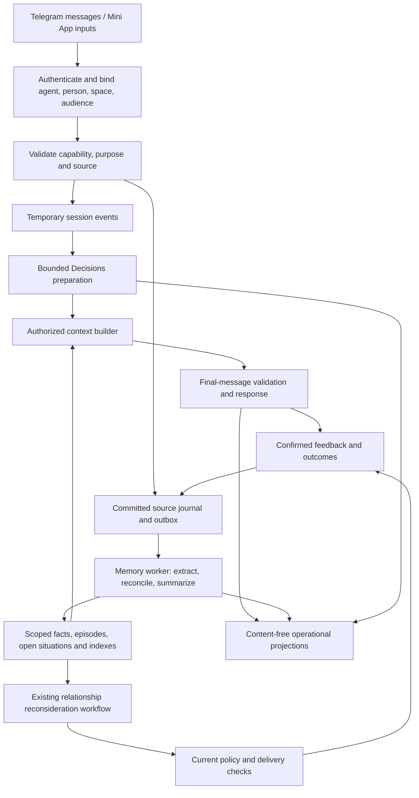

# Vox event-driven memory and predictive preparation

Prepared 22 October 2026. Planning baseline: `d56dfa7aa185e807f656fcc864c36e94c98ebaf2`.

Product clarification, 24 October 2026: the primary goal is conversational continuity from previous chats. Fibonacci describes memory layers organized by importance and timeline, not fixed message offsets or block sizes. This clarification supersedes the original chronological-width interpretation in section 7.

Product expansion, 25 October 2026: [the agent-centered design](../agents/AGENT_MEMORY_PRODUCT_DESIGN.md) and [delivery/KPI program](../agents/AGENT_MEMORY_DELIVERY_PROGRAM.md) now govern creator-owned personality, relationship growth, mind-map categories, managed file/message memory, and Telegram storage feasibility. In particular, the external-authoritative-store recommendation below is historical; the new plan first evaluates the user's Telegram storage requirement and does not assume approval for an external persistent memory backend. Existing event/cancellation/privacy invariants remain relevant.

**Status: proposed implementation plan.** Source inspection and independent planning reviews inform this document. No feature is enabled, deployed, or qualified by this plan. Tasks below extend the [canonical backlog](BACKLOG.json); their `EMP-*` IDs are proposed work packages, not completed backlog items. Existing untracked `docs/TELEGRAM_ACCOUNT_ACCESS_RESEARCH.md` is unrelated and was not changed.

## 1. Product decision

Give every agent created in Vox access to the same reliable memory infrastructure, with its own permitted memory scope, working brief, and relationship state. A person can talk through an agent's Telegram bot or Vox Mini App and continue the same authorized conversation. Relevant past information should improve the answer without requiring the person to repeat it.

The central acceptance question is: can the agent pick up an earlier discussion, understand what changed, and continue from the right point? Fibonacci layers support this continuity by preserving recent detail and important older knowledge. Sensor inputs and predictive preparation support this goal; they are later enhancements rather than prerequisites for remembering prior chats.

The system should observe an interaction, understand the current situation, retrieve relevant evidence, prepare plausible next steps, respond or remain quiet, and learn from the confirmed outcome. More observations are useful only when they improve correct recall, useful assistance, or response time. Predicting exact future wording is not required.

Recommended order: establish accurate Telegram memory; add eight-message briefs and compare Fibonacci compression with a simpler baseline; extend reversible preparation; then qualify richer inputs separately. Full speculative answer generation is a later experiment. Background camera/microphone surveillance and automatic model self-training are outside this plan.

“Store memories there” means users can save, inspect, correct, and forget memories from Telegram. **Vox's application database is the authoritative store.** Telegram is an input/output channel, not the memory database or a revocation mechanism. Use the authenticated Mini App for detailed memory inspection; short commands can open it. Text already sent to Telegram is an external copy, with separate deletion limitations.

## 2. What exists and what this adds

These are current source findings, not confirmation of live activation. Historical release receipts must not substitute for inspecting the actual target during implementation.

| Area | Source evidence | Required extension |
|---|---|---|
| Agent Telegram entry point | `src/lib/studio/updates.ts`, `src/lib/tireh/telegram/client.ts`, `src/lib/tireh/gateway.ts` | Explicit agent/chat/space binding, edited messages, supported photo/document/location adapters, reliable source revisions |
| Telegram scope | Private member observation currently selects `work` in `updates.ts` | A visible per-chat Work/Personal choice; Mini App changes must not silently reroute a Telegram chat |
| Conversation history | Gateway uses `HISTORY_LIMIT=20`, `EXTRACTION_WINDOW=6` | Eight-message checkpoints and general background consolidation are new work |
| Explicit memory capture | `src/lib/adaptive/message-memory/service.ts` proposes up to three selected-text claims and saves accepted claims | Preserve explicit review; add a separately governed automatic-memory path |
| Memory authority and correction | `src/lib/adaptive/persistence/service.ts`, `reviewed-memory/provenance.ts` | Extend lineage and invalidation to episodes, manifests, indexes, preparations, and jobs |
| Storage | `src/lib/adaptive/persistence/runtime-storage.ts` and `persistence/indexed/` | Normalized event/episode/manifest records behind the selected storage adapter; avoid enlarging the account aggregate or `studio/state` |
| Draft/image preparation | `src/lib/adaptive/prediction/README.md`, `client.ts`, `src/lib/adaptive/runtime/service.ts` | Extend existing revision, budget, cancellation, and receipt machinery; calibrate routes |
| Voice | Prediction README explicitly distinguishes final transcripts from an actual partial-ASR producer | Qualify a real streaming transcript producer before claiming preparation while speaking |
| Observation | `src/lib/adaptive/observation/contracts.ts` is a strict, content-free `optional.product_analytics` journal | A separate purpose-scoped experience-event path; only minimized projections enter analytics |
| Relationship decisions | `src/lib/relationships/`, `src/lib/adaptive/relationships/` | Connect scoped memory/open situations to the existing relationship workflow; avoid a second competing scheduler |

The existing account-memory schema limits source references and the provenance walker has bounded depth. A 144-message episode must use a separately paginated derivation manifest, not 144 references stuffed into one existing memory row. Existing file, SQLite, and managed-storage choices must be inventoried on the target; this plan does not assume a database migration is already complete.

## 3. Agents, people, and shared knowledge

Runtime agents are the assistants users create in Vox. Development agents implement this plan. Neither is automatically entitled to every user's information.

| Object | Meaning |
|---|---|
| Account / verified person | Authenticated account binding and the currently verified person; a display name, voice, or writing style does not establish identity |
| Agent | Persona, tools, purpose, and explicit grants; the creator does not own other participants' private memories |
| Space | Work or Personal, selected explicitly |
| Container | One person's private knowledge, one group's knowledge, or knowledge shared with exactly named recipients |
| Conversation | Agent, channel, chat/thread, active space/container, and audience/history-policy revision |
| Memory | A source-linked claim, preference, event, decision, or open situation owned by its container |
| Working brief | A compact view for one agent/conversation and current audience; not a universal personal profile |

Creating an agent installs capabilities, not blanket grants. Eligible users choose whether that agent remembers automatically within a scope. After that choice, routine supported memories can update without approval on every message. Explicit saving remains available without automatic learning. Temporary conversation remains usable when optional memory is disabled.

Agents may use the same durable fact only when each has a current purpose-specific grant to the relevant container. A task handoff passes authorized references and a narrowly scoped task; it does not copy all memory into a child agent. Child agents cannot delegate more authority than they received. Agent deletion, blocking, or replacement invalidates grants/preparations; a successor does not inherit private history because it has the same name.

Group messages create group-scoped evidence, not personal facts about every participant. Preserve the actual speaker and subject. New members and added agents follow the group's history policy. If the complete eligible audience cannot be established, withhold restricted recall. Summaries have the intersection of source permissions; mixed-audience material should be split by claim/container rather than emitted as a paragraph with broader visibility.

## 4. Runtime architecture



Keep three distinct data paths:

1. **Temporary interaction state:** drafts, partial transcripts, current selected media, tentative routes. Memory-only buffers, bounded lifetime, no durable content retries.
2. **Authorized conversation and memory state:** submitted sources, approved retained attachments, structured claims, source manifests, summaries, and open situations. Durable only under the applicable history/memory choice.
3. **Operational/product observations:** status, timing, counts, versions, cancellation, and user-reported outcomes. The existing optional analytics purpose cannot authorize personal content processing or automatic memory.

Use deterministic code for identity, permissions, capture state, clocks, rate limits, explicit stop/save controls, and commit eligibility. Use models for ambiguous meaning, extraction proposals, and composing responses. No continuously running model is needed for each event type.

## 5. Input and sensor capability matrix

| Input | Ordinary Telegram bot | Vox-owned Mini App surface | Proposed first behavior |
|---|---|---|---|
| Submitted text | Delivered bot-visible messages | Send in our composer | Current conversation; memory candidates if eligible |
| Unsent text | Arbitrary native composer drafts unavailable | Our own textbox only | Optional preparation, local until enabled; never durable memory |
| Touch/click/keyboard | Named button callbacks | Named actions such as stop, dismiss, select, attach | Execute direct controls immediately; coalesce optional observations |
| Microphone | Submitted voice/audio messages | User-started recording/call if supported | Final transcription first; stable partial transcripts only after qualification |
| Camera/photo | Submitted photos | User-selected image or deliberate one-shot capture | Explain submitted image; no continuous camera stream in first release |
| Files | Submitted documents | Selected attachments | Bounded parsing and source-linked retrieval, then eligible claim proposals |
| Language | Message evidence / explicit preference | Same plus chosen interface language | Adapt current reply; save a preference only under memory policy |
| Time/timezone | Server time plus explicit timezone | Same | Resolve dates using known timezone; preserve ambiguity |
| Location | Deliberately shared location | Explicit location request if supported | Task-specific, timestamped location; no default location tracking |
| Session/device state | Bot transport status only | Focus, visibility, connectivity, playback state | Cancel/reduce work and choose usable interaction mode |
| Scheduled event | Vox's durable reminders/open situations | Same | Reconsider current relevance at due time |

Telegram's Bot API specifies message/edit updates and submitted media. It does not expose arbitrary unsent composer text or general device sensor streams. Group privacy and bot configuration affect which messages reach the bot; missing delivery is unknown, not evidence that an event did not happen. Normal bot access does not provide an arbitrary historical-chat archive. [Bot API](https://core.telegram.org/bots/api#update), [Bots FAQ](https://core.telegram.org/bots/faq)

Mini Apps provide a JavaScript surface and optional device/location APIs. Validate signed `initData` on the server; never treat `initDataUnsafe` or a client-supplied account ID as authority. Availability varies by Telegram client/version. [Mini Apps](https://core.telegram.org/bots/webapps)

Camera/microphone access requires the browser permission path and secure context; test actual Telegram WebViews instead of assuming desktop browser success is equivalent. Pointer events can represent touch, mouse, and pen interactions. [Media capture](https://developer.mozilla.org/en-US/docs/Web/API/MediaDevices/getUserMedia), [Pointer events](https://developer.mozilla.org/en-US/docs/Web/API/Pointer_events)

Observe meaningful actions, not every pointer move or audio frame. A stop tap means stop; it is not proof of anger. Silence, location, facial appearance, voice tone, and typing speed must not create guessed identities or sensitive personal traits. OS sensor permission alone does not authorize durable memory, provider export, or product analytics. Backgrounding/closing the first-release capture surface stops capture and invalidates dependent work.

## 6. Event contract and delivery semantics

Proposed Vox application envelope; these field names are not an OpenAI API schema:

```ts
type ExperienceEvent = {
  schemaVersion: 1;
  eventId: string;
  kind: string; // registered union, never arbitrary executable input
  accountId: string;
  personId: string | null;
  agentId: string;
  space: 'work' | 'personal';
  containerId: string;
  conversationId: string;
  sessionId: string;
  turnId: string;
  turnRevision: number;
  source: { channel: string; endpointId: string; id: string; revision: number };
  audienceRevision: number;
  policyRevision: number;
  consentEpoch: number;
  agentGrantRevision: number;
  purpose: string; // reviewed registry value
  phase: 'observed' | 'interpreted' | 'predicted' | 'committed' | 'outcome';
  trust: 'server_verified' | 'client_reported' | 'model_inferred';
  occurredAt: string; // source evidence; not blindly trusted
  receivedAt: string; // server time
  expiresAt: string;
  payloadClass: 'ephemeral' | 'restricted_reference' | 'content_free';
  payloadRef?: string; // resolver enforces scope; not a public object URL
  causationId?: string;
};
```

The server derives identity, authority, scope, receipt time, purpose eligibility, and expiry from authenticated state. Validate source event time and record clock uncertainty; causal sequence/revisions govern processing. A verified Telegram sender establishes message transport provenance, not the factual truth of the message. Actor, statement subject, and current audience remain distinct. Authenticated control actions are not equivalent to unverified playback reports.

Initial registered kinds: `message.committed`, `message.edited`, `source.forgotten`, `draft.stable`, `input.cleared`, `speech.partial`, `speech.final`, `image.selected`, `image.submitted`, `file.submitted`, `control.activated`, `capture.stopped`, `location.shared`, `session.scope_changed`, `memory.corrected`, `situation.resolved`, `reminder.due`, and `outcome.reported`. Client predictions cannot forge `memory.corrected`, verified outcomes, or authority changes.

Durable committed events and their outbox entries use one transaction/CAS boundary. Deduplication uses tenant/agent/bot endpoint, Telegram update ID, and logical chat/message/revision identity; a redelivery is not a new message. Persist source-to-logical-message mapping so edits revise the source instead of incrementing the summary counter. Include a source adapter version and strict size/type limits.

Workers claim bounded leases, check current authority, and commit idempotently. A job key includes source range/revisions, extraction version, target container, and authority generation. Retry only eligible retained references, never abandoned draft/media bytes. Dead-letter records contain reason codes and protected references. Bound queue depth per account/agent and coalesce summary work; prioritize stop, correction, revocation, and submitted turns over speculation. Excess optional work is dropped with content-free counts, not allowed to delay replies indefinitely.

Edits, delayed voice transcription, and offline/reordered events are normal. Reject older source revisions; do not use client wall-clock ordering to overwrite newer facts. Record processing cursors/watermarks and gaps so observation completeness is explicit. If a source cannot be retained, update only permitted session state; durable reconstruction cannot depend on that temporary content later.

## 7. Memory structure and Fibonacci experiment

Use six distinct memory forms:

| Form | Content and update rule |
|---|---|
| Recent context | Newest eight eligible committed conversation messages, preserving wording and attribution within a token cap |
| Working brief | Current topic/goal, recent decisions, unresolved questions, next agreed steps; refresh on eight new messages or semantic boundary |
| Atomic facts/preferences | Source-linked, independently correctable claims; important facts survive beyond any recent-message range |
| Episodes | Dated conversation/topic summaries with source manifests and uncertainty |
| Open situations | Promises, tasks, unresolved questions, due times, last evidence, next reconsideration, and resolution state |
| Hypotheses | Tentative inferred intent/context with confidence, evidence, expiry, and limited effects; never presented as confirmed facts |

### Message counting and memory layers

A “message” is one accepted human message or committed final assistant message. Do not count tokens, partial transcripts, draft revisions, retries, tool logs, or sensor samples. Assistant statements retain their origin and cannot establish a user preference without user evidence. Count per conversation/scope, not across all agents or people.

Use `1, 1, 2, 3, 5, 8, 13, 21, 34, 55, 89, 144` as a proposed progression of memory layers. **Time and importance are separate dimensions.** Recent messages provide immediate detail; older information remains available according to its significance, validity, and relevance. The numbers are layer labels, not message counts, day counts, automatic importance scores, or a maximum history length. Use distinct layer IDs for the two entries labelled `1`.

The following grouping illustrates the clarified idea; exact layer thresholds and time horizons are implementation contracts to define and evaluate under EMP-01/06:

| Layers | Intended role | Example |
|---|---|---|
| First `1`, second `1` | Latest message and immediately preceding conversational context | The question now and the statement it answers |
| `2`, `3`, `5`, `8` | Nearby context and the developing conversation brief | Current topic, recent clarification, agreed next step |
| `13`, `21`, `34` | Earlier episodes and unresolved topics | Last week's discussion, an unfinished plan, a past decision |
| `55`, `89`, `144` | Increasingly selective, important durable knowledge | An enduring explicit preference, major decision, or significant shared history; `144` represents the highest-priority durable layer |

Age alone does not promote a memory to layer `144`. Important new information can qualify for durable storage immediately. An older memory relevant to today's message can be brought into active context without changing when it happened. Long-term storage priority does not force a memory into every reply: current relevance and access still govern use. Corrected, expired, or deleted information cannot survive merely because it was assigned high priority.

Keep the newest eight messages verbatim where permitted, and refresh their brief after eight new committed messages or a meaningful boundary. This eight-message checkpoint is independent of a layer labelled `8`. Layer views reference canonical claims and sources rather than copying facts into separate competing stores. Deduplicate sources/claims when combining recent context, episode summaries, and durable memory. No messages are selected or discarded solely because they occupy Fibonacci offsets.

Layer assignment should record importance evidence, event time, validity, last relevance, unresolved status, and a reason for promotion or demotion. Explicit user emphasis, meaningful decisions, continuing commitments, and stable preferences are candidate importance signals. Repeated agent retrieval or re-summarization alone cannot manufacture importance. Preserve dated history when a topic resolves, subject to retention, while removing it from the active unresolved list.

### Updating layers without rebuilding everything

Store append-only committed source revisions and stable episode/checkpoint segments. Every eight new messages, close a checkpoint and refresh the working brief asynchronously; topic completion, a new decision, a correction, a source edit, or a context-size limit can trigger earlier work. During a pending job, use the last valid brief plus the unsummarized committed tail.

Fibonacci is initially a **derived memory organization and retrieval policy** over canonical claims and stable episodes, not the primary database structure. Build/cache a layer or episode view only when needed, keyed by its source manifest, scope, policy, and summary version. Re-evaluate affected assignments when new evidence, a correction, a resolved topic, or expiry changes their value. Coalesce jobs and limit model work per checkpoint. Never rewrite twelve summaries on every new message.

Summaries preserve names, dates, negations, uncertainty, claim attribution, contradictions, and unresolved commitments. Store structured claims and evidence ranges alongside prose. Never repeatedly summarize only the previous prose with no source lineage. A summary cannot become independent evidence that outranks its sources. If required sources are unavailable, mark coverage incomplete and omit unsupported assertions.

Retain the simpler recent-window plus running-brief baseline. Fibonacci becomes the default only if the evaluation in section 14 demonstrates benefit at matched context and cost budgets.

## 8. How memory is written, corrected, and forgotten

Suggested claim fields: ID, container/subject, claim type/value, asserted-by, source references/revisions, observed time, valid-from/to, confidence/evidence class, explicit-or-inferred flag, status, supersedes ID, review/expiry time, extraction version, and authority generation. Statuses include `candidate`, `active`, `disputed`, `superseded`, `expired`, and `deleted`.

1. **Accept a submitted event.** Authenticate and select its exact scope. History retention, automatic memory, and analytics are separate decisions.
2. **Extract eligible candidates in the background.** The model proposes structured claims from a bounded authorized source batch. Direct UI controls and explicit corrections take the deterministic priority path.
3. **Validate.** Reject unsupported attribution, speculative intention, quoted instructions, permission changes, and duplicate claims. Attach lineage and expiry; do not infer a durable preference from one tap or brief silence.
4. **Reconcile.** Explicit correction outranks a hypothesis. A changed fact closes the old validity interval; conflicting claims from different people remain attributed/disputed. Do not overwrite another person's assertion as if it were the user's own fact.
5. **Commit.** Recheck source and policy revisions, write the versioned memory plus derivative-refresh outbox atomically, and advance the cursor only on success.
6. **Refresh.** Invalidate dependent summaries, indexes, working briefs, prepared context, and scheduled intentions. Rebuild only from still-permitted evidence.
7. **Explain and allow undo.** The user can inspect what was remembered, where it came from, who can use it, and correct/forget it.

Automatic mode initially covers explicit preferences, user-stated ordinary facts, agreed decisions, and open tasks. Ambiguous statements remain temporary hypotheses or review candidates. Sensitive information is not passively promoted; explicit user saving follows the separate reviewed flow. A single memory-setting decision should govern routine eligible updates rather than generating repeated permission questions.

Corrections take effect in the current-turn context immediately; background summary lag cannot keep the old claim active. Example: “I now live in Tallinn” supersedes an older residence claim, while “I am visiting Tallinn today” creates a short-lived visit event and does not change residence.

Forgetting first creates authoritative tombstones and suppresses retrieval, then purges source-dependent claims, manifests, summaries, embeddings/index entries, caches, queue references, and retained media. Replays, backups, and late worker results must consult tombstones. A saved claim may outlive raw chat only under an explicit memory-retention rule with enough retained provenance to be inspectable/correctable; a historical claim cannot silently become an eternal fact. Deleting its root saved memory invalidates descendants.

Telegram source edits should trigger the same invalidation. Standard bot updates do not provide a universal deletion feed for all ordinary messages; deleting a chat message in Telegram cannot be promised to erase Vox memory. Provide explicit Forget controls and describe this limitation clearly. Imports of past chats require a separate user-selected import flow; no historical scraping or inferred consent.

### Proposed retention rules

These are implementation targets to reconcile with [the existing retention schedule](PRIVACY_AND_CONSENT.md), not claims of measured deletion behavior. Never lengthen an existing stricter bound implicitly.

| Data | Application handling |
|---|---|
| Drafts / partial ASR | Active-turn/session buffers only; invalidate on clear, close, scope change, expiry, or withdrawal; no raw content in logs, durable queues, or dead letters |
| Raw microphone / camera working data | Process the deliberate capture; release buffers after the turn/cancel; first pilot does not save originals by default |
| Submitted source history | Existing disclosed finite history policy; the current planning schedule proposes 30 rolling days; verify actual implementation before activation |
| Deliberately retained attachment | Explicit attachment policy and linked deletion; bounded parser working copies are removed after processing |
| Facts / episodes / briefs | Source/purpose-dependent expiry and review; summaries never acquire longer authority merely through compression |
| Precise location | Current task only by default; saving city/home is a distinct intentional memory update |
| Hypothesis | End of turn for immediate intent; longer relationship hypotheses use their existing finite expiry and re-evaluation rules |
| Analytics journal | Preserve current strict purpose and existing seven-day/200-event bound unless a separately reviewed change replaces it |
| Content-free cancellation records | Preserve existing ten-minute tombstone bookkeeping; this does not permit ten-minute retention of draft text |

Provider retention, backups, and already delivered external copies need their own documented treatment. Application buffer expiry must not be described as guaranteed provider-side deletion.

## 9. Retrieving context for a reply

First authorize potential sources by person, agent/purpose, space, container, current audience, expiry, and deletion state. Only then resolve text or call a model/reranker. Apply the same checks to conversation history, directories, tool results, files, embeddings, summaries, and episode links.

Build a bounded context package from current input, valid recent messages, working brief, explicit preferences, relevant atomic facts, unresolved situations, and a few source-linked episodes. Use lexical/exact-name/date retrieval plus evaluated multilingual semantic retrieval where useful. Preserve original language and source; translation is a derived view, not new evidence. Do not infer location from language or identity from style.

Rank by present relevance, evidence quality, unresolved importance, temporal validity, and useful recency. Explicit pinning/correction takes precedence where applicable. Prefer a small exact fact over a large vague summary. The current gateway bounds selected memory at 12 rows/8192 serialized UTF-8 bytes; preserve that baseline until a measured context-budget change is reviewed. Allocate a separate, explicit total token budget across recent history, briefs, memory, tools, and the final answer.

Cache only safe ranking identifiers/receipts under the existing mechanism. Recheck current content/authority before provider use and delivery. Each selected claim carries an explanation/source reference for “Why did you remember that?” If evidence is ambiguous, ask one useful question or answer without the uncertain personalization.

## 10. Decisions and predictive preparation

The official Decisions guide currently documents text/image inputs, predicate/choice/score questions, `gpt-6-luna`, and a dedicated endpoint in public beta. Dedicated JavaScript examples require SDK 7.30.0+. Vox declares `openai:^6.9.1` and already uses a guarded `post('/decisions')` adapter; do not assume an SDK upgrade is mandatory or that provider access is qualified. Verify the adapter against the current contract during implementation. [Decisions guide](https://developers.openai.com/api/docs/guides/decisions)

Extend the existing versioned question registry. Agents may select permitted behavior profiles, but agent-authored prompts cannot redefine policy, retention, or the allowed action set.

| Proposed question | Type | Input | Result is allowed to do |
|---|---|---|---|
| Does this refer to prior conversation? | Predicate | Current text and minimal eligible topic labels | Request bounded authorized retrieval |
| Which context category is likely useful? | Choice | Submitted text or eligible stable partial | Select preference, open task, person-reference, episode, document, or none/uncertain |
| Is this an explicit correction or new statement? | Choice | Submitted statement and candidate prior claim | Propose reconcile/review; server controls commit |
| Is the current topic resolved? | Predicate | Committed conversation evidence | Propose closing an open situation, subject to validation |
| What is the useful conversational next step? | Choice | Current goal, evidence, constraints | Propose answer, ask one question, retrieve, offer help, defer, or stay quiet |
| Which already-authorized preparation is useful? | Choice | Stable input revision and candidate routes | Warm one bounded read-only context path |
| Is this situation worth reconsidering later? | Choice | Confirmed open situation and current context | Propose defer/close/quiet; existing scheduler and policy own timing/delivery |

For example, provider question name `prior_context_needed` with separate registry version `1` is a predicate with instructions to detect a reference such as “the issue from yesterday,” using only supplied evidence. Keep the name compatible with the existing adapter's lowercase-letter/digit/underscore schema. If accepted, ordinary retrieval searches eligible episodes. A separate response model writes the answer. Decisions does not generate a complete memory database, grant permissions, or predict facts with certainty.

Runtime sequence:

1. A meaningful input revision passes deterministic capability, scope, size, and budget checks.
2. Direct controls bypass Decisions. Ambiguous semantic routing receives only necessary authorized evidence.
3. Validate typed output and question/version identity. Unknown, refusal, malformed output, timeout, outage, or exhausted budget returns to the ordinary conversation path.
4. A valid prediction may prepare permitted retrieval. It cannot write memory, send a message, invoke a mutating tool, promise an action, or change sharing.
5. On Send/final transcript, recheck the final input, turn/source revisions, audience, consent, grants, and expiry. Reuse preparation only if compatible; otherwise discard it and compute from final input.
6. Record useful/discarded/unknown preparation outcomes separately. Missing usage is unknown cost, not zero.

Initial controls reuse existing source values: text debounce 180 ms, at most two prediction calls per turn, one active session lease, no speculative retries, a 500 ms Decisions service deadline, a 1500 ms prepared receipt, and a separate 250 ms retrieval-preparation bound. These are caps, not end-to-end latency promises. Relationships currently use a different background timeout (6000 ms); preserve separate workload budgets. Coalesce bursts and honor IME composition before sending a stable text revision.

Calibrate thresholds by question, language, modality, and error cost. A model score is not automatically calibrated probability. Add a per-person/account daily spend ceiling and a global concurrency ceiling before a real pilot; exact monetary amounts are operator configuration, not guessed here. Stop speculation when capped and retain ordinary chat.

### Three prediction horizons

- **Immediate, milliseconds/seconds:** likely relevant context while typing/speaking. Cache preparation only; input changes frequently.
- **Next interaction, minutes:** an unresolved task suggests a likely next question. Keep a short-lived hypothesis and optional in-app suggestion; do not pre-generate every possible answer.
- **Later, hours/days:** a confirmed deadline/open situation can trigger reconsideration. Fresh evidence and the existing relationship policy decide whether to respond, defer, close, or remain quiet. Lack of reply is weak evidence, not a reason to invent a problem.

The first release implements the immediate horizon and connects confirmed open situations to existing reconsideration. Full answer speculation requires a separate experiment with final-message compatibility checks and counts all discarded generation cost.

### Voice and multimodal timing

The official voice integration describes transcript-linked Decisions with source-event correlation and potentially out-of-order results. Use this pattern only after a qualified partial-transcript producer exists; current final-transcript callbacks do not establish early prediction. [Voice-to-Decisions guide](https://developers.openai.com/api/docs/guides/decisions-voice)

Tag every partial and media selection with source revision; cancellation wins over late provider results. Stop microphone/camera on interruption or leaving the supported capture surface. Cancel on attachment replacement, agent/person/space/audience change, revocation, source deletion, timeout, and new turn. Keep the current image minimization path (one selected raster, at most 512 pixels per edge and 64 KiB after normalization) as the baseline. Audio uses a qualified transcription path; files use a bounded parser. File/OCR text is untrusted evidence, not instructions to execute tools.

## 11. Telegram and Mini App experience

Keep everyday chat simple. Show the selected agent and space in the Mini App; confirm a space change in Telegram when the user explicitly makes it there. Bind Telegram choices to account + agent + bot endpoint + chat/thread and a server revision. Unbound/ambiguous chats must not silently fall back to another space's private memories. Group scope comes from group configuration, not one participant's personal switch.

Proposed controls:

- `/memories`: open an authenticated view showing allowed memories, sources, audience, and edit/forget actions. Do not dump a private memory list into a group.
- “Remember that I prefer short replies”: save under the explicit-memory flow; clarify only if the scope/content is ambiguous.
- “That changed; the meeting is Friday”: update the linked event and immediately invalidate stale preparation.
- “Forget the information about that meeting”: show a precise selection if necessary and apply source-linked deletion.
- “Don't remember this conversation”: temporary mode for the declared scope, with a clear effect on future collection.
- “Prepare while I type”: existing optional control; explain unsent provider processing once, keep it visible and easy to disable.
- Microphone/camera/attachment: deliberate capture controls, visible active state, stop, and a useful text fallback.

Settings should distinguish memory, draft preparation, sensor capture, analytics, and external contact without repeating those choices on every normal turn. Maintain English/Persian parity, RTL, keyboard and screen-reader operation, and a single focused companion surface. Details can open from the relevant action without turning the main conversation into a dashboard.

Requested replies in a Telegram conversation may contain authorized conversational detail after final audience checks. Proactive relationship work follows the existing scoped design: detailed check-ins in the authenticated inbox and, when eligible, a generic Telegram alert. Preserve current caps, quiet hours, explicit opt-out, and current source checks; this plan does not replace those product decisions with a classifier.

## 12. Example behavior

**A. An old promise becomes relevant.** A user told an agent last month about a presentation. Today they write “Tomorrow is the day.” Current topic, dated open situation, and authorized episode retrieval identify a possible connection. The agent confirms ambiguity if needed. The important older memory returns to active context so the conversation continues from the earlier discussion, while preserving its original date and any subsequent corrections.

**B. A draft changes meaning.** “I decided to accept…” warms job-related context. The user finishes “…that I should not accept the offer.” The new revision cancels the old route. The final answer uses the submitted meaning; no acceptance is saved or acted on.

**C. Touch plus microphone.** The user taps Stop during a voice answer, then records a clarification. Stop takes effect immediately without Decisions. The final transcript updates the task. Optional feedback can record an interruption, but no “impatient personality” memory is created.

**D. Camera/file evidence.** The user submits a whiteboard photo and a project brief. Each source has its own authorized audience and revision. The agent extracts proposed dates with uncertainty, identifies a disagreement, and asks which is current. It does not merge the photo's bystanders into identity records or obey instructions hidden in the file.

**E. Two agents, one person.** A travel agent may use a saved city preference if granted. A work agent does not automatically see private travel discussions. The person can share a specific fact with both; revoking one agent suppresses its derived summaries and prepared context.

## 13. Development work packages

All packages below are **proposed**. Before dispatch, record the exact baseline, owned files, approved contracts, candidate acceptance owner, and evidence directory. Existing canonical tasks remain authoritative; map these slices into them rather than starting a parallel release process. New directories below are proposed and require contract review before creation.

| ID / canonical mapping | Owner; independent reviewer | Dependencies | Owned paths/responsibility | Acceptance |
|---|---|---|---|---|
| EMP-01 / VOX-006,008,013,017 | `vox_architect`; privacy + QA | None | New `src/lib/adaptive/experience-events/contracts.ts`, `memory-consolidation/contracts.ts`; scoped architecture updates | Versioned event/claim/manifest schema, exact counting, identity/trust, expiry, invalidation, capacity and provider/device matrix |
| EMP-02 / VOX-004,012,028 | `vox_ux_designer`; privacy + frontend | EMP-01 | Focused EN/FA memory/capture/scope flows and copy specification | Simple automatic-memory choice, explicit save, temporary mode, draft processing, capture/stop and failure states |
| EMP-03 / VOX-013–018 | `vox_architect`; privacy + QA | EMP-01 | `persistence/` schema/adapter changes plus new experience-event repository/outbox | Normalized bounded storage, CAS/idempotence, leases, source revisions, tombstones, replay/recovery; no aggregate blow-up |
| EMP-04 / VOX-009,010,017 | `vox_architect`; QA | EMP-01,02,03 | `studio/updates.ts`, `tireh/telegram/client.ts`, Telegram routing in `tireh/gateway.ts` | Per-chat scope, committed text/voice/edit/callback ingress, correct bot/update identity, reconnect and duplicate handling |
| EMP-05 / VOX-013,014,018 | `vox_architect`; privacy + QA | EMP-03,04 | New `memory-consolidation/` workers and bounded persistence integration | Structured extraction, explicit-vs-auto policy, eight-message brief, source invalidation, temporal supersession, crash-safe cursor |
| EMP-06 / VOX-013,025,030 | `vox_architect`; QA | EMP-05 | `memory-consolidation/` layer projection and `tireh/memory/` selection | Priority/time layer policy, justified promotion/demotion, old-topic continuity, no duplicate claims or fixed history cutoff, bounded refresh and baseline comparison |
| EMP-07 / VOX-004,012,014,028 | `vox_frontend_engineer`; privacy + QA | EMP-02,05 | Studio memory components/client routes and Telegram control presentation | Inspect/source/audience, correct/forget, automatic/temporary mode, EN/FA, immediate invalidation feedback |
| EMP-08 / VOX-024–026,030 | `vox_architect`; QA | EMP-01,03,06 | `adaptive/decisions/`, runtime question registry and preparation integration | Versioned bounded questions, fallback, calibrated routing, exact final-input revalidation, cost/cancellation receipts |
| EMP-09 / VOX-017,019,020,026 | `vox_data_engineer` after frozen schema; QA | EMP-01,02,03,08 | New `experience-events/adapters/` and approved named-action producers; no schema/policy ownership | Draft/touch/focus events coalesced, no raw keystroke analytics, IME and accessibility parity, deny optional export before capture |
| EMP-10 / VOX-017,031 | `vox_frontend_engineer` plus separately dispatched backend architect; privacy + QA | EMP-03,04,08,09 | Selected image/file UI, Telegram media adapter, bounded new content parser/resolver | Size/type limits, metadata stripping, source-linked OCR/text, malicious content isolation, cancellation/deletion/fallback |
| EMP-11 / VOX-031,038,051 | `vox_voice_engineer`; privacy + QA | EMP-03,08,09 | Voice transcript adapter, `adaptive/prediction/voice-client.ts`, capture UI integration | Actual partial-ASR source, final-negation handling, stop/background/reconnect, supported-device proof; no identity unlock |
| EMP-12 / VOX-017,031 | `vox_frontend_engineer`; privacy + QA | EMP-02,09,10 | Deliberate camera/location adapters and capture controls | Capability detection, explicit capture, denied-permission fallback, transient state, no background tracking |
| EMP-13 / VOX-027,032–036 | `vox_architect`; QA | EMP-05,08 | Scoped `adaptive/relationships/` and existing relationship workflow seams | Fresh open-situation reconsideration, resolve/defer/quiet, no duplicate scheduler, no unsolicited sensitive Telegram detail |
| EMP-14 / VOX-015,016,052 | `vox_architect`; privacy + release | EMP-03,05,06 | Versioned migration/rollback scripts and scoped recovery records | Dry-run reconciliation, quarantine ambiguous records, bounded indexes, restore honors current tombstones/grants |
| EMP-15 / VOX-007,025,030,049–052 | `vox_qa_evaluator`; independent acceptance owner | Baseline early; candidate after EMP-04–14 as applicable | Protected fixtures/protocol, candidate evaluation and device matrix | Section 14 gates, matched baselines, chronological replay, provider/device limits explicit |
| EMP-16 / VOX-054–056 | `vox_release_engineer`; lead + independent QA | EMP-14,15 and applicable capability reviews | Scoped release packet, deployment flags, rollback/repair runbook | Exact artifact/CI/target, authenticated journey, live transport/provider proof, kill and recovery checks |

Sequencing:

1. **Contracts and baseline:** EMP-01/02 plus independent baseline evaluation. No feature activation.
2. **Useful Telegram memory:** EMP-03/04/05/07 and their QA slice. Deliver one agent, one authenticated person's private Telegram chat, EN/FA, source-backed recall and correction/forget. Exercise two-agent isolation synthetically before expanding.
3. **Memory quality:** EMP-06 and EMP-14 dry-run. Keep Fibonacci behind a separate experiment switch.
4. **Faster preparation:** EMP-08/09; compare against the same memory without prediction.
5. **Additional inputs:** EMP-10, then EMP-11 and EMP-12 independently when each adapter can qualify. Photos/files need not wait for streaming voice.
6. **Contextual initiative and release:** EMP-13; complete EMP-14/15/16 for each supported channel/capability.

Use the existing four-slot development limit: lead plus at most three workers. Reserve an independent reviewer when needed. Do not edit `gateway.ts`, `runtime/service.ts`, shared schemas, or `ConversationPanel.tsx` concurrently; split responsibilities into exact files before dispatch and serialize integration. Sol owns ambiguous architecture, identity/policy, implementation and evaluation judgments; Luna performs frozen-schema wiring, scripted checks, and evidence formatting under the existing team rules. Estimates follow task sizing and baseline measurements; stages are dependencies, not promised weeks.

## 14. Independent evaluation and acceptance

Freeze the protocol, thresholds, corpus, model/provider versions, context limits, device/network profiles, assignment unit, and spend budget before candidate evaluation. The author cannot alter protected tests to make a candidate pass. Use synthetic or specifically approved histories, never production conversations copied into development by default.

Compare matched conditions:

- A: recent context + ordinary running brief + relevant facts.
- B: A with Fibonacci priority/time layers under the same context budget.
- C: the selected memory design with event-guided retrieval.
- D: C plus speculative preparation.

Replay conversations in chronological order. At each point, models see only evidence available then; future messages are labels/outcomes, never retrieval input. Include new people/containers and later time windows in held-out evaluation. Keep shared containers in one experimental assignment and isolate derived writes between variants. Report voice, Telegram, Mini App, EN, FA, mixed-language, and device results separately.

Measure memory claim precision, correction/temporal/provenance accuracy, useful implicit recall, abstention, task completion, unnecessary questions, unwanted outreach, p50/p95 first useful visible/audible response, total model/parse/storage cost, and discarded preparation. Estimate next-step usefulness against the user's actual subsequent action or explicit feedback; inactivity/unfinished sessions are censored or unknown, not automatically wrong predictions. Synthetic persona judgments alone do not prove real-user benefit.

Use the existing [QA protocol](QA_AND_RELEASE.md) as the starting point: proposed memory precision >=98%; correction/temporal/provenance accuracy and abstention >=95%; Decisions macro F1 >=0.90 with harmful/wasteful-route false positives <=1%; quality non-inferiority within two percentage points with uncertainty and subgroup checks. These are proposed gates, not current measured results. QA predeclares denominators, confidence intervals, power/sample requirements, and stopping rules. Insufficient evidence keeps the baseline.

Prediction promotion requires at least 20% lower p95 first-useful-response latency at comparable quality, or a predeclared task-success improvement within the approved cost bound. Include all cancelled, timed-out, refused, failed, invalid, and discarded work. Measure user-visible latency with valid same-clock durations/correlated tracing; do not subtract unrelated client and server clocks. Report provider usage gaps explicitly. Each capability must justify its incremental cost and device/battery impact.

Mandatory failure scenarios:

1. Agent A private canary cannot reach Agent B, another person, another space, group context, provider payload, analytics, or optimizer dataset without a valid grant.
2. New group member, removed member, added agent, expired binding, or guest during a pending reply invalidates affected context.
3. “Accept” becomes “do not accept”; edited image/file, cleared draft, or late ASR cannot reuse a stale interpretation.
4. Stop, scope switch, revocation, and deletion race provider dispatch, summary commit, cache reuse, worker retry, and delivery; stale work loses.
5. Deleted sources cannot reappear through summaries, indexes, queues, replay, or backup restore.
6. Duplicate/out-of-order Telegram updates, repeated callbacks, crash after commit, expired worker lease, and delayed transcription preserve one logical event and correct source revisions.
7. Temporary mode leaves no content-bearing durable speculative artifact or automatic memory; analytics opt-in cannot authorize sensors/drafts/memory.
8. A forwarded message, quote, OCR instruction, malicious file, or assistant statement cannot become an authenticated user fact or tool permission.
9. Current facts supersede older claims, disputed third-party claims remain attributed, relative dates preserve timezone uncertainty, and important old facts remain retrievable across sessions without a fixed message-count cutoff.
10. Eight-message checkpoints and Fibonacci layer views have no duplicated evidence or summary inventions. An old topic can resume accurately; recent trivial content cannot crowd out relevant important history; important new information can become durable immediately; retrieval repetition alone cannot promote importance. Job fan-out and recovery remain bounded.
11. Permission denial, unsupported WebView, offline/reconnect, hidden tab, provider outage, malformed/refused Decisions, budget exhaustion, and observation backlog leave basic chat usable.
12. Actual Telegram edit/media transport, EN/FA and RTL, real microphone/camera controls, accessible equivalents, and target devices complete their own journeys.

Any observed unauthorized export/disclosure, speculative external effect, deletion resurrection, or post-revocation dispatch is a hard failure. Zero failures in a test set is necessary evidence, not proof that future failures are impossible.

## 15. Migration, rollout, and operation

Inventory existing source retention, storage format, identity/grants, exact agent endpoints, feature flags, and serving revision. Dry-run migration only against retained authorized sources. Reconcile counts, active facts, revisions, expiry, lineage and access; quarantine missing/ambiguous attribution instead of guessing. Keep old readers operational through a versioned adapter where feasible; test the supported old-binary read path explicitly.

Do not backfill private Telegram history from another account or infer opt-in from past use. Enabling memory prospectively does not authorize historical reconstruction. A source correction/delete during backfill wins. Backfill checkpoints and repairs must be idempotent and bounded.

Proposed capability switches are distinct: committed-event capture, automatic consolidation, Fibonacci context, draft preparation, media/file processing, partial voice, camera/location, and relationship preparation. Map these to existing server policy/capabilities where available; avoid duplicate contradictory flags. All new optional capabilities start off. A code flag never grants user permission.

Rollout follows the existing synthetic -> internal adult pilot -> 5% -> 25% -> intended availability process, with adequate evidence at each step. Qualify each channel/capability independently. Release records distinguish source revision, local tests, independent acceptance, CI, artifact/build, deployed runtime, authenticated user journey, actual provider invocation, Telegram outcome, and physical-device proof.

Kill switches stop new capture/provider work and invalidate leases/receipts while preserving basic chat. Rollback disables the candidate, restores the prior reader/routing configuration, and repairs candidate-derived summaries/indexes. Preserve current consent, grants, corrections, and deletion tombstones; never restore a stale account snapshot over newer revocation state. Record uncertain Telegram sends as uncertain and suppress unsafe blind retries.

Operational owners track queue age, failures, storage growth, extraction lag, stale-summary suppression, prediction usefulness/discard rate, provider cost completeness, p95 latency, capture failures, delete backlog, and unwanted contact. Operational views receive minimized counts/reason codes, with protected source access only through the corresponding authorized product flow.

## 16. Planning review and next action

Three read-only reviews inspected the 22 October baseline: memory/Telegram architecture (`MEM-SENSE-REVIEW-A`), sensor/privacy boundaries (`MEM-SENSE-REVIEW-B`), and prediction/evaluation (`MEM-SENSE-REVIEW-C`). Their findings informed the original plan. Independent document reviews found no blocking privacy issues and one question-name compatibility defect, corrected by separating the provider name from its registry version. Those reviews do not constitute acceptance of the revised layer policy or runtime behavior. The 24 October clarification replaces fixed Fibonacci widths with priority/time layers and updates the associated work package and acceptance cases. Local document checks cover links, unique work-package IDs, balanced code fences, whitespace, and removal of the superseded fixed-range requirements. Exact layer thresholds remain EMP-01/06 work. No runtime tests or live-provider/device checks were performed for these documentation changes.

The next implementable slice is EMP-01/02 plus the baseline protocol, followed by one complete Telegram memory journey: submitted message -> eligible claim -> eight-message brief -> relevant recall -> correction -> forget -> verified non-reappearance. Expand inputs and prediction only after this foundation is useful and measurable.

References: [memory strategy](../AGENT_MEMORY_STRATEGY.md), [relationship plan](../RELATIONSHIP_SYSTEM_PLAN.md), [implementation architecture](ARCHITECTURE.md), [privacy/retention](PRIVACY_AND_CONSENT.md), [team dispatch rules](TEAM.md), [prediction contract](../../src/lib/adaptive/prediction/README.md), [current backlog](BACKLOG.json).
