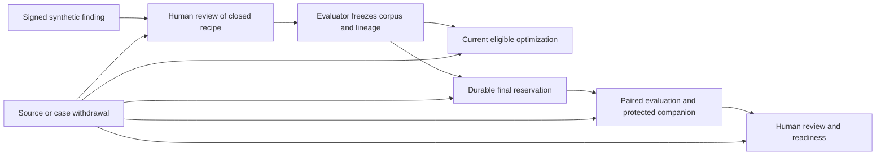

# Reviewed synthetic learning cases / نمونه‌های مصنوعیِ بازبینی‌شده برای یادگیری

LC1 is a bounded VOX-043 / VOX-014 implementation, independently qualified locally at `e05e46074e1c4741b93b0a85d8bcc4e65a041773` on 20 October 2026. It connects reviewed synthetic findings to reproducible optimization and evaluation cases in the existing improvement workflow. Source qualification, CI and deployment remain distinct evidence; this contract grants no real-data collection approval and establishes no model-quality improvement.

## Purpose and scope

A signed finding describes an observed problem using minimized metadata. It does not itself grant permission to copy conversation content into training or evaluation. LC1 accepts only the existing `synthetic` finding kind. A separate human review selects a closed fictional template and binds its source, exact original finding envelope, catalog and explicit lifecycle deadlines. Text, expected answers, arbitrary unit seeds, transcripts and caller-supplied prompts cannot enter this path. Opaque metadata references still require minimization and human review; the schema is not a general personal-data detector.

The evaluator chooses the corpus partitions and signs their lineage. The workflow checks the exact case set, source/review bindings, split and corpus digests. The optimizer receives only the optimization partition. Final evaluation retains the existing independent evaluator, fixed budgets, protected Docker companion and human approval; LC1 does not replace or weaken those gates.

## Current authority and lifecycle

Findings, reviews, corpus lineage, source/case exclusions and final-use markers share one serialized workflow. A prepared handle is privately minted for the registry, trust, corpus/protocol and current audit head. A copied or serialized object cannot replace that authority. Consumer dispatch and result publication check current eligibility; asynchronous adapter work does not hold the writer lock. An unrelated committed change may conservatively invalidate a prepared handle. Only explicitly owned, checked workflow transitions can advance it.

Expiry applies at equality, using the minimum applicable signed deadline. Explicit lifecycle/use operations persist monotonic time; informational reads do not advance it. A clock regression, changed trust configuration, unsupported state or corrupt history makes use unavailable. The configured trust set is pinned at construction and bound durably; live key rotation and hostile full-history restoration require separate operational controls.

Withdrawal of any source or case invalidates its frozen corpus as a whole. It does not silently remove rows, change denominators or reopen a consumed final partition. Failures, cancellation, revocation and crashes after final reservation retain that reservation. Already delivered bytes cannot be recalled from an external consumer merely by revoking a handle.

Durable LC1 records contain bounded metadata, closed recipes, reviewed references, signatures, digests and exclusions. Materialized example bodies are not written into the workflow audit. Metadata retention floors and payload deadlines have different meanings and must be supplied explicitly; no legal duration is inferred. Automatic retirement or physical erasure of immutable audit history needs a separately reviewed compaction/retirement design.

The audit is bounded to 5,000 events, 2,000,000 bytes per event and 64,000,000 bytes in total. Writers check actual existing bytes plus exact serialized new bytes before publication. Guarded handoffs also require space and valid state/count capacity for a worst-case clock-observation successor. LC1 artifact/readiness reads refuse authority when that observation cannot be recorded; queue eligibility is false. These reads remain non-mutating. Capacity refusal neither resets history nor silently retires exclusions.

## Upgrade and release boundary

Migration is explicit and preserves all legacy findings, proposals, candidates, operation commitments, source revocations and final-use markers. A v2 audit event uses `schemaVersion: 2`, `kind: "vox_improvement_audit"` and a domain-separated digest over its complete body. Existing v1 history remains a prefix; a v1 event after migration is invalid. The old runtime's body-only digest verification refuses v2 records.

New release manifests declare `supportedImprovementWorkflowSchemas: [1, 2]`. The installer inspects the committed `improvement-review/audit` chain with bounded, no-follow reads, including when the feature is not configured. It refuses an unsupported candidate or malformed/moving history before and after stopping the service. It does not migrate, repair or reset data. Deep schema/signature validation remains the runtime's responsibility. These new checks cannot retroactively change an older installer; production recovery must use a compatible release and preserve exclusion history.

## Qualification and limits

Independent qualification at `e05e460` passed 41 external checks and 45 release-scanner checks. Coverage includes original-envelope and frozen-review provenance, raw-content refusal, private authority forgery, exact expiry/clock rollback, mid-adapter revocation, final-use preservation, restart and the actual released v1 reader rejecting a real migrated v2 chain while preserving its original prefix and exclusions. The composed repository improvement suite passed 185 tests with four existing skips.

The real isolated Docker companion used unchanged protected programs and fixtures, image `sha256:efd0ab5780c2d9ab1f0f869571a00d5edb17793bff4cce4a2792e3eb0ffc7562`: the good synthetic routing candidate had zero failures in three checks; its baseline and a deliberately bad candidate each failed two. This is synthetic local container evidence, separate from host-signed fixture tests and any provider/runtime IAM claim.

Independent review found and reproduced a P1 defect at `bf568e2`: a signed write grew a readable 63,999,999-byte audit to 64,035,684 bytes and the next read failed. The repaired candidate refuses before publication, preserves original file hashes and operation absence, reserves post-write clock capacity, and prevents approved readiness from reviving after a capacity-denied expiry observation and clock rollback. Original failing evidence is retained.

The first highly parallel local full suite had 13 failures across eight unchanged files while the build and QA also ran. All 98 tests in those files passed with one worker and unchanged assertions/timeouts. CI 220 also passed the complete suite and 41 browser checks at the pre-repair `bf568e2` pin; it does not qualify the subsequent capacity repair. Final CI and deployment evidence must bind the final reviewed candidate separately. Evidence is retained under `/Users/reza/.codex/visualizations/2026/10/20/vox-learning-cases/`, including original failures, bounded reruns, independent scripts and container results.

Real conversation ingestion, automatic Observer export, production IAM separation, legal approval, provider/backup deletion, calibrated language quality and measured model benefit remain separate gates. LC1 adds no Studio mutation UI, provider call, background job, automatic promotion or production activation. Parent VOX-043 and VOX-014 remain open for those broader requirements.

## فارسی

LC1 مسیر محدودی است که یافتهٔ مصنوعیِ امضاشده را پس از بازبینی مستقل انسان، به نمونهٔ قابل تکرار برای بهینه‌سازی و ارزیابی تبدیل می‌کند. فقط قالب‌ها و واحدهای خیالیِ مشخص پذیرفته می‌شوند؛ متن گفتگو، رونوشت صدا، دستور دلخواه و پاسخ مورد انتظارِ سفارشی در این مسیر پذیرفته نمی‌شوند. ارجاع‌های فراداده همچنان به کمینه‌سازی و بازبینی انسان نیاز دارند؛ اعتبارسنجی ساختار، تشخیص عمومی اطلاعات شخصی نیست. این بخش، مجوز استفاده از محتوای واقعی کاربران نیست.

ارزیاب، بخش‌بندی مجموعه و تبار هر نمونه را امضا می‌کند. بهینه‌ساز فقط بخش بهینه‌سازی را دریافت می‌کند. ارزیابی نهایی همچنان به رزرو پایدار، ارزیاب مستقل، بررسی محافظت‌شده و تأیید انسان نیاز دارد. خروجی موفقِ یک آزمون محلی، مجوز استقرار یا اثبات بهبود کیفیت مدل نیست.

یافته‌ها، نمونه‌ها و لغوها زیر یک مرجع واحد نگهداری می‌شوند. لغو منبع یا نمونه، کل مجموعهٔ ثابت وابسته را نامعتبر می‌کند؛ نمونه‌ها برای بهتر شدن نتیجه پنهانی حذف نمی‌شوند. انقضا در لحظهٔ رسیدن به مهلت اعمال می‌شود. عقب‌رفتن ساعت، تغییر کلیدهای مورد اعتماد یا تاریخچهٔ خراب، استفاده را متوقف می‌کند. رزرو مجموعهٔ نهایی پس از خطا، لغو یا قطع اجرا دوباره آزاد نمی‌شود.

بدنهٔ نمونه‌ها در دفتر ممیزی ذخیره نمی‌شود؛ فقط فرادادهٔ محدود، قالب، امضا، مهلت و سابقهٔ منع استفاده نگهداری می‌شود. دورهٔ نگهداری قانونی حدس زده نمی‌شود. لغو دسترسی به معنی پاک شدن نسخه‌ای که قبلاً به گیرندهٔ بیرونی رسیده یا حذف فیزیکی تاریخچهٔ تغییرناپذیر نیست.

ارتقا به نسخهٔ دوم صریح است و تاریخچه، لغوها و رزروهای قبلی را حفظ می‌کند. نصب‌کنندهٔ جدید، قالب و زنجیرهٔ ثبت‌شده را بدون تغییر داده بررسی کرده و بازگشت به نسخهٔ ناسازگار را رد می‌کند. فعال‌سازی تولید، ورود خودکار گفتگوی واقعی، جداسازی دسترسی سرویس‌ها، تأیید حقوقی و حذف نزد ارائه‌دهنده یا پشتیبان، همچنان به بررسی جداگانه نیاز دارند.

نسخهٔ `e05e460` در ۴۱ بررسی مستقل و ۴۵ بررسی نصب‌کننده موفق بود. مجموعهٔ آزمون‌های مرتبط مخزن نیز ۱۸۵ موفقیت و چهار آزمونِ از پیش کنارگذاشته‌شده داشت. اجرای واقعیِ محلی در Docker با برنامه و دادهٔ ارزیابیِ محافظت‌شدهٔ بدون تغییر، نامزد صحیح را پذیرفت و نامزد دارای خطای عمدی را رد کرد؛ این نتیجه، اثبات کیفیت ارائه‌دهنده یا جداسازی دسترسیِ تولید نیست.

بررسی مستقل یک نقص جدی در سقف مجموع حجم ممیزی پیدا کرد: ثبت موفق می‌توانست خواندن بعدی را ناممکن کند. اصلاح، پیش از انتشار ظرفیت را بررسی می‌کند و برای ثبت زمانِ انقضا نیز فضای کافی لازم دارد. اگر ثبت این زمان ممکن نباشد، نامزد پس از عقب‌رفتن ساعت دوباره آماده اعلام نمی‌شود. تاریخچه، لغوها و رزروهای قبلی حذف یا بازنشانی نمی‌شوند. شکست اولیه و آزمون‌های اصلاح نگهداری شده‌اند.

اجرای موازی اولیهٔ آزمون‌ها ۱۳ شکست داشت؛ هر ۹۸ آزمونِ هشت فایل مربوط، با یک پردازشگر و بدون تغییر معیار یا مهلت موفق شدند. CI قبلی مربوط به نسخهٔ پیش از اصلاح است؛ پذیرش CI و استقرار نهایی باید جداگانه به نسخهٔ نهایی متصل شوند. فعال‌سازی اختیاری، دادهٔ واقعی، تأیید حقوقی، حذف بیرونی و بهبود اندازه‌گیری‌شدهٔ مدل همچنان خارج از این پذیرش محلی هستند.
