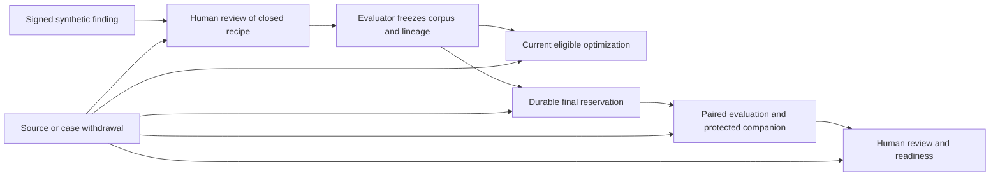

# Reviewed synthetic learning cases / نمونه‌های مصنوعیِ بازبینی‌شده برای یادگیری

LC1 is a bounded VOX-043 / VOX-014 implementation under independent qualification. It connects reviewed synthetic findings to reproducible optimization and evaluation cases in the existing improvement workflow. This document describes its contract; it is not a completed release, a real-data collection approval, or evidence of better model quality.

## Purpose and scope

A signed finding describes an observed problem using minimized metadata. It does not itself grant permission to copy conversation content into training or evaluation. LC1 accepts only the existing `synthetic` finding kind. A separate human review selects a closed fictional template and binds its source, exact original finding envelope, catalog and explicit lifecycle deadlines. Text, expected answers, arbitrary unit seeds, transcripts and caller-supplied prompts cannot enter this path.

The evaluator chooses the corpus partitions and signs their lineage. The workflow checks the exact case set, source/review bindings, split and corpus digests. The optimizer receives only the optimization partition. Final evaluation retains the existing independent evaluator, fixed budgets, protected Docker companion and human approval; LC1 does not replace or weaken those gates.

## Current authority and lifecycle

Findings, reviews, corpus lineage, source/case exclusions and final-use markers share one serialized workflow. A prepared handle is privately minted for the registry, trust, corpus/protocol and current audit head. A copied or serialized object cannot replace that authority. Consumer dispatch and result publication check current eligibility; asynchronous adapter work does not hold the writer lock. An unrelated committed change may conservatively invalidate a prepared handle. Only explicitly owned, checked workflow transitions can advance it.

Expiry applies at equality, using the minimum applicable signed deadline. Explicit lifecycle/use operations persist monotonic time; informational reads do not advance it. A clock regression, changed trust configuration, unsupported state or corrupt history makes use unavailable. The configured trust set is pinned at construction and bound durably; live key rotation and hostile full-history restoration require separate operational controls.

Withdrawal of any source or case invalidates its frozen corpus as a whole. It does not silently remove rows, change denominators or reopen a consumed final partition. Failures, cancellation, revocation and crashes after final reservation retain that reservation. Already delivered bytes cannot be recalled from an external consumer merely by revoking a handle.

Durable LC1 records contain bounded metadata, closed recipes, reviewed references, signatures, digests and exclusions. Materialized example bodies are not written into the workflow audit. Metadata retention floors and payload deadlines have different meanings and must be supplied explicitly; no legal duration is inferred. Automatic retirement or physical erasure of immutable audit history needs a separately reviewed compaction/retirement design.

## Upgrade and release boundary

Migration is explicit and preserves all legacy findings, proposals, candidates, operation commitments, source revocations and final-use markers. A v2 audit event uses `schemaVersion: 2`, `kind: "vox_improvement_audit"` and a domain-separated digest over its complete body. Existing v1 history remains a prefix; a v1 event after migration is invalid. The old runtime's body-only digest verification refuses v2 records.

New release manifests declare `supportedImprovementWorkflowSchemas: [1, 2]`. The installer inspects the committed `improvement-review/audit` chain with bounded, no-follow reads, including when the feature is not configured. It refuses an unsupported candidate or malformed/moving history before and after stopping the service. It does not migrate, repair or reset data. Deep schema/signature validation remains the runtime's responsibility. These new checks cannot retroactively change an older installer; production recovery must use a compatible release and preserve exclusion history.

## Qualification and limits

Independent acceptance must cover original-envelope provenance, raw-content refusal, exact corpus binding, private handle forgery, expiry/clock rollback, revocation during awaited work, final-use preservation, restart/migration/downgrade behavior, optimizer minimization and the complete candidate-to-readiness path. Actual Docker execution is separate from synthetic signed receipts and pure adapter tests. Source, CI, compiled/container and deployment evidence must name their exact candidate.

Real conversation ingestion, automatic Observer export, production IAM separation, legal approval, provider/backup deletion, calibrated language quality and measured model benefit remain separate gates. LC1 adds no Studio mutation UI, provider call, background job, automatic promotion or production activation. Parent VOX-043 and VOX-014 remain open for those broader requirements.

## فارسی

LC1 مسیر محدودی است که یافتهٔ مصنوعیِ امضاشده را پس از بازبینی مستقل انسان، به نمونهٔ قابل تکرار برای بهینه‌سازی و ارزیابی تبدیل می‌کند. فقط قالب‌های خیالیِ مشخص پذیرفته می‌شوند؛ متن گفتگو، رونوشت صدا، دستور دلخواه، پاسخ مورد انتظار یا شناسهٔ واقعی را نمی‌توان به این مسیر وارد کرد. این بخش، مجوز استفاده از محتوای واقعی کاربران نیست.

ارزیاب، بخش‌بندی مجموعه و تبار هر نمونه را امضا می‌کند. بهینه‌ساز فقط بخش بهینه‌سازی را دریافت می‌کند. ارزیابی نهایی همچنان به رزرو پایدار، ارزیاب مستقل، بررسی محافظت‌شده و تأیید انسان نیاز دارد. خروجی موفقِ یک آزمون محلی، مجوز استقرار یا اثبات بهبود کیفیت مدل نیست.

یافته‌ها، نمونه‌ها و لغوها زیر یک مرجع واحد نگهداری می‌شوند. لغو منبع یا نمونه، کل مجموعهٔ ثابت وابسته را نامعتبر می‌کند؛ نمونه‌ها برای بهتر شدن نتیجه پنهانی حذف نمی‌شوند. انقضا در لحظهٔ رسیدن به مهلت اعمال می‌شود. عقب‌رفتن ساعت، تغییر کلیدهای مورد اعتماد یا تاریخچهٔ خراب، استفاده را متوقف می‌کند. رزرو مجموعهٔ نهایی پس از خطا، لغو یا قطع اجرا دوباره آزاد نمی‌شود.

بدنهٔ نمونه‌ها در دفتر ممیزی ذخیره نمی‌شود؛ فقط فرادادهٔ محدود، قالب، امضا، مهلت و سابقهٔ منع استفاده نگهداری می‌شود. دورهٔ نگهداری قانونی حدس زده نمی‌شود. لغو دسترسی به معنی پاک شدن نسخه‌ای که قبلاً به گیرندهٔ بیرونی رسیده یا حذف فیزیکی تاریخچهٔ تغییرناپذیر نیست.

ارتقا به نسخهٔ دوم صریح است و تاریخچه، لغوها و رزروهای قبلی را حفظ می‌کند. نصب‌کنندهٔ جدید، قالب و زنجیرهٔ ثبت‌شده را بدون تغییر داده بررسی کرده و بازگشت به نسخهٔ ناسازگار را رد می‌کند. فعال‌سازی تولید، ورود خودکار گفتگوی واقعی، جداسازی دسترسی سرویس‌ها، تأیید حقوقی و حذف نزد ارائه‌دهنده یا پشتیبان، همچنان به بررسی جداگانه نیاز دارند.
