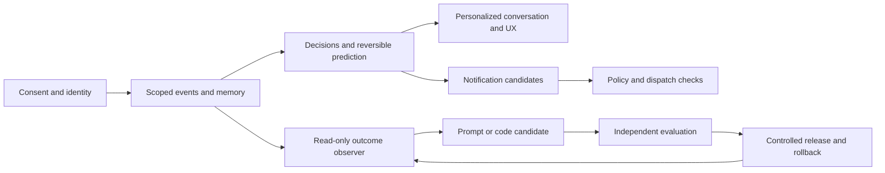

# Vox adaptive agents: implementation plan

Prepared 19 October 2026 for Joyixir OÜ. Product scope: adults in the EU/EEA and US; English and Persian interfaces; Work and Personal spaces. Current released baseline: `a49f734e16e0a5b3430c1e1c088dab33feda5d53` (20 October 2026); see the [reviewed synthetic learning-case release](RELEASE_LEARNING_CASES_2026_10_20.md). Further rights-control implementation is a separate candidate.

**Delivery status:** the observation/lifecycle/improvement work and the complementary scoped chat, image prediction, bounded retrieval and optional voice lifecycle are now integrated in the completion candidate. See [adaptive completion](ADAPTIVE_COMPLETION_RESULT.md) for implementation, independent review and precise release evidence. Existing source/release receipts remain historical. Optional capabilities stay off without reviewed configuration; provider/device/privacy qualification and the unfinished roadmap entries remain open.

**Product outcome.** Vox should understand the current task early, remember the right information for the right people, adapt the experience with visible user control, send useful timely notifications, and turn measured failures into tested product improvements. Success means more completed tasks and less rework, with bounded latency and cost and correct privacy boundaries.

| Read this | Purpose |
|---|---|
| [Task backlog](BACKLOG.md) | Detailed tasks, dependencies, owners, reviewers and acceptance criteria |
| [Machine-readable backlog](BACKLOG.json) | Canonical task data for dispatch and progress tracking |
| [Architecture and Decisions contract](ARCHITECTURE.md) | Components, data contracts, prediction and notification behavior |
| [Privacy and consent](PRIVACY_AND_CONSENT.md) | Jurisdiction requirements, consent lifecycle, draft English/Persian copy and legal launch decisions |
| [QA and release](QA_AND_RELEASE.md) | Test matrix, independent evaluation, device proof and release gates |
| [Product team](TEAM.md) | Skills, agent definitions, model routing and handoffs |
| [Package validation](PACKAGE_VALIDATION.md) | Checks performed on the plan and skills, plus remaining runtime evidence boundaries |
| [Implementation start and decisions](STARTER_SLICE.md) | Active work, concrete decisions, metric contract and remaining foundation gaps |
| [Production release receipt](RELEASE_2026_10_19.md) | Exact develop/CI/build/deployment evidence and activation limits |
| [20 October release receipt](RELEASE_2026_10_20.md) | Retention, observation and presentation experiments; exact live revision and remaining gates |
| [Guest and evaluation release receipt](RELEASE_GUEST_EVALUATION_2026_10_20.md) | Public privacy fallback, signed evaluation protocol, trusted public origins and exact deployed evidence |
| [Recorded maintenance status](MAINTENANCE_HEALTH.md) | Read-only operator checkpoint progress, failure and lease evidence without enabling execution |
| [Maintenance status release receipt](RELEASE_MAINTENANCE_2026_10_20.md) | Independent and CI acceptance, exact deployed revision and preserved configuration |
| [Communication diagnostics](OBSERVATION_DIAGNOSTICS.md) | Next source slice, independent review and remaining observation scope |
| [Rendered experience and correction observation](OBSERVATION_COMPLETION.md) | Visible committed text, scoped correction feedback and current-state rollback |
| [Reviewed rights retention](RIGHTS_RETENTION.md) | Explicit reassessment, terminal purge, finite continuity and ledger compatibility |
| [Scoped local-use restrictions](RIGHTS_LOCAL_USE.md) | RF1 source acceptance passed (39/39), CI230 tests/E2E and production build passed, and compiled-app SQLite and FILE attempt09 each passed 13/13; independent compiled-app acceptance passed 26/26; documentation-head CI, merge and release remain pending; security audit has 14 findings and is not clean |
| [Reviewed synthetic learning cases](LEARNING_CASES.md) | Exact finding/review provenance, current-use authority, migration/capacity safety and independent local acceptance |
| [Protected evaluation protocol](EVALUATION_PROTOCOL.md) | Frozen synthetic splits, paired budgets, durable final-attempt reservation and signed promotion binding |
| [Controlled presentation experiments](CONTROLLED_EXPERIMENTS.md) | Private Studio consumption, consent lifecycle, isolated variants and kill semantics |
| [Adaptive runtime integration](ADAPTIVE_RUNTIME_RESULT.md) | Reminder delivery, stage and usage diagnostics, partial voice preparation and exact qualification limits |
| [Observation and lifecycle delivery](OBSERVATION_LEARNING.md) | Durable observer, scoped export, maintenance and local routing workflow; activation limits |
| [Integrated local delivery](DELIVERY_RESULT.md) | Historical local foundation, evidence and remaining gates |
| [First foundation result](FOUNDATION_RESULT.md) | Implemented code, independent acceptance, 480-test evidence and remaining integration |
| [Prior memory strategy](../AGENT_MEMORY_STRATEGY.md) and [research](../SELF_DEVELOPMENT_RESEARCH.md) | Research rationale and source findings |

**Agreed product decisions.** Work and Personal are separate spaces. Each contains private memory per person, group memory, and memory shared with an exact set of selected people independently of a chat group. Agent ownership never grants access to everyone's private memory. Prediction can prepare reversible work; permission checks remain deterministic. Voice recognition is optional and must not unlock private data. The user confirmed **Joyixir OÜ** as the registered operator name. The user confirmed **info@joyixir.com** as the privacy contact on 19 October 2026; mailbox operation and legal approval remain unverified. The [registered address is verified from the official Estonian register](OPERATOR_DETAILS.md); the complete notice still needs legal approval.

The system has three improvement loops: per-person adaptation, versioned agent optimization, and sandboxed software development. A common event contract connects them through purpose-specific data projections and separate credentials. It does not grant every worker access to all observations.

**Scope and sequencing.** Deliver a useful core while the biometric feature completes its separate legal/provider/security gates. Build in vertical slices, each including design, implementation, QA and evidence. Calendar estimates should follow baseline measurements and task sizing; the stage numbers below express dependencies, not guaranteed weeks.

| Stage | Deliverable | Exit evidence |
|---|---|---|
| P0 — define and design | Approved flows, event purposes, market matrix, provider constraints, baseline metrics | Product/design/privacy/QA contracts agree; unresolved launch facts have owners |
| P1 — establish boundaries | Person/space/container/grant model, consent ledger, scoped memory, deletion and migration | Cross-space/guest/revocation tests pass, no silent expansion of historical access |
| P2 — observe reliably | Durable events, turn traces, outcome capture and read-only observer | Replay, deduplication, completeness and export-minimization evidence |
| P3 — decide and personalize | Decisions adapter, bounded prediction, preference controls and UX variants | Held-out routing quality; stale decisions cancelled; clear reset/undo |
| P4 — notify usefully | In-app inbox, opted-in Telegram delivery, reminder scheduling and feedback | Revoke-before-send, duplicates, quiet hours and recipient privacy tests |
| P5 — recognize voice optionally | Enrolled speaker hints and confirmed profile switch | Jurisdiction clearance, measured voice errors and spoof tests, non-biometric fallback |
| P6 — improve the product | Reviewed learning cases, prompt candidates and tested code PRs | Evaluator independence, traceable evidence and controlled experiments |
| P7 — qualify and release | Actual device/provider E2E, staged rollout and operational ownership | Release packet distinguishes source, CI, deployment and observed behavior |

P0 design and source exploration run in parallel. P5 provider/legal work can run alongside P1–P4. Public voice recognition stays disabled until P5 qualifies; core release does not imply biometric clearance. Browser push is a follow-up channel behind capability detection and separate permission; the first notification delivery channels are an in-app inbox and an existing, explicitly opted-in Telegram conversation. No email/SMS or marketing campaigns are included in the initial release.

**User stories and requirements.** Every implementation task maps to these IDs. `Must` means required before the associated capability is enabled; it does not require biometric work before shipping the core.

| ID | Priority | Requirement and observable acceptance |
|---|---|---|
| REQ-01 | Must | A person can use core Vox while declining optional purposes. First use explains AI processing; separate opt-ins and receipts govern optional analytics, durable personalization, biometrics and proactive contact. Withdrawal stops future dependent processing. |
| REQ-02 | Must | A person can select Work/Personal and private/group/exact-recipient memory. Every read, write, summary, cache, extraction and tool output obeys space, audience, agent and purpose grants. New group members follow an explicit history policy. |
| REQ-03 | Must | Account, verified person, temporary speaker, statement subject and claimed identity are distinct. Ambiguous identity cannot write a guessed personal profile or unlock it. Authenticated switching establishes the active person. |
| REQ-04 | Must | Observations use server-validated versioned event envelopes, purpose-specific exports, deduplication and durable processing. Optional collection is denied before persistence/export when disabled. |
| REQ-05 | Must | Actions, model interpretations and verified outcomes remain separate. Reports show cohort, versions, QA exclusion, sampling and completeness; missing data never counts as success. |
| REQ-06 | Must | A server-side Decisions adapter uses typed results, validated question versions, deadlines, bounded retries, refusal/unknown handling, usage and model tracking. Service failure preserves a usable baseline conversation. |
| REQ-07 | Must | Early text/image/transcript predictions only prepare permitted retrieval or UI suggestions. Turn revision, context changes and revoked permission cancel work; predictions never create commitments, send messages or change sharing. |
| REQ-08 | Must | Explicit preferences take precedence over learned hypotheses. People can inspect why behavior changed, correct it, reset it and disable learning. Hypotheses have evidence, expiry, scope and limited effect. |
| REQ-09 | Must | UX presents active space, person and sharing audience; includes accessible consent, memory, preference and notification controls with EN/FA parity, RTL, keyboard and screen-reader coverage. |
| REQ-10 | Must | Notification candidates have a reason, evidence, expiry and recipient. Deterministic policy enforces category/channel permission, quiet hours, caps, deduplication and current relevance before queueing and sending. |
| REQ-11 | Must | External notification payloads contain generic text and an opaque reference, without private facts. Detailed content is rendered per recipient inside the authenticated inbox after current access checks; deep links recheck access. Provider acceptance, delivery and user action are distinct states. |
| REQ-12 | Must for voice | A verified adult can separately enroll, test, disable and delete voice recognition. No passive enrollment or cross-account search. Unknown/multiple/spoofed speakers follow a conservative fallback. |
| REQ-13 | Must for voice | Recognition only suggests a person within the explicitly permitted candidate set. Private access still requires authenticated confirmation. Voice cloning, diarization and emotion inference are separate capabilities; cloning and emotion inference are outside this work. |
| REQ-14 | Must | Improvement agents receive permitted evidence, propose versioned changes, and cannot modify the protected evaluator, promotion rules or production permissions. Model-graded success cannot override deterministic failures. |
| REQ-15 | Must | Runtime observers, personalizers, optimizers and release services have enforceably separate credentials. Development-agent role instructions are not treated as a security sandbox. |
| REQ-16 | Must | Latency, accuracy, cost and telemetry completeness have measured baselines and predeclared gates. Speculative work, event cardinality, model invocations and retries have budgets and kill switches. |
| REQ-17 | Must | Deletion/revocation covers source records, derived context, indexes, caches, queued jobs, evaluation exports and provider workflows where available. Tombstones prevent replay from recreating deleted information. Disclosed retention exceptions stay explicit. |
| REQ-18 | Must | Experiments have stable assignment and actual-exposure events. Shared-memory variants isolate the group/exact-recipient container; experimental writes cannot contaminate control or other recipients. |
| REQ-19 | Must | Migration quarantines ambiguous legacy identity/audience/purpose data, preserves user-authored content and provides reconciliation/rollback. No blanket grant or automatic enrollment is inferred from historical use. |
| REQ-20 | Must | Offline/reconnect, refusal, provider outage and permission-denied states remain usable. No repeated permission nagging or involuntary conversation interruption. A person can report an unwanted adaptation or notification. |
| REQ-21 | Must | A named release owner can disable each capability, investigate an incident, repair derived state and roll back a version. Live claims require exact deployed revision and target-specific evidence. |
| REQ-22 | Must | Legal notices, retention, subprocessors, transfers, account-specific data controls and jurisdiction availability match the actual system. Privacy review resolves launch dependencies; no consent banner is represented as a compliance guarantee. |

**Experience to design.** The initial design deliverable includes onboarding with equal optional accept/decline paths; a privacy center; a visible Work/Personal switch; active person and shared-account confirmation; memory audience controls; a “Why this?” explanation with undo; notification inbox/settings/snooze; optional voice enrollment and deletion; group disclosure/guest behavior; and degraded states. UI copy must describe user consequences rather than internal model names. Keep a clear distinction between an acknowledged privacy notice and a consent choice.

Example: a user says “Please keep voice answers short.” If personal learning is allowed, Vox records an explicit scoped preference and provides an undo. Repeated interruptions alone create only a temporary hypothesis. A relevant task deadline may generate a notification candidate, but dispatch still checks the user's notification choices, current memory rights and quiet hours. A recurring playback failure generates a sanitized issue for development, never a broad export of the user's conversation.

**Model allocation.** The requested development team uses `gpt-6.1-sol` for complex design, architecture, privacy/security, voice implementation, independent evaluation and release diagnosis. `gpt-6-luna` handles bounded event wiring after schemas are approved, scripted E2E execution and documentation/evidence formatting. Luna escalates ambiguous ownership, permissions, consent, schema changes and unexplained failures to Sol. Changing a model to save cost is measured against quality and risk, not task length alone. Official guidance describes Sol for demanding work and Luna for focused workloads. [Model catalog](https://developers.openai.com/api/docs/models).

For deployed Vox, use `gpt-6-luna` through Decisions for supported classification questions. Use normal response generation for replies and structured record creation; Sol can handle difficult tasks when authorized and justified by evaluation. Decisions is not the speaker-recognition engine or the permission system. Preserve the current provider baseline for comparisons during the rollout.

**Metrics and evaluation.** Establish a versioned baseline by language, channel, device and task. Primary measures are verified task completion, unnecessary corrections, appropriate memory use, end-of-speech to first useful audio, first useful text, and cost per successful task. Monitor unwanted notification reports, opt-out/undo, inaccurate personal attribution and collection without permission. Engagement duration and notification opens cannot be the sole optimization goal.

Provisional efficacy target: at least a 20% improvement in p95 useful-response latency at comparable task quality, or a predeclared task-success improvement at a bounded cost. Quality non-inferiority starts at a maximum two-percentage-point degradation with an appropriate confidence interval and subgroup checks; privacy and attribution failures are hard failures regardless of average quality. The QA plan defines denominators, evidence sizes, stopping rules and operational targets. These are proposed release criteria, not measured current results. Small samples keep the baseline in place.

**Launch decisions still needed.** Joyixir OÜ must finalize the remaining controller details (registered address verified in [operator details](OPERATOR_DETAILS.md)), applicable US state rollout, contractual role for Work spaces, biometric vendor and permitted jurisdictions, retention schedule, transfer/processor agreements, account-specific provider settings, and acceptable voice error bounds. Operation and notice approval for the user-confirmed privacy contact **info@joyixir.com** remain unverified. Product and engineering also need the pilot cohort, spend ceiling and supported device/channel list. The backlog assigns these decisions; they do not prevent design, synthetic-data development or ordinary code tests.

**Starting slice.** Execute VOX-001 through VOX-008 for release contracts, then dependency-ready tasks in VOX-009 through VOX-023 plus VOX-056 for permissions, consent, user rights and reliable observation. Prove one Studio voice turn with synthetic participants and one explicit preference before enabling predictive adaptation. The lead may parallelize non-conflicting tasks whose dependencies are satisfied; each task retains an independent reviewer and evidence packet. Public-facing capability activation follows its completed gate, not the existence of a role file or a passing mock test.
