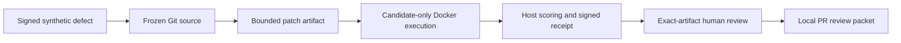

# Software patch evaluation

VOX-045 adds a local, reviewable software patch workflow alongside the existing routing experiment. It starts from a signed synthetic defect, freezes a Git commit and target blob, produces a bounded patch, executes the baseline and candidate in Docker, and generates a review packet. It does not activate a production developer agent or deploy its own changes.

The first reproduction is concrete: `SentenceDetector.addChunk()` emits an English question ending in `?`, but retains a Persian question ending in `؟` until the stream is flushed. The candidate adds Persian punctuation to the existing streaming boundary expression. This module serves progressive TTS; this experiment does not establish improvements to every Studio voice path.

## Boundaries

- Only `src/lib/utils/sentence-detector.ts` is permitted. The materializer accepts a single exact-context hunk, with a 32 KiB patch limit, at most 32 added/deleted lines, and at most 128 old/new hunk lines. It rejects path changes, fuzzy matching, binary patches, symlinks, mode changes and extra files. The initial registry further restricts registration to the exact deterministic Persian fix. Git objects are read without checkout or candidate scripts.
- The container receives only one source file, a fixed runner and operation inputs. Expected results, scoring, Git metadata, registry data and signing keys stay outside it. The command and image are fixed; no input chooses an executable or shell command.
- Execution uses an already installed image by SHA-256, no image pull, no network, a read-only root, an unprivileged user, dropped capabilities and bounded memory, CPU, process count, output and wall time. Cleanup removes the named container after success or failure. Docker and the host evaluator remain trusted infrastructure.
- The host compares strict structured results for English and Persian boundaries, split chunks, abbreviations, decimals, markdown, flush, reset and indexes. Baseline reproduction is required. A crash, malformed output, fake success log or timeout cannot count as a pass. This finite corpus does not prove arbitrary candidate correctness.
- Analyst, author, evaluator and reviewer use distinct Ed25519 keys. Immutable patch bytes, base identity, policy, evaluation and review must agree. Current trust, expiry, revoked lineage and current base are checked again when preparing a review packet. The local demonstration uses synthetic keys and a synthetic reviewer; these are not production IAM or an actual person's approval.

## Rehearsal and evidence

Run the local demonstration only with a fresh output directory and the exact pre-fix Git commit. It reads local Git objects and executes synthetic fixtures; it sends no user messages and reads no private conversation store. The [qualified commands and results](evidence/software-patch/RESULT.md) include the source manifest, public verification keys and exact patch. Failed or incomplete evaluations retain a report and cannot receive synthetic approval.

Keep the original baseline commit even after the reviewed fix is applied to the repository. Using a newer already-fixed commit as a reproduction would fail the required baseline check. A packet is scoped to its frozen base and must be reviewed again after rebasing.

The evaluator fingerprint binds runtime corpus/scoring functions and is loader-dependent. Matching evaluator/registry runtimes and the full source manifest are required when verifying a receipt. Packet readiness is a point-in-time advisory result; a future publisher must coordinate Git state and registry state before writing. The local workflow has no such publisher.

The task remains in progress until production developer credentials, protected service deployment, a representative corpus and the automatic reviewed-defect-to-PR service are qualified. This local workflow provides a real executable patch rehearsal and evidence format; it does not claim measured user benefit, autonomous feature development or production deployment authority.

## فارسی

این بخش یک مسیر محلی و قابل بازبینی برای اصلاح کد می‌سازد: گزارش مصنوعیِ امضاشده، نسخهٔ ثابت کد در Git، پچ محدود، اجرای نسخهٔ اولیه و اصلاح‌شده در Docker، ارزیابی بیرون از کانتینر و بستهٔ بازبینی. این مسیر عامل توسعهٔ خودکار را در محیط عملیاتی فعال نمی‌کند و خودش تغییری را منتشر نمی‌کند.

نمونهٔ واقعی مربوط به تشخیص پایان جمله در تبدیل تدریجی متن به گفتار است. پرسش انگلیسی با `?` به‌موقع جدا می‌شود، ولی پرسش فارسی با `؟` تا پایان جریان در بافر می‌ماند. اصلاح پیشنهادی فقط علامت سؤال فارسی را به الگوی موجود اضافه می‌کند. نتیجه به همین ماژول محدود است و به معنی بهبود همهٔ مسیرهای تماس نیست.

کانتینر فقط کد هدف، اجراکنندهٔ ثابت و ورودی‌های مصنوعی را دریافت می‌کند. پاسخ‌های مورد انتظار، امتیازدهی، کلیدها و اطلاعات Git بیرون از آن باقی می‌مانند. شبکه قطع است و زمان، خروجی و منابع محدودند. نتیجهٔ ناقص، توقف اجرا یا پیام جعلیِ موفقیت پذیرفته نمی‌شود. پچ، نسخهٔ پایه، سیاست، ارزیابی و تأیید نهایی باید دقیقاً به یکدیگر متصل باشند؛ تغییر اعتماد، انقضا یا لغو منبع دوباره بررسی می‌شود.

کلیدها و تأییدکنندهٔ نمایش محلی مصنوعی‌اند و تأیید انسانی یا جداسازی دسترسی در محیط عملیاتی محسوب نمی‌شوند. پیش از فعال‌سازی واقعی، دسترسی‌های مستقل سرویس‌ها، مجموعهٔ ارزیابی نماینده، مسیر خودکار تولید درخواست ادغام و شواهد محیط عملیاتی همچنان لازم‌اند. اجرای محلی، کیفیت مکالمه یا منفعت واقعی کاربران را ثابت نمی‌کند.
